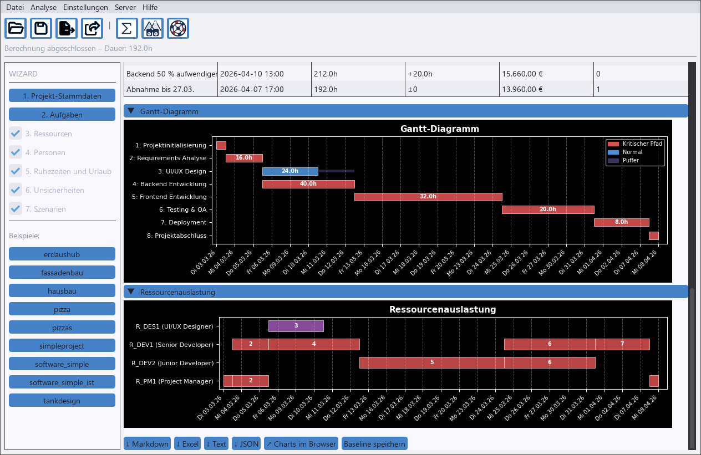
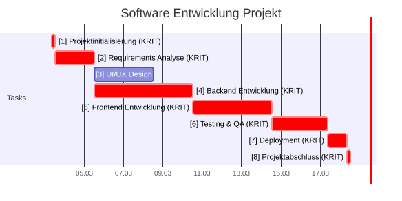

# sproject – Terminpläne mit Wahrscheinlichkeiten

**Wann ist das Projekt wirklich fertig?** sproject plant Projekte mit der Netzplantechnik (CPM), berücksichtigt
Ressourcen, Urlaub und Teilzeit – und antwortet mit einer **Monte-Carlo-Simulation**: *„zu 80 % fertig bis
16. April“* statt eines einzelnen, meist zu optimistischen Termins. **Szenarien** zeigen, was eine kranke
Kollegin oder eine verspätete Lieferung bewirkt. Eine Desktop-GUI, eine CLI und ein **MCP-Server** lassen dich –
oder Claude – Pläne aufbauen, z. B. direkt aus einer Excel-Aufgabenliste.

[](https://github.com/mistamichael/sproject/actions/workflows/tests.yml)
[](LICENSE)


> English documentation: [README.md](README.md)




## Warum sproject

- **Wahrscheinlichkeiten statt eines Termins** – Dauer-Bandbreiten, Risiken und Szenario-Wahrscheinlichkeiten fließen
  in eine Monte-Carlo-Simulation: P50/P80/P90, Chance, Plan oder Deadline zu halten, und welche Aufgaben am häufigsten
  kritisch sind.
- **Was-wäre-wenn-Szenarien** – „Backend dauert 50 % länger“, „Alice eine Woche krank“, „LKW defekt“ – im Vergleich
  zum Basisplan nach Dauer, Kosten und verfehlten Deadlines.
- **Realistische Ressourcenplanung** – eine Person bzw. Maschine macht eine Aufgabe zugleich; Urlaub, Teilzeit und
  Ruhepausen strecken den Plan; feste Termine (`not_before`, `deadline`); Plan gegen Ist mit Baseline.
- **KI-Schnittstelle (MCP)** – Claude Code oder Claude Desktop bauen Projekte über einen gemeinsamen moncapro-Server
  auf, prüfen und berechnen sie, z. B. aus einer Excel-Aufgabenliste; die GUI kann live zusehen.
- **Desktop-GUI, CLI und Berichte** – Markdown/HTML mit Gantt- und Netzplan-Diagrammen, Excel, TXT, JSON und
  interaktive Charts.

Ergebnisse ohne Installation ansehen: [Beispielergebnisse](doc/result_examples/README.md).

## Schnellstart

Voraussetzung: Python 3.10 oder höher.

sproject ist der Desktop-Editor. Rechenkern, Kommandozeile und MCP-Server stammen aus dem eigenen Paket
[moncapro](https://github.com/mistamichael/moncapro) und werden automatisch mitinstalliert.

1. Code holen: `git clone https://github.com/mistamichael/sproject.git` (oder ZIP herunterladen)
2. Installieren: Doppelklick auf `bin\install_py.bat` – Linux/macOS: `bash bin/install_py.sh`
   (legt `.venv` an und installiert alles aus `requirements.txt`)
3. Starten: Doppelklick auf `bin\gui.bat` – Linux/macOS: `bash bin/gui.sh` – und links ein Beispiel öffnen (deutsche Dateien in `examples/de`, englische in `examples/en`)

Kommandozeile statt GUI (mit aktivem `.venv`):

```bash
moncapro --project my_project.json --export md,html --simulate 300
```

Projekt mit Claude aufbauen: siehe [Drei Wege, sproject zu nutzen](#drei-wege-sproject-zu-nutzen).

## Drei Wege, sproject zu nutzen

| | |
| --- | --- |
| **Desktop-GUI** | `bin\gui.bat` – Aufgaben, Ressourcen, Unsicherheiten und Szenarien bearbeiten, berechnen, exportieren. [Anleitung GUI](doc/de/gui.md) |
| **Kommandozeile** | `moncapro --project <datei> --export md,html,xlsx --simulate 300` – Berichte im Stapel. [Anleitung CLI](https://github.com/mistamichael/moncapro/blob/main/doc/de/cli.md) |
| **KI / Claude (MCP)** | `bin\mcp_server.bat` starten, dann Claude Code z. B. bitten: *„Lies `data/simple_software_project.xlsx` und baue daraus ein sproject-Projekt“* – die GUI kann live zusehen. [KI-Schnittstelle](https://github.com/mistamichael/moncapro/blob/main/doc/de/ki-schnittstelle.md) |


## Beispielergebnisse (ohne Installation)



Fertig berechnete Ergebnisse der Beispiele liegen in [doc/result_examples/](doc/result_examples/README.md),
z. B. für `software_simple.json`. **Mit einem Klick lesbar:** der Markdown-Bericht (Gantt-Diagramm und Netzplan
werden auf GitHub/Gitea direkt angezeigt) und die Diagramme auf dieser Seite.

| Datei | Inhalt |
| --- | --- |
| [software_simple.md](doc/result_examples/software_simple.md) | Bericht mit Gantt-Diagramm und Netzplan (direkt auf GitHub/Gitea lesbar) |
| [software_simple.html](doc/result_examples/software_simple.html) | derselbe Bericht als HTML – *herunterladen und öffnen* |
| [software_simple_charts.html](doc/result_examples/software_simple_charts.html) | interaktives Gantt-Diagramm und Ressourcenauslastung – *herunterladen und öffnen, braucht Internet* |
| [software_simple_scenarios.html](doc/result_examples/software_simple_scenarios.html) | Szenario-Vergleich – *herunterladen und öffnen, braucht Internet* |
| [software_simple_simulation.html](doc/result_examples/software_simple_simulation.html) | Monte-Carlo-Simulation mit Kritikalität – *herunterladen und öffnen, braucht Internet* |
| [software_simple.xlsx](doc/result_examples/software_simple.xlsx) | Excel-Bericht – *herunterladen und öffnen* |

Auf GitHub/Gitea zeigt ein Klick auf eine HTML-Datei nur den Quelltext – über *Download raw file* herunterladen
und im Browser öffnen. Die interaktiven Seiten laden die Plotly-Bibliothek aus dem Internet.

## Dokumentation

| Thema | Dokument |
| --- | --- |
| Desktop-Editor | [doc/de/gui.md](doc/de/gui.md) |
| Kommandozeile, Exportformate, Ausgabe | [doc/de/cli.md](https://github.com/mistamichael/moncapro/blob/main/doc/de/cli.md) |
| KI-Schnittstelle (MCP-Server, Claude, Excel-Import) | [doc/de/ki-schnittstelle.md](https://github.com/mistamichael/moncapro/blob/main/doc/de/ki-schnittstelle.md) |
| Projektdatei-Format: Dauern, Abhängigkeiten, Ressourcen, Loops, Unsicherheiten, Szenarien | [doc/de/projektformat.md](https://github.com/mistamichael/moncapro/blob/main/doc/de/projektformat.md) |
| Termine, Ressourcen, Plan gegen Ist, Szenarien, Monte-Carlo im Detail | [doc/de/termine-und-ist.md](https://github.com/mistamichael/moncapro/blob/main/doc/de/termine-und-ist.md) |
| Abhängigkeitstypen EA/AA/EE/AE | [doc/de/dependency_types.md](https://github.com/mistamichael/moncapro/blob/main/doc/de/dependency_types.md) |
| Konfiguration, Feiertage | [doc/de/config_doc.md](https://github.com/mistamichael/moncapro/blob/main/doc/de/config_doc.md) |
| Beispielprojekte | [`examples/`](examples/) – `de/` deutsch, `en/` englisch; Beschreibung: [doc/de/examples.md](https://github.com/mistamichael/moncapro/blob/main/doc/de/examples.md) |
| Tests, Entwicklung, Projektstruktur | [doc/de/entwicklung.md](doc/de/entwicklung.md) |

## Lizenz

Dieses Projekt ist unter der [MIT-Lizenz](LICENSE) lizenziert.
