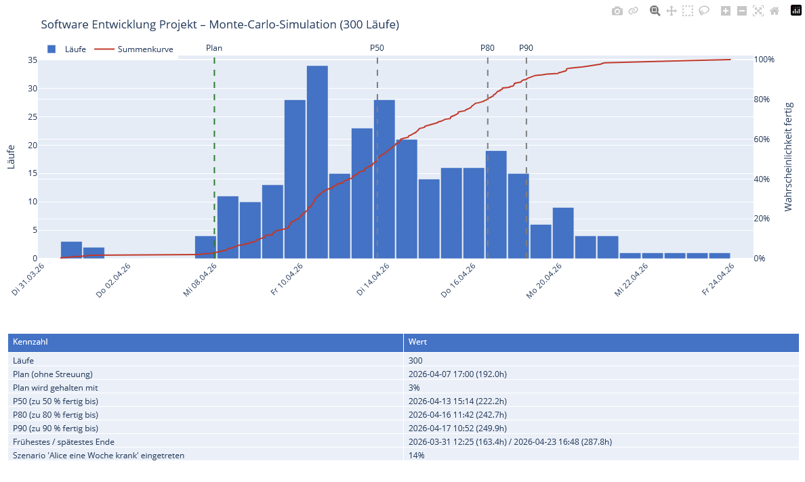
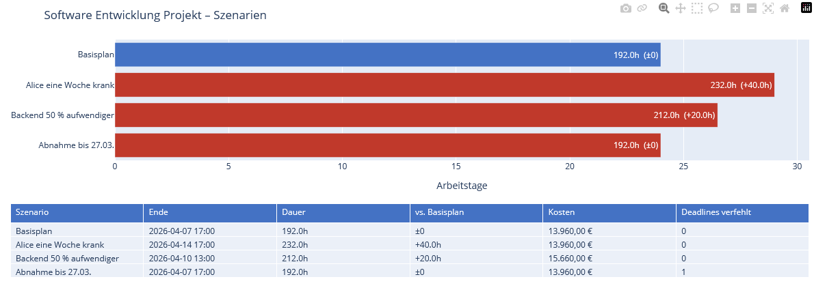
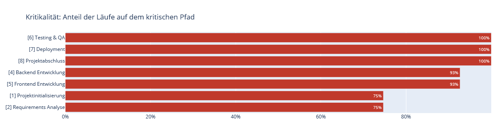

# sproject – Terminpläne mit Wahrscheinlichkeiten

**Wann ist das Projekt wirklich fertig?** sproject plant Projekte mit der Netzplantechnik (CPM), berücksichtigt
Ressourcen, Urlaub und Teilzeit – und antwortet mit einer **Monte-Carlo-Simulation**: *„zu 80 % fertig bis
16. April“* statt eines einzelnen, meist zu optimistischen Termins. **Szenarien** zeigen, was eine kranke
Kollegin oder eine verspätete Lieferung bewirkt. Eine Desktop-GUI, eine CLI und ein **MCP-Server** lassen dich –
oder Claude – Pläne aufbauen, z. B. direkt aus einer Excel-Aufgabenliste.

[](https://github.com/mistamichael/sproject/actions/workflows/tests.yml)
[](LICENSE)


> English documentation: [README.md](README.md)




## Warum sproject

- **Wahrscheinlichkeiten statt eines Termins** – Dauer-Bandbreiten, Risiken und Szenario-Wahrscheinlichkeiten fließen
  in eine Monte-Carlo-Simulation: P50/P80/P90, Chance, Plan oder Deadline zu halten, und welche Aufgaben am häufigsten
  kritisch sind.
- **Was-wäre-wenn-Szenarien** – „Backend dauert 50 % länger“, „Alice eine Woche krank“, „LKW defekt“ – im Vergleich
  zum Basisplan nach Dauer, Kosten und verfehlten Deadlines.
- **Realistische Ressourcenplanung** – eine Person bzw. Maschine macht eine Aufgabe zugleich; Urlaub, Teilzeit und
  Ruhepausen strecken den Plan; feste Termine (`not_before`, `deadline`); Plan gegen Ist mit Baseline.
- **KI-Schnittstelle (MCP)** – Claude Code oder Claude Desktop bauen Projekte über einen gemeinsamen sproject-Server
  auf, prüfen und berechnen sie, z. B. aus einer Excel-Aufgabenliste; die GUI kann live zusehen.
- **Desktop-GUI, CLI und Berichte** – Markdown/HTML mit Gantt- und Netzplan-Diagrammen, Excel, TXT, JSON und
  interaktive Charts.

Ergebnisse ohne Installation ansehen: [Beispielergebnisse](doc/result_examples/README.md).

## Schnellstart

Voraussetzung: Python 3.10 oder höher.

1. Code holen: `git clone https://github.com/mistamichael/sproject.git` (oder ZIP herunterladen)
2. Installieren: Doppelklick auf `bin\install_py.bat` – Linux/macOS: `bash bin/install_py.sh`
   (legt `.venv` an und installiert alles aus `requirements.txt`)
3. Starten: Doppelklick auf `bin\gui.bat` – Linux/macOS: `bash bin/gui.sh` – und links ein Beispiel öffnen

Kommandozeile statt GUI (mit aktivem `.venv`):

```bash
python lib/sproject.py --project examples/software_simple.json --export md,html --simulate 300
```

Projekt mit Claude aufbauen: siehe [KI-Schnittstelle (MCP)](#ki-schnittstelle-mcp).

## Verwendung

### Einzelnes Projekt verarbeiten

Lege deine Projektdatei (z. B. `newproject.json`) in den Ordner `data/` (`$PV_DATA`) und rufe
`bin/create_reports.bat` (`.sh`) auf – es verarbeitet alle Projektdateien dort – oder direkt:

```bash
python lib/sproject.py --project newproject.json

```

### Exportformat wählen

```bash
# Nur JSON (Standard)
python lib/sproject.py --project examples/tankdesign.json

# Mehrere Formate gleichzeitig
python lib/sproject.py --project examples/hausbau.json --export txt,json,xlsx,md,html,zip

# Alle verfügbaren Formate
python lib/sproject.py --project examples/software_simple.json --export txt,json,xlsx,md,html,zip
```

### Alle Projekte im Verzeichnis verarbeiten

```bash
python lib/sproject.py --data-dir examples --export json
```

### Weitere Optionen

```bash
# Ausgabeverzeichnis angeben
python lib/sproject.py --project examples/pizza.json --output-dir ./meine_ergebnisse

# Startdatum überschreiben
python lib/sproject.py --project examples/simpleproject.json --start-date 2026-06-01

# Konfigurationsverzeichnis
python lib/sproject.py --project examples/pizza.json --cfg-dir ./cfg

# Ausführliche Ausgabe
python lib/sproject.py --project examples/pizza.json --verbose

# Alle Szenarien mit dem Basisplan vergleichen / ein Szenario statt des Basisplans rechnen
python lib/sproject.py --project examples/software_simple.json --scenarios
python lib/sproject.py --project examples/software_simple.json --scenario "Alice eine Woche krank" --export xlsx

# Monte-Carlo-Simulation mit 500 Läufen (reproduzierbar mit --seed)
python lib/sproject.py --project examples/software_simple.json --simulate 500 --seed 42

# Kleine interaktive HTML-Charts: plotly.js aus dem Internet laden statt einbetten (~4 MB)
python lib/sproject.py --project examples/software_simple.json --export plotly,simulation --plotly-cdn

# Hilfe
python lib/sproject.py --help
```

### Exportformate

| Format | Beschreibung |
| ------ | ------------ |
| `json` | Netzplan + Gantt als JSON (Standard) |
| `txt` | Strukturierte ASCII-Textdatei |
| `xlsx` | Excel mit konfigurierbaren Tabs (via `cfg/excel_export.cfg`) |
| `md` | Markdown-Report mit eingebetteten Mermaid-Diagrammen |
| `html` | HTML-Report, Mermaid-Diagramme werden im Browser gerendert |
| `zip` | Alle Diagramme als SVG in einem ZIP-Archiv (via Mermaid/kroki.io) |
| `plotly` | Interaktive HTML-Charts (Gantt, Ressourcen) |
| `plotly_svg` | Die Plotly-Charts als SVG-Bilder (braucht kaleido und ein lokales Chrome) |
| `scenarios` | Szenario-Vergleich als HTML |
| `simulation` | Monte-Carlo-Simulation als HTML (Histogramm, Kritikalität, Kennzahlen) |

## Grafischer Editor (GUI)

Start mit `bin/gui.bat` (Windows) oder `bash bin/gui.sh` (Linux/Mac). Ein Beispiel öffnet man über die Sidebar, eine eigene Datei über *Datei → Öffnen*.

| Sektion | Inhalt |
| ------- | ------ |
| 1. Projekt-Stammdaten | Name, Startdatum, Einheit, Volumen, Stichtag |
| 2. Aufgaben | Einfache, Loop- und Subtasks mit Dauer, Ressourcen, Nachfolgern, Kosten |
| 3. Ressourcen | ID, Name, Typ, Farbe – Farbfeld mit Farbwähler (Klick aufs Farbfeld oder Doppelklick auf den Hex-Wert) |
| 4. Personen | Name, Rolle, Stundensatz |
| 5. Ruhezeiten und Urlaub | Ruhezeitregeln, Urlaub, Teilzeit |
| 6. Unsicherheiten | Je Task Min/Max-Dauer und Risiko (Wahrscheinlichkeit, Verzögerung, Hinweis) für die Monte-Carlo-Simulation |
| 7. Szenarien | Was-wäre-wenn-Varianten mit Wahrscheinlichkeit und ihre Änderungen (Task, Ressource, Person) |

Die Sektionen 3–7 sind optional und lassen sich in der Sidebar einschalten; sie erscheinen automatisch, wenn das geladene Projekt sie nutzt.

- **Bearbeiten:** direkt in den Tabellen tippen oder in den Sektionen 6 und 7 per Doppelklick auf eine Zeile das Formular öffnen.
- **Warnung:** Liegt die geplante Dauer eines Tasks außerhalb von Min–Max, markiert Sektion 6 sie rot (die Simulation würde mit dem Rand des Bereichs rechnen).
- **Menü Analyse / Toolbar:** berechnen, Szenarien vergleichen, Monte-Carlo-Simulation starten. Ergebnisse erscheinen im Tab *Ergebnis*, Reports landen in `results/`.
- **Sprache:** Deutsch / Englisch über *Einstellungen*.
- **KI-Schnittstelle:** *Server → Mit sproject-Server verbinden …* teilt das Projekt mit Claude (siehe unten).

## KI-Schnittstelle (MCP)

Ein KI-Werkzeug wie Claude Code oder Claude Desktop kann Projekte anlegen, aus Excel-Listen oder anderen
Quellen aufbauen, prüfen, berechnen und speichern. Es verbindet sich über einen MCP-Server (Model Context
Protocol); Python-Skripte nutzen dieselben Operationen über `lib.api.ProjectSession`. Jede Änderung wird
sofort validiert – ungültige Eingaben ändern nichts und liefern eine Fehlermeldung.

Genau **ein** sproject-Server hält das Projekt; Claude Code und die GUI sind beide Clients und sehen
immer denselben Stand:

| Schritt | Wie |
| --- | --- |
| 1. Server starten | `bin\mcp_server.bat` → `http://127.0.0.1:8765/mcp` (ein zweiter Start auf demselben Port wird abgelehnt) |
| 2. Claude Code verbinden | automatisch über `.mcp.json` im Projektordner (HTTP); Kontrolle mit `/mcp` |
| 3. GUI verbinden (optional) | *Server → Mit sproject-Server verbinden …*; läuft keiner, bietet die GUI an, ihn zu starten |

Solange die GUI verbunden ist, gehen ihre Änderungen etwa jede Sekunde an den Server, und Änderungen von
Claude erscheinen in der GUI. Ändern beide gleichzeitig, gewinnt der Server-Stand; die Statuszeile meldet den Konflikt.

Schalter: `--port [N]` (HTTP auf Port N, Standard 8765), `--project DATEI` (Projekt beim Start öffnen),
`--claude` (stdio nur für Skripte/Tests – die GUI kann sich damit nicht verbinden), `--help`;
unter Linux/macOS `bin/mcp_server.sh`.

**Neues Projekt mit Claude aufbauen – zum Ausprobieren mit
[`data/simple_software_project.xlsx`](data/simple_software_project.xlsx)** (Webshop-Relaunch: Blätter
*Projekt*, *Aufgaben* mit Dauer, Vorgängern und Min/Max, *Team* mit Stundensätzen):

1. Server mit `bin\mcp_server.bat` starten (optional die GUI verbinden, um zuzusehen).
2. Claude Code im Projektordner starten; `/mcp` zeigt `sproject` als verbunden.
3. Bitten: *„Lies `data/simple_software_project.xlsx` und baue daraus ein neues sproject-Projekt (Personen
   und Ressourcen aus ‚Team', Aufgaben und Abhängigkeiten aus ‚Aufgaben', Min/Max als Unsicherheit). Prüfe und
   berechne es, simuliere 300 Läufe und speichere es als `webshop.json`.“*

Claude liest die Excel-Datei selbst und baut das Projekt schrittweise mit den Werkzeugen auf (`new_project`,
`add_task` → Task-ID, `add_dependency`, …). Erwartet: Ende 03.12.2026, Kosten 23.240 €.

Wird ein Projekt als Ganzes ersetzt (`new_project`, `load_project` oder eine andere Datei in der verbundenen
GUI öffnen), sichert der Server vorher den bisherigen Stand in `work/backup/`, und Claude wie GUI bekommen
eine Meldung.

```python
from lib.api import ProjectSession

s = ProjectSession()
s.new_project("Garage", project_start="2026-04-01")
fundament = s.add_task({"name": "Fundament", "duration": "3d"})   # gibt die Task-ID zurück
mauern = s.add_task({"name": "Mauern", "duration": "5d"})
s.add_dependency(fundament, mauern)
print(s.calculate()["end"])
s.save("work/garage.json")
```

Werkzeuge, Rückgabewerte, GUI-Einstellungen und Fehlerbehebung: [doc/de/ki-schnittstelle.md](doc/de/ki-schnittstelle.md).

## Projektdatei-Format (JSON)

### Minimales Beispiel

```json
{
  "project": "Mein Projekt",
  "project_start": "2026-04-01 08:00:00",
  "tasks": [
    {
      "id": 1,
      "name": "Planung",
      "duration": "3d",
      "successors": [2]
    },
    {
      "id": 2,
      "name": "Umsetzung",
      "duration": "10d",
      "successors": [3]
    },
    {
      "id": 3,
      "name": "Abnahme",
      "duration": "2d",
      "successors": []
    }
  ]
}
```

### Dauerformate

| Angabe  | Bedeutung                 |
| ------- | ------------------------- |
| `"10d"` | 10 Arbeitstage            |
| `"2w"`  | 2 Wochen = 10 Arbeitstage |
| `"8h"`  | 8 Stunden = 1 Arbeitstag  |
| `"30m"` | 30 Minuten                |
| `10`    | 10 Tage (Zahl)            |

### Abhängigkeitstypen

| Feld | Typ | Bedeutung |
| ---- | --- | --------- |
| `successors` | EA | Ende→Anfang: Nachfolger startet nach Ende des Vorgängers (Standard) |
| `successors_aa` | AA | Anfang→Anfang: Nachfolger startet gleichzeitig mit Vorgänger |
| `successors_ae` | AE | Anfang→Ende: Nachfolger endet wenn Vorgänger beginnt |
| `successors_ee` | EE | Ende→Ende: Nachfolger endet gleichzeitig mit Vorgänger |

Beispiel (aus `hausbau.json`):

```json
{
  "id": 5,
  "name": "Mauerwerk errichten",
  "duration": "10d",
  "successors": [10],
  "successors_aa": [6, 7],
  "note": "AA: Elektrik und Sanitär beginnen sobald Mauern beginnen"
}
```

### Projekt mit Ressourcen und Kosten

```json
{
  "project": "Software Projekt",
  "project_start": "2026-04-01 09:00:00",
  "persons": [
    {
      "id": "DEV1",
      "name": "Alice",
      "email": "alice@example.com",
      "role": "Senior Developer",
      "hourly_rate": 85.0,
      "vacation": [
        {"from": "2026-04-14", "to": "2026-04-18", "description": "Urlaub"}
      ]
    }
  ],
  "resources": [
    {
      "id": "R_DEV1",
      "name": "Senior Developer",
      "type": "person",
      "person_id": "DEV1"
    }
  ],
  "tasks": [
    {
      "id": 1,
      "name": "Backend Entwicklung",
      "duration": "40h",
      "resources": ["R_DEV1"],
      "successors": [2]
    },
    {
      "id": 2,
      "name": "Deployment",
      "duration": "8h",
      "resources": ["R_DEV1"],
      "successors": []
    }
  ]
}
```

### Loop-Tasks (wiederkehrende Vorgänge)

Für sich wiederholende Zyklen (z. B. Produktionsschleifen) können `is_loop`-Tasks verwendet werden:

```json
{
  "id": 2,
  "name": "Produktionszyklus",
  "is_loop": true,
  "loop_until": "total_volume <= 0",
  "cycle_prefix": "P",
  "volume_per_cycle": 1,
  "subtasks": [
    {"name": "Bearbeitung", "duration": "5m", "resources": ["R_WORKER"]},
    {"name": "Qualitätsprüfung", "duration": "2m", "resources": ["R_QA"]}
  ]
}
```

Das Programm expandiert Loop-Tasks automatisch vor der CPM-Berechnung.

### Unsicherheiten und Szenarien

Unsicherheiten für die Monte-Carlo-Simulation stehen am Task; Szenarien sind benannte Listen von Änderungen am Basisplan:

```json
{
  "tasks": [
    { "id": 4, "name": "Backend", "duration": "40h",
      "duration_range": ["32h", "72h"],
      "risk": { "probability": 0.2, "delay": "16h", "note": "API des Kunden noch instabil" } }
  ],
  "scenarios": [
    { "name": "Alice eine Woche krank", "probability": 0.15,
      "changes": [ { "person": "DEV1", "vacation": [ { "from": "2026-03-09", "to": "2026-03-13", "description": "krank" } ] } ] },
    { "name": "Backend 50 % aufwendiger",
      "changes": [ { "task": 4, "duration_factor": 1.5 } ] }
  ]
}
```

| Feld | Wirkung |
| ---- | ------- |
| `duration_range` | Dauer schwankt zwischen Minimum und Maximum, am häufigsten die geplante Dauer (Dreiecksverteilung) |
| `risk` | Mit `probability` verschiebt sich der Start um `delay` |
| `scenarios[].changes` | Genau eines von `task` (ID oder Muster wie `2-F*.1`), `resource` (`unavailable`), `person` (`vacation`); Task-Änderungen: `duration_factor` oder beliebige Task-Felder |
| `scenarios[].probability` | Das Szenario tritt in der Simulation mit dieser Wahrscheinlichkeit ein; ohne wird es nur verglichen |

Szenario-Vergleich (`--export scenarios`) und Monte-Carlo-Simulation mit Kritikalität (`--export simulation`)
für `examples/software_simple.json`:






Details und Lesehilfe: [doc/de/termine-und-ist.md](doc/de/termine-und-ist.md). Beispiel: `examples/software_simple.json`.

## Konfiguration

Alle Standardwerte werden aus `cfg/defaults.cfg` gelesen:

```ini
[CPM]
skip_weekends  = true     # Wochenenden überspringen
skip_holidays  = true     # Feiertage überspringen (Land/Region: siehe unten)

[WorkingHours]
hours_per_day  = 8        # Arbeitsstunden pro Tag
days_per_week  = 5        # Arbeitstage pro Woche

[Resource]
hourly_rate    = 100.00   # Standard-Stundensatz (EUR)

[Costs]
overhead_factor = 1.5     # Overhead-Multiplikator

[Output]
results_dir    = results  # Ausgabeverzeichnis
```

Feiertage funktionieren für **jedes Land und jede Region**: `country` und `region` im Abschnitt `[Holidays]` von
`cfg/defaults.cfg` setzen (nutzt die Bibliothek [holidays](https://pypi.org/project/holidays/)). Die Einstellung
gilt für alle Projekte. Optional kann `holidays_file` stattdessen auf eine eigene JSON-Datei zeigen (Format:
[doc/de/config_doc.md](doc/de/config_doc.md#feiertage)).

```ini
[Holidays]
consider_holidays = true
country = DE        # z. B. AT, CH, US, GB …
region  = NW        # Bundesland/Region, z. B. BY, BW …
holidays_file =     # optional: eigene JSON-Datei in cfg/ statt der Bibliothek
```

Der XLSX-Export konfiguriert die Tabellenblätter über `cfg/excel_export.cfg`.

## Ausgabestruktur (CPM-Tabelle)

```text
ID      Name                           Dauer    FAZ    FEZ    SAZ    SEZ    GP     FP     Krit.
─────────────────────────────────────────────────────────────────────────────────────────────
1       Planung                        3d       0.0    3.0    0.0    3.0    0.0    0.0    JA
2       Umsetzung                      10d      3.0    13.0   3.0    13.0   0.0    0.0    JA
3       Abnahme                        2d       13.0   15.0   13.0   15.0   0.0    0.0    JA
```

| Kürzel | Bedeutung                  |
| ------ | -------------------------- |
| FAZ    | Frühester Anfangszeitpunkt |
| FEZ    | Frühester Endzeitpunkt     |
| SAZ    | Spätester Anfangszeitpunkt |
| SEZ    | Spätester Endzeitpunkt     |
| GP     | Gesamtpuffer               |
| FP     | Freier Puffer              |

## Beispielprojekte

| Datei                  | Beschreibung               | Besonderheiten                    |
| ---------------------- | -------------------------- | --------------------------------- |
| `pizza.json`           | Pizza zubereiten (Minuten) | Kurze Dauern in `m`               |
| `pizzas.json`          | Pizza-Service mit Volumen  | Loop-Tasks, Ressourcen, Maschinen |
| `simpleproject.json`   | Maschinenmontage           | Klassisches CPM-Beispiel          |
| `tankdesign.json`      | Tank-Design Projekt        | Einfaches Ingenieurprojekt        |
| `hausbau.json`         | Einfamilienhaus-Bau        | AA/EE-Abhängigkeiten              |
| `erdaushub.json`       | Erdaushub                  | Parallel laufende Tätigkeiten     |
| `fassadenbau.json`     | Fassadenbau                | Abschnittweise Montage            |
| `software_simple.json` | Software-Entwicklung       | Personen, Ressourcen, Kosten      |

### Beispielergebnisse (ohne Installation)


Fertig berechnete Ergebnisse der Beispiele liegen in [doc/result_examples/](doc/result_examples/README.md),
z. B. für `software_simple.json`. **Mit einem Klick lesbar:** der Markdown-Bericht (Gantt-Diagramm und Netzplan
werden auf GitHub/Gitea direkt angezeigt) und die Diagramm-Bilder oben unter *Unsicherheiten und Szenarien*.

| Datei | Inhalt |
| --- | --- |
| [software_simple.md](doc/result_examples/software_simple.md) | Bericht mit Gantt-Diagramm und Netzplan (direkt auf GitHub/Gitea lesbar) |
| [software_simple.html](doc/result_examples/software_simple.html) | derselbe Bericht als HTML – *herunterladen und öffnen* |
| [software_simple_charts.html](doc/result_examples/software_simple_charts.html) | interaktives Gantt-Diagramm und Ressourcenauslastung – *herunterladen und öffnen, braucht Internet* |
| [software_simple_scenarios.html](doc/result_examples/software_simple_scenarios.html) | Szenario-Vergleich – *herunterladen und öffnen, braucht Internet* |
| [software_simple_simulation.html](doc/result_examples/software_simple_simulation.html) | Monte-Carlo-Simulation mit Kritikalität – *herunterladen und öffnen, braucht Internet* |
| [software_simple.xlsx](doc/result_examples/software_simple.xlsx) | Excel-Bericht – *herunterladen und öffnen* |

Auf GitHub/Gitea zeigt ein Klick auf eine HTML-Datei nur den Quelltext – über *Download raw file* herunterladen
und im Browser öffnen. Die interaktiven Seiten laden die Plotly-Bibliothek aus dem Internet.

## Tests

Alle Tests ausführen (Unit-Tests, Golden-File-Vergleich aller Beispiele, GUI-Tests ohne Fenster):

```bash
python -m pytest
```

Nach einer gewollten Ergebnisänderung die Referenzdateien in `tests/golden/` neu erzeugen:

```bash
UPDATE_GOLDEN=1 python -m pytest tests/test_golden.py
```

Nur die KI-Schnittstelle (API, MCP-Werkzeuge, GUI-Anbindung über HTTP):

```bash
python -m pytest tests/test_api.py
python -m pytest tests/test_gui_headless.py -k server_link
```

Oder über das Batch-Skript (Windows):

```cmd
bin\run_unittests.bat
```

## Entwicklung

### Code-Qualität prüfen

```bash
make lint           # Alle Tools
make lint-dead      # Nur Dead Code (vulture + skylos)
make lint-types     # Nur Type Checks (pyright + mypy)
```

Einzelne Tools:

```bash
make vulture        # Dead Code (80% Konfidenz)
make skylos         # Dead Code (ML-gestützt)
make pyright        # Typprüfung (schnell)
make mypy           # Typprüfung (streng)
```

### Neue Projekte hinzufügen

1. JSON-Datei in `examples/` anlegen (Struktur wie oben)
2. Verarbeiten: `python lib/sproject.py --project examples/meinprojekt.json`
3. Ergebnisse im `results/`-Verzeichnis prüfen

### Modelle erweitern

- Task-Modelle: [lib/models/tasks.py](lib/models/tasks.py)
- Ressourcen: [lib/models/resources.py](lib/models/resources.py)
- CPM-Berechnung: [lib/models/cpm.py](lib/models/cpm.py)
- Gantt: [lib/models/gantt.py](lib/models/gantt.py)
- Export-Module: `lib/*_export.py`

## Logging

Logdateien werden automatisch unter `log/` erstellt:

- Format: `sproject_YYYYMMDD_HHMMSS.log`
- Konsole: INFO-Level (wichtige Meldungen)
- Datei: DEBUG-Level (vollständige Details)

## Projektstruktur

```text
sproject/
├── bin/                        # Start-Skripte, jeweils als .bat (Windows) und .sh (Linux/macOS)
│   ├── install_py.bat          # Installation: .venv anlegen und pip install (Doppelklick)
│   ├── setenv.bat              # Umgebungsvariablen setzen
│   ├── activate_venv.bat       # Virtuelle Umgebung aktivieren
│   ├── create_reports.bat      # Reports erzeugen
│   ├── gui.bat                 # GUI-Editor starten
│   ├── mcp_server.bat          # sproject-Server (KI-Schnittstelle) starten: --port [N] | --claude
│   └── run_unittests.bat       # Unit-Tests starten
├── cfg/                        # Konfigurationsdateien
│   ├── defaults.cfg            # Haupt-Konfiguration (Kalender, CPM, Kosten)
│   ├── excel_export.cfg        # XLSX Tab-Reihenfolge und Namen
│   ├── txt_export.cfg          # TXT Ausgabestruktur
│   ├── json_export.cfg         # JSON Export-Einstellungen
│   └── markdown_export.cfg     # Markdown/Mermaid-Optionen
├── examples/                   # Beispiel-Projektdateien
│   ├── pizza.json              # Einfaches Beispiel (Minuten)
│   ├── pizzas.json             # Loop-Task Beispiel
│   ├── hausbau.json            # AA/EE-Abhängigkeiten
│   ├── simpleproject.json      # Maschinenmontage (Tage)
│   ├── software_simple.json    # Software-Projekt mit Ressourcen
│   ├── tankdesign.json         # Ingenieurprojekt
│   └── results/                # Vorberechnete Beispiel-Ergebnisse
├── gui/                        # GUI-Editor (Dear PyGui)
│   ├── app.py                  # Layout, Menüs, Toolbar, Dialoge
│   ├── editor.py               # Editor-State, Datei-Operationen, Berechnung, Exporte
│   ├── task_rows.py            # Verlustfreie Umwandlung Tasks ↔ Tabellenzeilen
│   ├── analysis_rows.py        # Text ↔ Modell für Unsicherheiten und Szenarien
│   ├── server_link.py          # Verbindung der GUI zum sproject-Server (Menü Server)
│   └── components/             # Sektionen, Tabellen, Ergebnis-Panel, Sidebar
├── lib/                        # Python-Quellcode (Paket "lib")
│   ├── sproject.py             # CLI-Einstiegspunkt
│   ├── api.py                  # ProjectSession: Projekt-Operationen für KI-Werkzeuge und Skripte
│   ├── schedule.py             # build_schedule(): Expansion → CPM → Gantt → Kosten
│   ├── scenarios.py            # Szenarien anwenden und vergleichen
│   ├── simulation.py           # Monte-Carlo-Simulation
│   ├── charts.py               # Plotly-Charts (Gantt, Ressourcen, Simulation)
│   ├── exporters.py            # Export-Registry (gemeinsam für CLI und GUI)
│   ├── models/                 # Pydantic-Modelle
│   │   ├── project.py          # Projekt-Wurzelmodell (Daten + Validierung)
│   │   ├── tasks.py            # Task-Modelle (inkl. Loop/Cycle)
│   │   ├── dependencies.py     # Abhängigkeitstypen EA/AA/EE/AE
│   │   ├── resources.py        # Ressourcen und Personen
│   │   ├── expander.py         # Expansion von Instance-/Loop-Tasks
│   │   ├── rest_breaks.py      # Ruhepausen für Personen
│   │   ├── cpm.py              # CPM-Berechnung
│   │   ├── gantt.py            # Gantt-Terminplanung (Kalenderdaten)
│   │   └── loader.py           # JSON-Loader
│   ├── durations.py            # Dauer-Parsing/-Formatierung (hours_per_day aus defaults.cfg)
│   ├── work_calendar.py        # Arbeitstage, Wochenenden, Feiertage
│   ├── cost_calculator.py      # Kostenrechnung
│   ├── report_data.py          # Gemeinsame Datenaufbereitung der Exporte
│   ├── excel_reports.py        # XLSX-Export
│   ├── json_export.py          # JSON-Export
│   ├── txt_export.py           # TXT-Export
│   ├── markdown_export.py      # Markdown/HTML/ZIP-Export
│   ├── mermaid_export.py       # SVG via Mermaid/kroki
│   ├── colors.py, paths.py, export_config.py, config_loader.py
├── mcp_server/                 # MCP-Server (KI-Schnittstelle): Werkzeuge auf Basis von lib/api.py
├── tests/                      # pytest (inkl. Golden-File-Tests in tests/golden/)
├── data/                       # Eigene Projektdateien für die CLI (Beispiel: simple_software_project.xlsx)
├── .mcp.json                   # meldet den MCP-Server bei Claude Code an
├── requirements.txt            # Python-Abhängigkeiten
├── log/                        # Logdateien (automatisch erstellt)
├── results/                    # Generierte Reports (automatisch erstellt)
└── README.md
```

## Lizenz

Dieses Projekt ist unter der [MIT-Lizenz](LICENSE) lizenziert.
