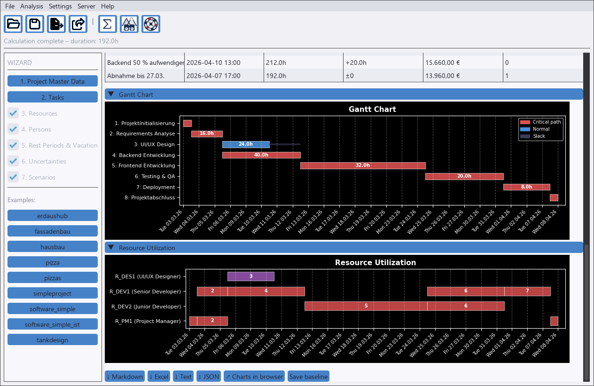

# sproject – Project Schedules with Probabilities

**When will the project really be done?** sproject plans projects with the critical path method (CPM), levels
resources, vacations and part-time work – and then answers with a **Monte Carlo simulation**: *"done by 16 April
with 80 % probability"* instead of a single, usually too optimistic date. What-if **scenarios** show the effect
of a sick colleague or a late delivery. A desktop GUI, a CLI and an **MCP server** let you – or Claude – build
plans, e.g. straight from an Excel task list.

[](https://github.com/mistamichael/sproject/actions/workflows/tests.yml)
[](LICENSE)


> Deutsche Dokumentation: [README.de.md](README.de.md)




## Why sproject

- **Probabilities instead of a single date** – duration ranges, risks and scenario probabilities feed a Monte Carlo
  simulation: P50/P80/P90, the chance to meet the plan or a deadline, and which tasks are most often critical.
- **What-if scenarios** – "backend takes 50 % longer", "Alice sick for a week", "truck broken" – compared with the
  base plan in duration, costs and missed deadlines.
- **Realistic resource planning** – one person or machine can only do one task at a time; vacations, part-time and
  rest breaks stretch the plan; fixed dates (`not_before`, `deadline`); plan vs. actual with a baseline.
- **AI interface (MCP)** – Claude Code or Claude Desktop builds, checks and calculates projects through one shared
  sproject server, e.g. from an Excel task list; the GUI can watch live.
- **Desktop GUI, CLI and reports** – Markdown/HTML with Gantt and network diagrams, Excel, TXT, JSON and interactive
  charts.

Look at the results without installing anything: [example results](doc/result_examples/README.md).

## Quickstart

Requires Python 3.10 or higher.

1. Get the code: `git clone https://github.com/mistamichael/sproject.git` (or download the ZIP)
2. Install: double-click `bin\install_py.bat` – Linux/macOS: `bash bin/install_py.sh`
   (creates `.venv` and installs everything from `requirements.txt`)
3. Start: double-click `bin\gui.bat` – Linux/macOS: `bash bin/gui.sh` – and open an example from the sidebar

Command line instead of the GUI (with `.venv` active):

```bash
python lib/sproject.py --project examples/software_simple.json --export md,html --simulate 300
```

Building a project with Claude: see [AI Interface (MCP)](#ai-interface-mcp).

## Usage

### Process a single project

Put your project file (e.g. `newproj.json`) into the `data/` folder (`$PV_DATA`) and run
`bin/create_reports.bat` (`.sh`) – it processes all project files there – or call directly:

```bash
python lib/sproject.py --project newproj.json
```

### Choose export format

```bash
# JSON only (default)
python lib/sproject.py --project examples/tankdesign.json

# Multiple formats at once
python lib/sproject.py --project examples/hausbau.json --export txt,json,xlsx,md,html,zip

# All available formats
python lib/sproject.py --project examples/software_simple.json --export txt,json,xlsx,md,html,zip
```

### Process all projects in a directory

```bash
python lib/sproject.py --data-dir examples --export json
```

### Additional options

```bash
# Custom output directory
python lib/sproject.py --project examples/pizza.json --output-dir ./my_results

# Override start date
python lib/sproject.py --project examples/simpleproject.json --start-date 2026-06-01

# Custom config directory
python lib/sproject.py --project examples/pizza.json --cfg-dir ./cfg

# Verbose output
python lib/sproject.py --project examples/pizza.json --verbose

# Compare all scenarios with the base plan / calculate one scenario instead of the base plan
python lib/sproject.py --project examples/software_simple.json --scenarios
python lib/sproject.py --project examples/software_simple.json --scenario "Alice eine Woche krank" --export xlsx

# Monte Carlo simulation with 500 runs (reproducible with --seed)
python lib/sproject.py --project examples/software_simple.json --simulate 500 --seed 42

# Small interactive HTML charts: load plotly.js from the internet instead of embedding it (~4 MB)
python lib/sproject.py --project examples/software_simple.json --export plotly,simulation --plotly-cdn

# Help
python lib/sproject.py --help
```

### Export Formats

| Format | Description |
| ------ | ----------- |
| `json` | Network plan + Gantt as JSON (default) |
| `txt` | Structured plain-text report |
| `xlsx` | Excel with configurable tabs (via `cfg/excel_export.cfg`) |
| `md` | Markdown report with embedded Mermaid diagrams |
| `html` | HTML report — Mermaid diagrams rendered in the browser |
| `zip` | All diagrams (Gantt, network plan, resource Gantts) as SVG files in a ZIP archive (rendered via kroki.io) |
| `plotly` | Interactive HTML charts (Gantt, resources) |
| `plotly_svg` | The Plotly charts as SVG images (needs kaleido and a local Chrome) |
| `scenarios` | Scenario comparison as HTML |
| `simulation` | Monte Carlo simulation as HTML (histogram, criticality, key figures) |

> **Excel tabs** (Gantt chart, resource list, etc.) are controlled by `section_order` in `cfg/excel_export.cfg` — no command-line flags needed.

## Graphical Editor (GUI)

Start with `bin/gui.bat` (Windows) or `bash bin/gui.sh` (Linux/Mac). Open an example from the sidebar or a file via *File → Open*.

| Section | Content |
| ------- | ------- |
| 1. Project master data | Name, start date, unit, volumes, status date |
| 2. Tasks | Simple, loop and subtasks with duration, resources, successors, costs |
| 3. Resources | ID, name, type, color – color field with color picker (click the swatch or double-click the hex value) |
| 4. Persons | Name, role, hourly rate |
| 5. Rest periods and vacation | Rest rules, vacation, part-time |
| 6. Uncertainties | Per task: Min/Max duration and risk (probability, delay, note) for the Monte Carlo simulation |
| 7. Scenarios | What-if variants with probability, and their changes (task, resource, person) |

Sections 3–7 are optional and can be switched on in the sidebar; they appear automatically when the loaded project uses them.

- **Edit:** type directly in the tables, or double-click a row in sections 6 and 7 to open it in a form.
- **Warning:** if a task's planned duration lies outside its Min–Max range, section 6 marks it red (the simulation would use the edge of the range).
- **Analysis menu / toolbar:** calculate, compare scenarios, run the Monte Carlo simulation. Results appear in the *Result* tab; reports go to `results/`.
- **Language:** German / English via *Settings*.
- **AI interface:** *Server → Connect to sproject server …* shares the project with Claude (see below).

## AI Interface (MCP)

An AI tool such as Claude Code or Claude Desktop can create projects, build them from Excel lists or other
sources, check, calculate and save them. It connects through an MCP server (Model Context Protocol); Python
scripts use the same operations via `lib.api.ProjectSession`. Every change is validated immediately –
invalid input changes nothing and returns an error message.

Exactly **one** sproject server holds the project; Claude Code and the GUI are both clients of it and
always see the same state:

| Step | How |
| --- | --- |
| 1. Start the server | `bin\mcp_server.bat` → `http://127.0.0.1:8765/mcp` (a second start on the same port is refused) |
| 2. Connect Claude Code | automatically via `.mcp.json` in the project folder (HTTP); check with `/mcp` |
| 3. Connect the GUI (optional) | *Server → Connect to sproject server …*; if none is running, the GUI offers to start it |

While connected, GUI changes go to the server about once per second and Claude's changes appear in the GUI.
If both change at the same time, the server version wins and the status bar reports the conflict.

Switches: `--port [N]` (HTTP on port N, default 8765), `--project FILE` (open a project at startup),
`--claude` (stdio for scripts/tests only – the GUI cannot connect to it), `--help`;
on Linux/macOS `bin/mcp_server.sh`.

**Build a new project with Claude – try it with the included example
[`data/simple_software_project.xlsx`](data/simple_software_project.xlsx)** (web shop relaunch: sheets
*Projekt*, *Aufgaben* with durations, predecessors and min/max, *Team* with hourly rates):

1. Start the server with `bin\mcp_server.bat` (optionally connect the GUI to watch).
2. Start Claude Code in the project folder; `/mcp` shows `sproject` as connected.
3. Ask: *"Read `data/simple_software_project.xlsx` and build a new sproject project from it (persons and
   resources from 'Team', tasks and dependencies from 'Aufgaben', min/max as uncertainty). Check and calculate
   it, simulate 300 runs and save it as `webshop.json`."*

Claude reads the Excel file itself and builds the project step by step with the tools (`new_project`,
`add_task` → task id, `add_dependency`, …). Expected: end 3 Dec 2026, 23,240 € costs.

When a project is replaced as a whole (`new_project`, `load_project`, or opening another file in the
connected GUI), the server first backs up the previous state to `work/backup/` and both Claude and the GUI
are told.

```python
from lib.api import ProjectSession

s = ProjectSession()
s.new_project("Garage", project_start="2026-04-01")
foundation = s.add_task({"name": "Foundation", "duration": "3d"})   # returns the task id
walls = s.add_task({"name": "Walls", "duration": "5d"})
s.add_dependency(foundation, walls)
print(s.calculate()["end"])
s.save("work/garage.json")
```

Tools, return values, GUI settings and troubleshooting: [doc/en/ai-interface.md](doc/en/ai-interface.md)
(German: [doc/de/ki-schnittstelle.md](doc/de/ki-schnittstelle.md)).

## Project File Format (JSON)

### Minimal Example

```json
{
  "project": "My Project",
  "project_start": "2026-04-01 08:00:00",
  "tasks": [
    {
      "id": 1,
      "name": "Planning",
      "duration": "3d",
      "successors": [2]
    },
    {
      "id": 2,
      "name": "Implementation",
      "duration": "10d",
      "successors": [3]
    },
    {
      "id": 3,
      "name": "Acceptance",
      "duration": "2d",
      "successors": []
    }
  ]
}
```

### Duration Formats

| Value   | Meaning                    |
| ------- | -------------------------- |
| `"10d"` | 10 working days            |
| `"2w"`  | 2 weeks = 10 working days  |
| `"8h"`  | 8 hours = 1 working day    |
| `"30m"` | 30 minutes                 |
| `10`    | 10 days (numeric)          |

### Dependency Types

| Field | Type | Meaning |
| --------------- | ---- | ------- |
| `successors` | FS | Finish→Start: successor starts after predecessor finishes (default) |
| `successors_aa` | SS | Start→Start: successor starts at the same time as predecessor |
| `successors_ae` | SF | Start→Finish: successor finishes when predecessor starts |
| `successors_ee` | FF | Finish→Finish: successor finishes at the same time as predecessor |

Example (from `hausbau.json`):

```json
{
  "id": 5,
  "name": "Build masonry",
  "duration": "10d",
  "successors": [10],
  "successors_aa": [6, 7],
  "note": "SS: Electrical and plumbing start as soon as masonry starts"
}
```

### Project with Resources and Costs

```json
{
  "project": "Software Project",
  "project_start": "2026-04-01 09:00:00",
  "persons": [
    {
      "id": "DEV1",
      "name": "Alice",
      "email": "alice@example.com",
      "role": "Senior Developer",
      "hourly_rate": 85.0,
      "vacation": [
        {"from": "2026-04-14", "to": "2026-04-18", "description": "Holiday"}
      ]
    }
  ],
  "resources": [
    {
      "id": "R_DEV1",
      "name": "Senior Developer",
      "type": "person",
      "person_id": "DEV1"
    }
  ],
  "tasks": [
    {
      "id": 1,
      "name": "Backend Development",
      "duration": "40h",
      "resources": ["R_DEV1"],
      "successors": [2]
    },
    {
      "id": 2,
      "name": "Deployment",
      "duration": "8h",
      "resources": ["R_DEV1"],
      "successors": []
    }
  ]
}
```

### Loop Tasks (Recurring Operations)

For repeating cycles (e.g. production loops), use `is_loop` tasks:

```json
{
  "id": 2,
  "name": "Production Cycle",
  "is_loop": true,
  "loop_until": "total_volume <= 0",
  "cycle_prefix": "P",
  "volume_per_cycle": 1,
  "subtasks": [
    {"name": "Processing", "duration": "5m", "resources": ["R_WORKER"]},
    {"name": "Quality Check", "duration": "2m", "resources": ["R_QA"]}
  ]
}
```

Loop tasks are automatically expanded before CPM calculation.

### Uncertainties and Scenarios

Uncertainties for the Monte Carlo simulation are set per task; scenarios are named lists of changes to the base plan:

```json
{
  "tasks": [
    { "id": 4, "name": "Backend", "duration": "40h",
      "duration_range": ["32h", "72h"],
      "risk": { "probability": 0.2, "delay": "16h", "note": "Customer API still unstable" } }
  ],
  "scenarios": [
    { "name": "Alice sick for a week", "probability": 0.15,
      "changes": [ { "person": "DEV1", "vacation": [ { "from": "2026-03-09", "to": "2026-03-13", "description": "sick" } ] } ] },
    { "name": "Backend 50 % more effort",
      "changes": [ { "task": 4, "duration_factor": 1.5 } ] }
  ]
}
```

| Field | Effect |
| ----- | ------ |
| `duration_range` | Duration varies between minimum and maximum, most often the planned duration (triangular distribution) |
| `risk` | With `probability` the start is delayed by `delay` |
| `scenarios[].changes` | Exactly one of `task` (ID or pattern like `2-F*.1`), `resource` (`unavailable`), `person` (`vacation`); task changes: `duration_factor` or any task field |
| `scenarios[].probability` | The scenario occurs with this probability in the simulation; without it the scenario is only compared |

Scenario comparison (`--export scenarios`) and Monte Carlo simulation with criticality (`--export simulation`)
for `examples/software_simple.json` (labels in German):


Details and how to read the charts (in German): [doc/de/termine-und-ist.md](doc/de/termine-und-ist.md). Example: `examples/software_simple.json`.

## Configuration

All defaults are read from `cfg/defaults.cfg`:

```ini
[CPM]
skip_weekends  = true     # Skip weekends
skip_holidays  = true     # Skip public holidays (country/region: see below)

[WorkingHours]
hours_per_day  = 8        # Working hours per day
days_per_week  = 5        # Working days per week

[Resource]
hourly_rate    = 100.00   # Default hourly rate (EUR)

[Costs]
overhead_factor = 1.5     # Overhead multiplier

[Output]
results_dir    = results  # Output directory
```

Public holidays work for **any country and region**: set `country` and `region` in the `[Holidays]` section of
`cfg/defaults.cfg` (uses the [holidays](https://pypi.org/project/holidays/) library). The setting applies to all
projects. `holidays_file` can optionally point to your own JSON file instead – `cfg/holidays_BY_2026.json` is just
an example of that format. **Note:** the shipped `defaults.cfg` sets `holidays_file = holidays_BY_2026.json`, and
the file takes precedence – clear `holidays_file` to use `country`/`region`.

```ini
[Holidays]
consider_holidays = true
country = DE        # e.g. AT, CH, US, GB …
region  = NW        # state/region, e.g. BY, BW …
holidays_file =     # optional: own JSON file in cfg/ instead of the library
```

## CPM Output Structure

```text
ID      Name                           Duration  ES     EF     LS     LF     TF     FF     Crit.
─────────────────────────────────────────────────────────────────────────────────────────────────
1       Planning                       3d        0.0    3.0    0.0    3.0    0.0    0.0    YES
2       Implementation                 10d       3.0    13.0   3.0    13.0   0.0    0.0    YES
3       Acceptance                     2d        13.0   15.0   13.0   15.0   0.0    0.0    YES
```

| Column | Meaning              |
| ------ | -------------------- |
| ES     | Earliest Start       |
| EF     | Earliest Finish      |
| LS     | Latest Start         |
| LF     | Latest Finish        |
| TF     | Total Float          |
| FF     | Free Float           |

## Example Projects

| File                   | Description                  | Features                          |
| ---------------------- | ---------------------------- | --------------------------------- |
| `pizza.json`           | Pizza preparation (minutes)  | Short durations in `m`            |
| `pizzas.json`          | Pizza service with volume    | Loop tasks, resources, machines   |
| `simpleproject.json`   | Machine assembly             | Classic CPM example               |
| `tankdesign.json`      | Tank design project          | Simple engineering project        |
| `hausbau.json`         | Single-family house build    | SS/FF dependencies                |
| `erdaushub.json`       | Excavation                   | Parallel activities               |
| `fassadenbau.json`     | Facade construction          | Section-by-section assembly       |
| `software_simple.json` | Software development         | Persons, resources, costs         |


### Example Results (without installing)


Pre-computed results of the examples are in [doc/result_examples/](doc/result_examples/README.md), e.g. for
`software_simple.json`. **Readable with one click:** the Markdown report (Gantt chart and network diagram render
directly on GitHub/Gitea) and the chart images above under *Uncertainties and Scenarios*.

| File | Content |
| --- | --- |
| [software_simple.md](doc/result_examples/software_simple.md) | report with Gantt chart and network diagram (renders directly on GitHub/Gitea) |
| [software_simple.html](doc/result_examples/software_simple.html) | the same report as HTML – *download and open* |
| [software_simple_charts.html](doc/result_examples/software_simple_charts.html) | interactive Gantt chart and resource utilization – *download and open, needs internet* |
| [software_simple_scenarios.html](doc/result_examples/software_simple_scenarios.html) | scenario comparison – *download and open, needs internet* |
| [software_simple_simulation.html](doc/result_examples/software_simple_simulation.html) | Monte Carlo simulation with criticality – *download and open, needs internet* |
| [software_simple.xlsx](doc/result_examples/software_simple.xlsx) | Excel report – *download and open* |

On GitHub/Gitea, clicking an HTML file only shows its source code – use *Download raw file* and open it in a
browser. The interactive pages load the Plotly library from the internet.

## Tests

Run all tests (unit tests, golden-file comparison of all examples, headless GUI tests):

```bash
python -m pytest
```

After an intended change of results, regenerate the reference files in `tests/golden/`:

```bash
UPDATE_GOLDEN=1 python -m pytest tests/test_golden.py
```

Only the AI interface (API, MCP tools, GUI connection over HTTP):

```bash
python -m pytest tests/test_api.py
python -m pytest tests/test_gui_headless.py -k server_link
```

Or via batch script (Windows):

```cmd
bin\run_unittests.bat
```

## Development

### Code Quality

```bash
make lint           # All tools
make lint-dead      # Dead code only (vulture + skylos)
make lint-types     # Type checks only (pyright + mypy)
```

Individual tools:

```bash
make vulture        # Dead code (80% confidence)
make skylos         # Dead code (ML-based)
make pyright        # Type checking (fast)
make mypy           # Type checking (strict)
```

### Adding New Projects

1. Create a JSON file in `examples/` (see format above)
2. Run: `python lib/sproject.py --project examples/myproject.json`
3. Check results in the `results/` directory

### Extending Models

- Task models: [lib/models/tasks.py](lib/models/tasks.py)
- Resources: [lib/models/resources.py](lib/models/resources.py)
- CPM calculation: [lib/models/cpm.py](lib/models/cpm.py)
- Gantt: [lib/models/gantt.py](lib/models/gantt.py)
- Export modules: `lib/*_export.py`

## Logging

Log files are created automatically under `log/`:

- Format: `sproject_YYYYMMDD_HHMMSS.log`
- Console: INFO level (key messages)
- File: DEBUG level (full details)

## Project Structure

```text
sproject/
├── bin/                        # Start scripts, each as .bat (Windows) and .sh (Linux/macOS)
│   ├── install_py.bat          # Install: create .venv and pip install (double-click)
│   ├── setenv.bat              # Set environment variables
│   ├── activate_venv.bat       # Activate virtual environment
│   ├── create_reports.bat      # Generate reports
│   ├── gui.bat                 # Start the GUI editor
│   ├── mcp_server.bat          # Start the sproject server (AI interface): --port [N] | --claude
│   └── run_unittests.bat       # Run unit tests
├── cfg/                        # Configuration files
│   ├── defaults.cfg            # Main config (calendar, CPM, costs)
│   ├── excel_export.cfg        # XLSX tab order and names
│   ├── txt_export.cfg          # TXT output structure
│   ├── json_export.cfg         # JSON export settings
│   ├── markdown_export.cfg     # Markdown/Mermaid options (also used for HTML and ZIP)
│   └── holidays_BY_2026.json   # Example holiday file (any country via [Holidays] in defaults.cfg)
├── examples/                   # Sample project files
│   ├── pizza.json              # Simple example (minutes)
│   ├── pizzas.json             # Loop-task example
│   ├── hausbau.json            # AA/EE dependency example
│   ├── simpleproject.json      # Machine assembly (days)
│   ├── software_simple.json    # Software project with resources
│   ├── tankdesign.json         # Engineering project
│   └── results/                # Pre-computed reference results
├── gui/                        # GUI editor (Dear PyGui)
│   ├── app.py                  # Layout, menus, toolbar, dialogs
│   ├── editor.py               # Editor state, file operations, calculation, exports
│   ├── task_rows.py            # Lossless conversion tasks ↔ table rows
│   ├── analysis_rows.py        # Text ↔ model for uncertainties and scenarios
│   ├── server_link.py          # GUI connection to the sproject server (menu Server)
│   └── components/             # Sections, tables, result panel, sidebar
├── lib/                        # Python source code (package "lib")
│   ├── sproject.py             # CLI entry point
│   ├── api.py                  # ProjectSession: project operations for AI tools and scripts
│   ├── schedule.py             # build_schedule(): expand → CPM → Gantt → costs
│   ├── scenarios.py            # Apply and compare scenarios
│   ├── simulation.py           # Monte Carlo simulation
│   ├── charts.py               # Plotly charts (Gantt, resources, simulation)
│   ├── exporters.py            # Export registry (shared by CLI and GUI)
│   ├── models/                 # Pydantic models
│   │   ├── project.py          # Project root model (data + validation)
│   │   ├── tasks.py            # Task models (incl. loop/cycle)
│   │   ├── dependencies.py     # Dependency types EA/AA/EE/AE
│   │   ├── resources.py        # Resources and persons
│   │   ├── expander.py         # Expansion of instance/loop tasks
│   │   ├── rest_breaks.py      # Rest breaks for persons
│   │   ├── cpm.py              # CPM calculation
│   │   ├── gantt.py            # Gantt scheduling (calendar dates)
│   │   └── loader.py           # JSON loader
│   ├── durations.py            # Duration parsing/formatting (hours_per_day from defaults.cfg)
│   ├── work_calendar.py        # Working days, weekends, holidays
│   ├── cost_calculator.py      # Cost calculation
│   ├── report_data.py          # Data preparation shared by the exports
│   ├── excel_reports.py        # XLSX export
│   ├── json_export.py          # JSON export
│   ├── txt_export.py           # TXT export
│   ├── markdown_export.py      # Markdown/HTML/ZIP export
│   ├── mermaid_export.py       # SVG via Mermaid/kroki
│   ├── colors.py, paths.py, export_config.py, config_loader.py
├── mcp_server/                 # MCP server (AI interface): tools on top of lib/api.py
├── tests/                      # pytest (incl. golden-file tests in tests/golden/)
├── data/                       # Your project files for the CLI (example: simple_software_project.xlsx)
├── .mcp.json                   # Registers the MCP server for Claude Code
├── requirements.txt            # Python dependencies
├── log/                        # Log files (auto-created)
├── results/                    # Generated reports (auto-created)
└── README.md
```

## License

This project is licensed under the [MIT License](LICENSE).
