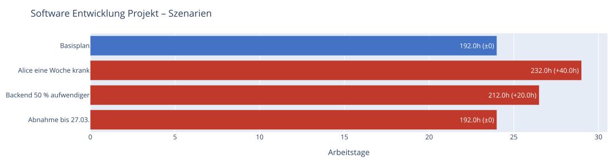
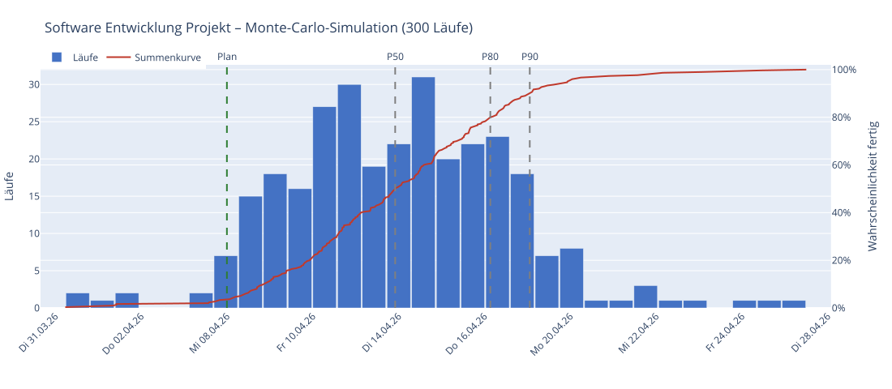
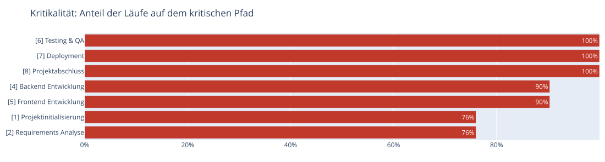

# Termine, Ressourcen und Plan gegen Ist

Alle hier beschriebenen Angaben sind optional. Ohne sie rechnet sproject wie bisher.

## Feste Termine

Pro Task in der Projektdatei:

```json
{ "id": 3, "name": "Fundament gießen", "duration": "2d",
  "not_before": "2026-04-15",
  "deadline":   "2026-04-30" }
```

| Feld | Bedeutung |
| --- | --- |
| `not_before` | Frühester Start (z. B. Materiallieferung). Datum ohne Uhrzeit = Tagesbeginn. |
| `deadline` | Spätestes Ende. Datum ohne Uhrzeit = Ende des Tages. |

Eine verfehlte Deadline erscheint als negativer Puffer und als Warnung in CLI, TXT, Markdown,
JSON, GUI und im Plotly-Gantt (rote Raute). Bei Loop- und Instance-Tasks gilt `not_before` für den
ersten, `deadline` für den letzten Zyklus.

## Ressourcen: wer kann wie viel gleichzeitig?

| Ressource | Gleichzeitige Aufgaben |
| --- | --- |
| mit `count` | `count` |
| `machine` / `oven` mit `capacity` | `capacity` (z. B. Ofen mit 4 Plätzen) |
| `material` | unbegrenzt |
| alle anderen (Personen, LKW, Bagger …) | 1 |

Beim LKW ist `capacity` die **Ladekapazität** (m³), nicht die Zahl paralleler Fahrten.

Teilen sich Tasks eine Ressource, plant sproject sie nacheinander ein. Die Wartebeziehung zählt wie
eine Abhängigkeit – Puffer und kritischer Pfad passen dadurch zum eingeplanten Ablauf. Im
Plotly-Tooltip steht, um wie viel ein Task verschoben wurde und auf wen er wartet.

## Urlaub und Teilzeit

An der Person (`persons`):

```json
{ "id": "DEV1", "name": "Alice", "role": "Entwicklerin", "hourly_rate": 85,
  "vacation": [ { "from": "2026-04-01", "to": "2026-04-05", "description": "Urlaub" },
                { "date": "2026-03-16", "description": "Fortbildung" } ],
  "workinghours_override": { "description": "halbtags", "days": ["mon", "tue", "wed", "thu", "fri"],
                             "hours": [ { "from": "08:00", "to": "12:00" } ] } }
```

- **Urlaub** unterbricht einen Task; er läuft nach dem Urlaub weiter.
- **Teilzeit** verlangsamt einen Task (4 h von 8 h → halbes Tempo, doppelte Dauer).
- Arbeiten mehrere Personen an einem Task, bestimmt die am wenigsten verfügbare das Tempo.

## Plan gegen Ist

Auf Projektebene:

```json
"status_date": "2026-03-13",
"actuals": {
  "1": { "start": "2026-03-03 09:00", "finish": "2026-03-03 13:00" },
  "4": { "start": "2026-03-06", "progress": 0.6 },
  "5": { "start": "2026-03-12", "remaining": "2d", "note": "Schätzung nach Review" }
},
"baseline": { "created": "...", "project_end": "...", "tasks": { "...": { "start": "...", "finish": "..." } } }
```

| Feld | Bedeutung |
| --- | --- |
| `status_date` | Stichtag des Ist-Stands (Ende des Tages). Nicht begonnene Tasks starten frühestens hier. |
| `actuals` | Ist-Stand je Task-ID (auch expandierte IDs wie `2-F1.1`). |
| `start` + `finish` | erledigt – liegt fest. |
| nur `start` | läuft – Restarbeit ab Stichtag aus `remaining` oder `duration × (1 − progress)`. |
| `baseline` | eingefrorener Plan, wird nicht von Hand gepflegt (siehe unten). |

**Baseline speichern** (einmal, wenn der Plan freigegeben ist):

```bash
python lib/sproject.py --project mein_projekt.json --save-baseline
```

oder in der GUI im Ergebnis-Tab „Baseline speichern“ und danach das Projekt speichern.

Ausgaben: Stichtag, erledigte/laufende Tasks, Prognose-Ende, Baseline-Ende und Verzug in allen
Reports; im Gantt ein grauer Baseline-Balken unter jedem Task, der erledigte Anteil in Grün und eine
Stichtag-Linie. Beispiel: [examples/software_simple_ist.json](../../examples/software_simple_ist.json).

## Szenarien (Was wäre wenn?)

Benannte Varianten des Plans auf Projektebene. Der Basisplan bleibt unverändert.

```json
"scenarios": [
  { "name": "Alice eine Woche krank",
    "changes": [ { "person": "DEV1", "vacation": [ { "from": "2026-03-09", "to": "2026-03-13", "description": "krank" } ] } ] },
  { "name": "Stau: Transporte 20 % langsamer",
    "changes": [ { "task": "2-F*.2", "duration_factor": 1.2 } ] },
  { "name": "LKW L1 defekt",
    "changes": [ { "resource": "L1", "unavailable": [ { "from": "2026-03-04", "to": "2026-03-05", "description": "Defekt" } ] } ] },
  { "name": "Lieferung 3 Tage später",
    "changes": [ { "task": 3, "delay": "3d" } ] }
]
```

| Änderung | Wirkung |
| --- | --- |
| `task` | Task-ID oder Muster (`2-F*.2` = alle Transporte, auch expandierte Zyklen). `duration_factor` multipliziert die Dauer; jedes weitere Feld (`duration`, `delay`, `resources`, `deadline`, `not_before` …) wird gesetzt. |
| `resource` + `unavailable` | zusätzliche Ausfallzeiten der Ressource |
| `person` + `vacation` | zusätzliche Abwesenheiten der Person |

`delay` (Wartezeit vor dem Start) und `unavailable` (Ausfallzeiten einer Ressource, z. B. Wartung)
lassen sich auch direkt im Basisplan verwenden.

```bash
python lib/sproject.py --project mein_projekt.json --scenarios                   # Vergleichstabelle
python lib/sproject.py --project mein_projekt.json --export scenarios            # Vergleich als HTML
python lib/sproject.py --project mein_projekt.json --scenario "LKW L1 defekt" --export txt,plotly
```

In der GUI erscheint der Vergleich im Ergebnis-Tab (Abschnitt „Szenarien“).



*Szenario-Vergleich (`--export scenarios`) für `examples/software_simple.json`:* Jeder Balken ist die
Projektdauer einer Variante, blau der Basisplan, rot die Abweichungen mit ihrem Mehraufwand gegenüber dem
Basisplan. Die Tabelle darunter nennt Ende, Dauer, Kosten und verfehlte Deadlines – „Abnahme bis 27.03.“
ändert die Dauer nicht, verfehlt aber eine Deadline.

## Monte-Carlo-Simulation (Wie sicher ist der Termin?)

sproject rechnet den Plan viele Male mit zufälligen Abweichungen. Unsicherheit wird an drei Stellen
angegeben:

```json
{ "id": 4, "name": "Backend Entwicklung", "duration": "40h",
  "duration_range": ["32h", "72h"],
  "risk": { "probability": 0.2, "delay": "16h", "note": "API des Kunden noch instabil" } }
```

```json
"scenarios": [ { "name": "Alice eine Woche krank", "probability": 0.15, "changes": [ ... ] } ]
```

| Angabe | Wirkung je Lauf |
| --- | --- |
| `duration_range` | Dauer zufällig zwischen Minimum und Maximum, am häufigsten die geplante Dauer (Dreiecksverteilung) |
| `risk` | mit `probability` verzögert sich der Start um `delay` |
| Szenario mit `probability` | das Szenario tritt mit dieser Wahrscheinlichkeit ein |

```bash
python lib/sproject.py --project mein_projekt.json --simulate 500 --seed 1          # Kennzahlen
python lib/sproject.py --project mein_projekt.json --export simulation --simulate 500
```

Ergebnis: mit welcher Wahrscheinlichkeit der Plan (und die Baseline, Deadlines) gehalten wird,
P50/P80/P90 („zu 80 % fertig bis …“), frühestes/spätestes Ende und die **Kritikalität** – wie oft
ein Task auf dem kritischen Pfad lag. Das HTML zeigt Histogramm und Summenkurve. `--seed` macht
Läufe reproduzierbar. In der GUI: Exportdialog „Simulation (HTML)“.



*Simulation mit 300 Läufen (`--export simulation`) für `examples/software_simple.json`:*

- **Balken** – wie viele Läufe an welchem Tag fertig wurden.
- **Rote Summenkurve** (rechte Achse) – mit welcher Wahrscheinlichkeit das Projekt bis zu diesem Tag fertig ist.
- **Grüne Linie „Plan“** – das Ende des Plans ohne Streuung; hier wird es nur in 3 % der Läufe gehalten.
- **P50 / P80 / P90** – bis dahin sind 50 / 80 / 90 % der Läufe fertig. Für eine verlässliche Zusage
  eignet sich eher P80 oder P90 als der Plan.
- Die Tabelle nennt dieselben Kennzahlen und, wie oft ein Szenario mit `probability` eingetreten ist.



**Kritikalität:** Anteil der Läufe, in denen ein Task auf dem kritischen Pfad lag. Tasks mit 100 %
bestimmen das Projektende immer; Tasks mit hohem Anteil (hier Backend und Frontend mit 90 %) lohnen
sich am meisten für Puffer, zusätzliche Leute oder genauere Schätzungen.
