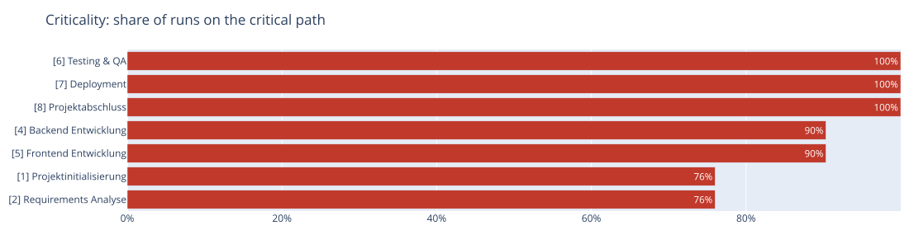

# Project File Format (JSON)

> Part of the [sproject documentation](../../README.md#documentation). Deutsch: [doc/de/projektformat.md](../de/projektformat.md)

## Minimal Example

```json
{
  "project": "My Project",
  "project_start": "2026-04-01 08:00:00",
  "tasks": [
    {
      "id": 1,
      "name": "Planning",
      "duration": "3d",
      "successors": [2]
    },
    {
      "id": 2,
      "name": "Implementation",
      "duration": "10d",
      "successors": [3]
    },
    {
      "id": 3,
      "name": "Acceptance",
      "duration": "2d",
      "successors": []
    }
  ]
}
```

## Duration Formats

| Value   | Meaning                    |
| ------- | -------------------------- |
| `"10d"` | 10 working days            |
| `"2w"`  | 2 weeks = 10 working days  |
| `"8h"`  | 8 hours = 1 working day    |
| `"30m"` | 30 minutes                 |
| `10`    | 10 days (numeric)          |

## Dependency Types

| Field | Type | Meaning |
| --------------- | ---- | ------- |
| `successors` | FS | Finish→Start: successor starts after predecessor finishes (default) |
| `successors_aa` | SS | Start→Start: successor starts at the same time as predecessor |
| `successors_ae` | SF | Start→Finish: successor finishes when predecessor starts |
| `successors_ee` | FF | Finish→Finish: successor finishes at the same time as predecessor |

Example (from `hausbau.json`):

```json
{
  "id": 5,
  "name": "Build masonry",
  "duration": "10d",
  "successors": [10],
  "successors_aa": [6, 7],
  "note": "SS: Electrical and plumbing start as soon as masonry starts"
}
```

## Project with Resources and Costs

```json
{
  "project": "Software Project",
  "project_start": "2026-04-01 09:00:00",
  "persons": [
    {
      "id": "DEV1",
      "name": "Alice",
      "email": "alice@example.com",
      "role": "Senior Developer",
      "hourly_rate": 85.0,
      "vacation": [
        {"from": "2026-04-14", "to": "2026-04-18", "description": "Holiday"}
      ]
    }
  ],
  "resources": [
    {
      "id": "R_DEV1",
      "name": "Senior Developer",
      "type": "person",
      "person_id": "DEV1"
    }
  ],
  "tasks": [
    {
      "id": 1,
      "name": "Backend Development",
      "duration": "40h",
      "resources": ["R_DEV1"],
      "successors": [2]
    },
    {
      "id": 2,
      "name": "Deployment",
      "duration": "8h",
      "resources": ["R_DEV1"],
      "successors": []
    }
  ]
}
```

## Loop Tasks (Recurring Operations)

For repeating cycles (e.g. production loops), use `is_loop` tasks:

```json
{
  "id": 2,
  "name": "Production Cycle",
  "is_loop": true,
  "loop_until": "total_volume <= 0",
  "cycle_prefix": "P",
  "volume_per_cycle": 1,
  "subtasks": [
    {"name": "Processing", "duration": "5m", "resources": ["R_WORKER"]},
    {"name": "Quality Check", "duration": "2m", "resources": ["R_QA"]}
  ]
}
```

Loop tasks are automatically expanded before CPM calculation.

## Uncertainties and Scenarios

Uncertainties for the Monte Carlo simulation are set per task; scenarios are named lists of changes to the base plan:

```json
{
  "tasks": [
    { "id": 4, "name": "Backend", "duration": "40h",
      "duration_range": ["32h", "72h"],
      "risk": { "probability": 0.2, "delay": "16h", "note": "Customer API still unstable" } }
  ],
  "scenarios": [
    { "name": "Alice sick for a week", "probability": 0.15,
      "changes": [ { "person": "DEV1", "vacation": [ { "from": "2026-03-09", "to": "2026-03-13", "description": "sick" } ] } ] },
    { "name": "Backend 50 % more effort",
      "changes": [ { "task": 4, "duration_factor": 1.5 } ] }
  ]
}
```

| Field | Effect |
| ----- | ------ |
| `duration_range` | Duration varies between minimum and maximum, most often the planned duration (triangular distribution) |
| `risk` | With `probability` the start is delayed by `delay` |
| `scenarios[].changes` | Exactly one of `task` (ID or pattern like `2-F*.1`), `resource` (`unavailable`), `person` (`vacation`); task changes: `duration_factor` or any task field |
| `scenarios[].probability` | The scenario occurs with this probability in the simulation; without it the scenario is only compared |

Scenario comparison (`--export scenarios`) and Monte Carlo simulation with criticality (`--export simulation`)
for `examples/software_simple.json`:




Details and how to read the charts (in German): [doc/de/termine-und-ist.md](../de/termine-und-ist.md). Example: `examples/software_simple.json`.
