# Erdaushub 1000m3 - CPM Report


## CPM Analyse

### Projektzusammenfassung

- **Projekt:** Erdaushub 1000m3
- **Projektdauer:** 2039.0m
- **Startdatum:** 2026-03-02 09:00
- **Enddatum (geschätzt):** 2026-03-06 10:59
- **Zeiteinheit:** minutes
- **Anzahl Tasks:** 185
- **Kritische Tasks:** 102

---

### Kritischer Pfad

Der kritische Pfad besteht aus folgenden Tasks:

- **[1]** Initialisierung und Bereitstellung (Dauer: 15.0m)
- **[2-F1.1]** Beladen #1 (Dauer: 8.0m)
- **[2-F1.2]** Transport-Umlauf #1 (Dauer: 40.0m)
- **[2-F3.1]** Beladen #3 (Dauer: 8.0m)
- **[2-F3.2]** Transport-Umlauf #3 (Dauer: 40.0m)
- **[2-F5.1]** Beladen #5 (Dauer: 8.0m)
- **[2-F5.2]** Transport-Umlauf #5 (Dauer: 40.0m)
- **[2-F7.1]** Beladen #7 (Dauer: 8.0m)
- **[2-F7.2]** Transport-Umlauf #7 (Dauer: 40.0m)
- **[2-F9.1]** Beladen #9 (Dauer: 8.0m)
- **[2-F9.2]** Transport-Umlauf #9 (Dauer: 40.0m)
- **[2-F11.1]** Beladen #11 (Dauer: 8.0m)
- **[2-F11.2]** Transport-Umlauf #11 (Dauer: 40.0m)
- **[2-F11.2-BRK-P1]** Pause: Max Mustermann (Lenkzeitunterbrechung laut Fahrpersonalgesetz) (Dauer: 45.0m)
- **[2-F13.1]** Beladen #13 (Dauer: 8.0m)
- **[2-F12.2-BRK-P2]** Pause: Heinz Müller (Lenkzeitunterbrechung laut Fahrpersonalgesetz) (Dauer: 45.0m)
- **[2-F13.2]** Transport-Umlauf #13 (Dauer: 40.0m)
- **[2-F15.1]** Beladen #15 (Dauer: 8.0m)
- **[2-F15.2]** Transport-Umlauf #15 (Dauer: 40.0m)
- **[2-F15.2-BRK-P1]** Pause: Max Mustermann (Vorschrift laut Arbeitszeitgesetz) (Dauer: 30.0m)
- **[2-F17.1]** Beladen #17 (Dauer: 8.0m)
- **[2-F16.2-BRK-P2]** Pause: Heinz Müller (Vorschrift laut Arbeitszeitgesetz) (Dauer: 30.0m)
- **[2-F17.2]** Transport-Umlauf #17 (Dauer: 40.0m)
- **[2-F19.1]** Beladen #19 (Dauer: 8.0m)
- **[2-F19.2]** Transport-Umlauf #19 (Dauer: 40.0m)
- **[2-F21.1]** Beladen #21 (Dauer: 8.0m)
- **[2-F21.2]** Transport-Umlauf #21 (Dauer: 40.0m)
- **[2-F23.1]** Beladen #23 (Dauer: 8.0m)
- **[2-F23.2]** Transport-Umlauf #23 (Dauer: 40.0m)
- **[2-F25.1]** Beladen #25 (Dauer: 8.0m)
- **[2-F25.2]** Transport-Umlauf #25 (Dauer: 40.0m)
- **[2-F27.1]** Beladen #27 (Dauer: 8.0m)
- **[2-F27.2]** Transport-Umlauf #27 (Dauer: 40.0m)
- **[2-F29.1]** Beladen #29 (Dauer: 8.0m)
- **[2-F29.2]** Transport-Umlauf #29 (Dauer: 40.0m)
- **[2-F31.1]** Beladen #31 (Dauer: 8.0m)
- **[2-F31.2]** Transport-Umlauf #31 (Dauer: 40.0m)
- **[2-F31.2-BRK-P1]** Pause: Max Mustermann (Lenkzeitunterbrechung laut Fahrpersonalgesetz) (Dauer: 45.0m)
- **[2-F33.1]** Beladen #33 (Dauer: 8.0m)
- **[2-F32.2-BRK-P2]** Pause: Heinz Müller (Lenkzeitunterbrechung laut Fahrpersonalgesetz) (Dauer: 45.0m)
- **[2-F33.2]** Transport-Umlauf #33 (Dauer: 40.0m)
- **[2-F35.1]** Beladen #35 (Dauer: 8.0m)
- **[2-F35.2]** Transport-Umlauf #35 (Dauer: 40.0m)
- **[2-F35.2-BRK-P1]** Pause: Max Mustermann (Vorschrift laut Arbeitszeitgesetz) (Dauer: 30.0m)
- **[2-F37.1]** Beladen #37 (Dauer: 8.0m)
- **[2-F36.2-BRK-P2]** Pause: Heinz Müller (Vorschrift laut Arbeitszeitgesetz) (Dauer: 30.0m)
- **[2-F37.2]** Transport-Umlauf #37 (Dauer: 40.0m)
- **[2-F39.1]** Beladen #39 (Dauer: 8.0m)
- **[2-F39.2]** Transport-Umlauf #39 (Dauer: 40.0m)
- **[2-F41.1]** Beladen #41 (Dauer: 8.0m)
- **[2-F41.2]** Transport-Umlauf #41 (Dauer: 40.0m)
- **[2-F43.1]** Beladen #43 (Dauer: 8.0m)
- **[2-F43.2]** Transport-Umlauf #43 (Dauer: 40.0m)
- **[2-F45.1]** Beladen #45 (Dauer: 8.0m)
- **[2-F45.2]** Transport-Umlauf #45 (Dauer: 40.0m)
- **[2-F47.1]** Beladen #47 (Dauer: 8.0m)
- **[2-F47.2]** Transport-Umlauf #47 (Dauer: 40.0m)
- **[2-F49.1]** Beladen #49 (Dauer: 8.0m)
- **[2-F49.2]** Transport-Umlauf #49 (Dauer: 40.0m)
- **[2-F51.1]** Beladen #51 (Dauer: 8.0m)
- **[2-F51.2]** Transport-Umlauf #51 (Dauer: 40.0m)
- **[2-F51.2-BRK-P1]** Pause: Max Mustermann (Lenkzeitunterbrechung laut Fahrpersonalgesetz) (Dauer: 45.0m)
- **[2-F53.1]** Beladen #53 (Dauer: 8.0m)
- **[2-F52.2-BRK-P2]** Pause: Heinz Müller (Lenkzeitunterbrechung laut Fahrpersonalgesetz) (Dauer: 45.0m)
- **[2-F53.2]** Transport-Umlauf #53 (Dauer: 40.0m)
- **[2-F55.1]** Beladen #55 (Dauer: 8.0m)
- **[2-F55.2]** Transport-Umlauf #55 (Dauer: 40.0m)
- **[2-F55.2-BRK-P1]** Pause: Max Mustermann (Vorschrift laut Arbeitszeitgesetz) (Dauer: 30.0m)
- **[2-F57.1]** Beladen #57 (Dauer: 8.0m)
- **[2-F56.2-BRK-P2]** Pause: Heinz Müller (Vorschrift laut Arbeitszeitgesetz) (Dauer: 30.0m)
- **[2-F57.2]** Transport-Umlauf #57 (Dauer: 40.0m)
- **[2-F59.1]** Beladen #59 (Dauer: 8.0m)
- **[2-F59.2]** Transport-Umlauf #59 (Dauer: 40.0m)
- **[2-F61.1]** Beladen #61 (Dauer: 8.0m)
- **[2-F61.2]** Transport-Umlauf #61 (Dauer: 40.0m)
- **[2-F63.1]** Beladen #63 (Dauer: 8.0m)
- **[2-F63.2]** Transport-Umlauf #63 (Dauer: 40.0m)
- **[2-F65.1]** Beladen #65 (Dauer: 8.0m)
- **[2-F65.2]** Transport-Umlauf #65 (Dauer: 40.0m)
- **[2-F67.1]** Beladen #67 (Dauer: 8.0m)
- **[2-F67.2]** Transport-Umlauf #67 (Dauer: 40.0m)
- **[2-F69.1]** Beladen #69 (Dauer: 8.0m)
- **[2-F69.2]** Transport-Umlauf #69 (Dauer: 40.0m)
- **[2-F71.1]** Beladen #71 (Dauer: 8.0m)
- **[2-F71.2]** Transport-Umlauf #71 (Dauer: 40.0m)
- **[2-F71.2-BRK-P1]** Pause: Max Mustermann (Lenkzeitunterbrechung laut Fahrpersonalgesetz) (Dauer: 45.0m)
- **[2-F73.1]** Beladen #73 (Dauer: 8.0m)
- **[2-F72.2-BRK-P2]** Pause: Heinz Müller (Lenkzeitunterbrechung laut Fahrpersonalgesetz) (Dauer: 45.0m)
- **[2-F73.2]** Transport-Umlauf #73 (Dauer: 40.0m)
- **[2-F75.1]** Beladen #75 (Dauer: 8.0m)
- **[2-F75.2]** Transport-Umlauf #75 (Dauer: 40.0m)
- **[2-F75.2-BRK-P1]** Pause: Max Mustermann (Vorschrift laut Arbeitszeitgesetz) (Dauer: 30.0m)
- **[2-F77.1]** Beladen #77 (Dauer: 8.0m)
- **[2-F76.2-BRK-P2]** Pause: Heinz Müller (Vorschrift laut Arbeitszeitgesetz) (Dauer: 30.0m)
- **[2-F77.2]** Transport-Umlauf #77 (Dauer: 40.0m)
- **[2-F79.1]** Beladen #79 (Dauer: 8.0m)
- **[2-F79.2]** Transport-Umlauf #79 (Dauer: 40.0m)
- **[2-F81.1]** Beladen #81 (Dauer: 8.0m)
- **[2-F81.2]** Transport-Umlauf #81 (Dauer: 40.0m)
- **[2-F83.1]** Beladen #83 (Dauer: 8.0m)
- **[2-F84.1]** Beladen #84 (Dauer: 8.0m)
- **[2-F84.2]** Transport-Umlauf #84 (Dauer: 40.0m)

---

### Netzplan

```mermaid
graph TD

    N1["<b>[1] | Initialisierung und Bereitstellung<br/>GP:0.0m | FP:0.0m</b>"]:::critical
    N2-F1.1["<b>[2-F1.1] | Beladen #1<br/>GP:0.0m | FP:0.0m</b>"]:::critical
    N2-F1.2["<b>[2-F1.2] | Transport-Umlauf #1<br/>GP:0.0m | FP:0.0m</b>"]:::critical
    N2-F2.1["[2-F2.1] | Beladen #2<br/>GP:32.0m | FP:0.0m"]
    N2-F2.2["[2-F2.2] | Transport-Umlauf #2<br/>GP:1968.0m | FP:1968.0m"]
    N2-F3.1["<b>[2-F3.1] | Beladen #3<br/>GP:0.0m | FP:0.0m</b>"]:::critical
    N2-F3.2["<b>[2-F3.2] | Transport-Umlauf #3<br/>GP:0.0m | FP:0.0m</b>"]:::critical
    N2-F4.1["[2-F4.1] | Beladen #4<br/>GP:32.0m | FP:0.0m"]
    N2-F4.2["[2-F4.2] | Transport-Umlauf #4<br/>GP:1920.0m | FP:1920.0m"]
    N2-F5.1["<b>[2-F5.1] | Beladen #5<br/>GP:0.0m | FP:0.0m</b>"]:::critical
    N2-F5.2["<b>[2-F5.2] | Transport-Umlauf #5<br/>GP:0.0m | FP:0.0m</b>"]:::critical
    N2-F6.1["[2-F6.1] | Beladen #6<br/>GP:32.0m | FP:0.0m"]
    N2-F6.2["[2-F6.2] | Transport-Umlauf #6<br/>GP:1872.0m | FP:1872.0m"]
    N2-F7.1["<b>[2-F7.1] | Beladen #7<br/>GP:0.0m | FP:0.0m</b>"]:::critical
    N2-F7.2["<b>[2-F7.2] | Transport-Umlauf #7<br/>GP:0.0m | FP:0.0m</b>"]:::critical
    N2-F8.1["[2-F8.1] | Beladen #8<br/>GP:32.0m | FP:0.0m"]
    N2-F8.2["[2-F8.2] | Transport-Umlauf #8<br/>GP:1824.0m | FP:1824.0m"]
    N2-F9.1["<b>[2-F9.1] | Beladen #9<br/>GP:0.0m | FP:0.0m</b>"]:::critical
    N2-F9.2["<b>[2-F9.2] | Transport-Umlauf #9<br/>GP:0.0m | FP:0.0m</b>"]:::critical
    N2-F10.1["[2-F10.1] | Beladen #10<br/>GP:32.0m | FP:0.0m"]
    N2-F10.2["[2-F10.2] | Transport-Umlauf #10<br/>GP:1776.0m | FP:1776.0m"]
    N2-F11.1["<b>[2-F11.1] | Beladen #11<br/>GP:0.0m | FP:0.0m</b>"]:::critical
    N2-F11.2["<b>[2-F11.2] | Transport-Umlauf #11<br/>GP:0.0m | FP:0.0m</b>"]:::critical
    N2-F11.2-BRK-P1["<b>[2-F11.2-BRK-P1] | Pause: Max Mustermann (Lenkzeitunterbrechung laut Fahrpersonalgesetz)<br/>GP:0.0m | FP:0.0m</b>"]:::critical
    N2-F12.1["[2-F12.1] | Beladen #12<br/>GP:32.0m | FP:0.0m"]
    N2-F12.2["[2-F12.2] | Transport-Umlauf #12<br/>GP:1683.0m | FP:0.0m"]
    N2-F12.2-BRK-P2["<b>[2-F12.2-BRK-P2] | Pause: Heinz Müller (Lenkzeitunterbrechung laut Fahrpersonalgesetz)<br/>GP:0.0m | FP:0.0m</b>"]:::critical
    N2-F13.1["<b>[2-F13.1] | Beladen #13<br/>GP:0.0m | FP:0.0m</b>"]:::critical
    N2-F13.2["<b>[2-F13.2] | Transport-Umlauf #13<br/>GP:0.0m | FP:0.0m</b>"]:::critical
    N2-F14.1["[2-F14.1] | Beladen #14<br/>GP:32.0m | FP:0.0m"]
    N2-F14.2["[2-F14.2] | Transport-Umlauf #14<br/>GP:1680.0m | FP:1680.0m"]
    N2-F15.1["<b>[2-F15.1] | Beladen #15<br/>GP:0.0m | FP:0.0m</b>"]:::critical
    N2-F15.2["<b>[2-F15.2] | Transport-Umlauf #15<br/>GP:0.0m | FP:0.0m</b>"]:::critical
    N2-F15.2-BRK-P1["<b>[2-F15.2-BRK-P1] | Pause: Max Mustermann (Vorschrift laut Arbeitszeitgesetz)<br/>GP:0.0m | FP:0.0m</b>"]:::critical
    N2-F16.1["[2-F16.1] | Beladen #16<br/>GP:32.0m | FP:0.0m"]
    N2-F16.2["[2-F16.2] | Transport-Umlauf #16<br/>GP:1602.0m | FP:0.0m"]
    N2-F16.2-BRK-P2["<b>[2-F16.2-BRK-P2] | Pause: Heinz Müller (Vorschrift laut Arbeitszeitgesetz)<br/>GP:0.0m | FP:0.0m</b>"]:::critical
    N2-F17.1["<b>[2-F17.1] | Beladen #17<br/>GP:0.0m | FP:0.0m</b>"]:::critical
    N2-F17.2["<b>[2-F17.2] | Transport-Umlauf #17<br/>GP:0.0m | FP:0.0m</b>"]:::critical
    N2-F18.1["[2-F18.1] | Beladen #18<br/>GP:32.0m | FP:0.0m"]
    N2-F18.2["[2-F18.2] | Transport-Umlauf #18<br/>GP:1584.0m | FP:1584.0m"]
    N2-F19.1["<b>[2-F19.1] | Beladen #19<br/>GP:0.0m | FP:0.0m</b>"]:::critical
    N2-F19.2["<b>[2-F19.2] | Transport-Umlauf #19<br/>GP:0.0m | FP:0.0m</b>"]:::critical
    N2-F20.1["[2-F20.1] | Beladen #20<br/>GP:32.0m | FP:0.0m"]
    N2-F20.2["[2-F20.2] | Transport-Umlauf #20<br/>GP:1536.0m | FP:1536.0m"]
    N2-F21.1["<b>[2-F21.1] | Beladen #21<br/>GP:0.0m | FP:0.0m</b>"]:::critical
    N2-F21.2["<b>[2-F21.2] | Transport-Umlauf #21<br/>GP:0.0m | FP:0.0m</b>"]:::critical
    N2-F22.1["[2-F22.1] | Beladen #22<br/>GP:32.0m | FP:0.0m"]
    N2-F22.2["[2-F22.2] | Transport-Umlauf #22<br/>GP:1488.0m | FP:1488.0m"]
    N2-F23.1["<b>[2-F23.1] | Beladen #23<br/>GP:0.0m | FP:0.0m</b>"]:::critical
    N2-F23.2["<b>[2-F23.2] | Transport-Umlauf #23<br/>GP:0.0m | FP:0.0m</b>"]:::critical
    N2-F24.1["[2-F24.1] | Beladen #24<br/>GP:32.0m | FP:0.0m"]
    N2-F24.2["[2-F24.2] | Transport-Umlauf #24<br/>GP:1440.0m | FP:1440.0m"]
    N2-F25.1["<b>[2-F25.1] | Beladen #25<br/>GP:0.0m | FP:0.0m</b>"]:::critical
    N2-F25.2["<b>[2-F25.2] | Transport-Umlauf #25<br/>GP:0.0m | FP:0.0m</b>"]:::critical
    N2-F26.1["[2-F26.1] | Beladen #26<br/>GP:32.0m | FP:0.0m"]
    N2-F26.2["[2-F26.2] | Transport-Umlauf #26<br/>GP:1392.0m | FP:1392.0m"]
    N2-F27.1["<b>[2-F27.1] | Beladen #27<br/>GP:0.0m | FP:0.0m</b>"]:::critical
    N2-F27.2["<b>[2-F27.2] | Transport-Umlauf #27<br/>GP:0.0m | FP:0.0m</b>"]:::critical
    N2-F28.1["[2-F28.1] | Beladen #28<br/>GP:32.0m | FP:0.0m"]
    N2-F28.2["[2-F28.2] | Transport-Umlauf #28<br/>GP:1344.0m | FP:1344.0m"]
    N2-F29.1["<b>[2-F29.1] | Beladen #29<br/>GP:0.0m | FP:0.0m</b>"]:::critical
    N2-F29.2["<b>[2-F29.2] | Transport-Umlauf #29<br/>GP:0.0m | FP:0.0m</b>"]:::critical
    N2-F30.1["[2-F30.1] | Beladen #30<br/>GP:32.0m | FP:0.0m"]
    N2-F30.2["[2-F30.2] | Transport-Umlauf #30<br/>GP:1296.0m | FP:1296.0m"]
    N2-F31.1["<b>[2-F31.1] | Beladen #31<br/>GP:0.0m | FP:0.0m</b>"]:::critical
    N2-F31.2["<b>[2-F31.2] | Transport-Umlauf #31<br/>GP:0.0m | FP:0.0m</b>"]:::critical
    N2-F31.2-BRK-P1["<b>[2-F31.2-BRK-P1] | Pause: Max Mustermann (Lenkzeitunterbrechung laut Fahrpersonalgesetz)<br/>GP:0.0m | FP:0.0m</b>"]:::critical
    N2-F32.1["[2-F32.1] | Beladen #32<br/>GP:32.0m | FP:0.0m"]
    N2-F32.2["[2-F32.2] | Transport-Umlauf #32<br/>GP:1203.0m | FP:0.0m"]
    N2-F32.2-BRK-P2["<b>[2-F32.2-BRK-P2] | Pause: Heinz Müller (Lenkzeitunterbrechung laut Fahrpersonalgesetz)<br/>GP:0.0m | FP:0.0m</b>"]:::critical
    N2-F33.1["<b>[2-F33.1] | Beladen #33<br/>GP:0.0m | FP:0.0m</b>"]:::critical
    N2-F33.2["<b>[2-F33.2] | Transport-Umlauf #33<br/>GP:0.0m | FP:0.0m</b>"]:::critical
    N2-F34.1["[2-F34.1] | Beladen #34<br/>GP:32.0m | FP:0.0m"]
    N2-F34.2["[2-F34.2] | Transport-Umlauf #34<br/>GP:1200.0m | FP:1200.0m"]
    N2-F35.1["<b>[2-F35.1] | Beladen #35<br/>GP:0.0m | FP:0.0m</b>"]:::critical
    N2-F35.2["<b>[2-F35.2] | Transport-Umlauf #35<br/>GP:0.0m | FP:0.0m</b>"]:::critical
    N2-F35.2-BRK-P1["<b>[2-F35.2-BRK-P1] | Pause: Max Mustermann (Vorschrift laut Arbeitszeitgesetz)<br/>GP:0.0m | FP:0.0m</b>"]:::critical
    N2-F36.1["[2-F36.1] | Beladen #36<br/>GP:32.0m | FP:0.0m"]
    N2-F36.2["[2-F36.2] | Transport-Umlauf #36<br/>GP:1122.0m | FP:0.0m"]
    N2-F36.2-BRK-P2["<b>[2-F36.2-BRK-P2] | Pause: Heinz Müller (Vorschrift laut Arbeitszeitgesetz)<br/>GP:0.0m | FP:0.0m</b>"]:::critical
    N2-F37.1["<b>[2-F37.1] | Beladen #37<br/>GP:0.0m | FP:0.0m</b>"]:::critical
    N2-F37.2["<b>[2-F37.2] | Transport-Umlauf #37<br/>GP:0.0m | FP:0.0m</b>"]:::critical
    N2-F38.1["[2-F38.1] | Beladen #38<br/>GP:32.0m | FP:0.0m"]
    N2-F38.2["[2-F38.2] | Transport-Umlauf #38<br/>GP:1104.0m | FP:1104.0m"]
    N2-F39.1["<b>[2-F39.1] | Beladen #39<br/>GP:0.0m | FP:0.0m</b>"]:::critical
    N2-F39.2["<b>[2-F39.2] | Transport-Umlauf #39<br/>GP:0.0m | FP:0.0m</b>"]:::critical
    N2-F40.1["[2-F40.1] | Beladen #40<br/>GP:32.0m | FP:0.0m"]
    N2-F40.2["[2-F40.2] | Transport-Umlauf #40<br/>GP:1056.0m | FP:1056.0m"]
    N2-F41.1["<b>[2-F41.1] | Beladen #41<br/>GP:0.0m | FP:0.0m</b>"]:::critical
    N2-F41.2["<b>[2-F41.2] | Transport-Umlauf #41<br/>GP:0.0m | FP:0.0m</b>"]:::critical
    N2-F42.1["[2-F42.1] | Beladen #42<br/>GP:32.0m | FP:0.0m"]
    N2-F42.2["[2-F42.2] | Transport-Umlauf #42<br/>GP:1008.0m | FP:1008.0m"]
    N2-F43.1["<b>[2-F43.1] | Beladen #43<br/>GP:0.0m | FP:0.0m</b>"]:::critical
    N2-F43.2["<b>[2-F43.2] | Transport-Umlauf #43<br/>GP:0.0m | FP:0.0m</b>"]:::critical
    N2-F44.1["[2-F44.1] | Beladen #44<br/>GP:32.0m | FP:0.0m"]
    N2-F44.2["[2-F44.2] | Transport-Umlauf #44<br/>GP:960.0m | FP:960.0m"]
    N2-F45.1["<b>[2-F45.1] | Beladen #45<br/>GP:0.0m | FP:0.0m</b>"]:::critical
    N2-F45.2["<b>[2-F45.2] | Transport-Umlauf #45<br/>GP:0.0m | FP:0.0m</b>"]:::critical
    N2-F46.1["[2-F46.1] | Beladen #46<br/>GP:32.0m | FP:0.0m"]
    N2-F46.2["[2-F46.2] | Transport-Umlauf #46<br/>GP:912.0m | FP:912.0m"]
    N2-F47.1["<b>[2-F47.1] | Beladen #47<br/>GP:0.0m | FP:0.0m</b>"]:::critical
    N2-F47.2["<b>[2-F47.2] | Transport-Umlauf #47<br/>GP:0.0m | FP:0.0m</b>"]:::critical
    N2-F48.1["[2-F48.1] | Beladen #48<br/>GP:32.0m | FP:0.0m"]
    N2-F48.2["[2-F48.2] | Transport-Umlauf #48<br/>GP:864.0m | FP:864.0m"]
    N2-F49.1["<b>[2-F49.1] | Beladen #49<br/>GP:0.0m | FP:0.0m</b>"]:::critical
    N2-F49.2["<b>[2-F49.2] | Transport-Umlauf #49<br/>GP:0.0m | FP:0.0m</b>"]:::critical
    N2-F50.1["[2-F50.1] | Beladen #50<br/>GP:32.0m | FP:0.0m"]
    N2-F50.2["[2-F50.2] | Transport-Umlauf #50<br/>GP:816.0m | FP:816.0m"]
    N2-F51.1["<b>[2-F51.1] | Beladen #51<br/>GP:0.0m | FP:0.0m</b>"]:::critical
    N2-F51.2["<b>[2-F51.2] | Transport-Umlauf #51<br/>GP:0.0m | FP:0.0m</b>"]:::critical
    N2-F51.2-BRK-P1["<b>[2-F51.2-BRK-P1] | Pause: Max Mustermann (Lenkzeitunterbrechung laut Fahrpersonalgesetz)<br/>GP:0.0m | FP:0.0m</b>"]:::critical
    N2-F52.1["[2-F52.1] | Beladen #52<br/>GP:32.0m | FP:0.0m"]
    N2-F52.2["[2-F52.2] | Transport-Umlauf #52<br/>GP:723.0m | FP:0.0m"]
    N2-F52.2-BRK-P2["<b>[2-F52.2-BRK-P2] | Pause: Heinz Müller (Lenkzeitunterbrechung laut Fahrpersonalgesetz)<br/>GP:0.0m | FP:0.0m</b>"]:::critical
    N2-F53.1["<b>[2-F53.1] | Beladen #53<br/>GP:0.0m | FP:0.0m</b>"]:::critical
    N2-F53.2["<b>[2-F53.2] | Transport-Umlauf #53<br/>GP:0.0m | FP:0.0m</b>"]:::critical
    N2-F54.1["[2-F54.1] | Beladen #54<br/>GP:32.0m | FP:0.0m"]
    N2-F54.2["[2-F54.2] | Transport-Umlauf #54<br/>GP:720.0m | FP:720.0m"]
    N2-F55.1["<b>[2-F55.1] | Beladen #55<br/>GP:0.0m | FP:0.0m</b>"]:::critical
    N2-F55.2["<b>[2-F55.2] | Transport-Umlauf #55<br/>GP:0.0m | FP:0.0m</b>"]:::critical
    N2-F55.2-BRK-P1["<b>[2-F55.2-BRK-P1] | Pause: Max Mustermann (Vorschrift laut Arbeitszeitgesetz)<br/>GP:0.0m | FP:0.0m</b>"]:::critical
    N2-F56.1["[2-F56.1] | Beladen #56<br/>GP:32.0m | FP:0.0m"]
    N2-F56.2["[2-F56.2] | Transport-Umlauf #56<br/>GP:642.0m | FP:0.0m"]
    N2-F56.2-BRK-P2["<b>[2-F56.2-BRK-P2] | Pause: Heinz Müller (Vorschrift laut Arbeitszeitgesetz)<br/>GP:0.0m | FP:0.0m</b>"]:::critical
    N2-F57.1["<b>[2-F57.1] | Beladen #57<br/>GP:0.0m | FP:0.0m</b>"]:::critical
    N2-F57.2["<b>[2-F57.2] | Transport-Umlauf #57<br/>GP:0.0m | FP:0.0m</b>"]:::critical
    N2-F58.1["[2-F58.1] | Beladen #58<br/>GP:32.0m | FP:0.0m"]
    N2-F58.2["[2-F58.2] | Transport-Umlauf #58<br/>GP:624.0m | FP:624.0m"]
    N2-F59.1["<b>[2-F59.1] | Beladen #59<br/>GP:0.0m | FP:0.0m</b>"]:::critical
    N2-F59.2["<b>[2-F59.2] | Transport-Umlauf #59<br/>GP:0.0m | FP:0.0m</b>"]:::critical
    N2-F60.1["[2-F60.1] | Beladen #60<br/>GP:32.0m | FP:0.0m"]
    N2-F60.2["[2-F60.2] | Transport-Umlauf #60<br/>GP:576.0m | FP:576.0m"]
    N2-F61.1["<b>[2-F61.1] | Beladen #61<br/>GP:0.0m | FP:0.0m</b>"]:::critical
    N2-F61.2["<b>[2-F61.2] | Transport-Umlauf #61<br/>GP:0.0m | FP:0.0m</b>"]:::critical
    N2-F62.1["[2-F62.1] | Beladen #62<br/>GP:32.0m | FP:0.0m"]
    N2-F62.2["[2-F62.2] | Transport-Umlauf #62<br/>GP:528.0m | FP:528.0m"]
    N2-F63.1["<b>[2-F63.1] | Beladen #63<br/>GP:0.0m | FP:0.0m</b>"]:::critical
    N2-F63.2["<b>[2-F63.2] | Transport-Umlauf #63<br/>GP:0.0m | FP:0.0m</b>"]:::critical
    N2-F64.1["[2-F64.1] | Beladen #64<br/>GP:32.0m | FP:0.0m"]
    N2-F64.2["[2-F64.2] | Transport-Umlauf #64<br/>GP:480.0m | FP:480.0m"]
    N2-F65.1["<b>[2-F65.1] | Beladen #65<br/>GP:0.0m | FP:0.0m</b>"]:::critical
    N2-F65.2["<b>[2-F65.2] | Transport-Umlauf #65<br/>GP:0.0m | FP:0.0m</b>"]:::critical
    N2-F66.1["[2-F66.1] | Beladen #66<br/>GP:32.0m | FP:0.0m"]
    N2-F66.2["[2-F66.2] | Transport-Umlauf #66<br/>GP:432.0m | FP:432.0m"]
    N2-F67.1["<b>[2-F67.1] | Beladen #67<br/>GP:0.0m | FP:0.0m</b>"]:::critical
    N2-F67.2["<b>[2-F67.2] | Transport-Umlauf #67<br/>GP:0.0m | FP:0.0m</b>"]:::critical
    N2-F68.1["[2-F68.1] | Beladen #68<br/>GP:32.0m | FP:0.0m"]
    N2-F68.2["[2-F68.2] | Transport-Umlauf #68<br/>GP:384.0m | FP:384.0m"]
    N2-F69.1["<b>[2-F69.1] | Beladen #69<br/>GP:0.0m | FP:0.0m</b>"]:::critical
    N2-F69.2["<b>[2-F69.2] | Transport-Umlauf #69<br/>GP:0.0m | FP:0.0m</b>"]:::critical
    N2-F70.1["[2-F70.1] | Beladen #70<br/>GP:32.0m | FP:0.0m"]
    N2-F70.2["[2-F70.2] | Transport-Umlauf #70<br/>GP:336.0m | FP:336.0m"]
    N2-F71.1["<b>[2-F71.1] | Beladen #71<br/>GP:0.0m | FP:0.0m</b>"]:::critical
    N2-F71.2["<b>[2-F71.2] | Transport-Umlauf #71<br/>GP:0.0m | FP:0.0m</b>"]:::critical
    N2-F71.2-BRK-P1["<b>[2-F71.2-BRK-P1] | Pause: Max Mustermann (Lenkzeitunterbrechung laut Fahrpersonalgesetz)<br/>GP:0.0m | FP:0.0m</b>"]:::critical
    N2-F72.1["[2-F72.1] | Beladen #72<br/>GP:32.0m | FP:0.0m"]
    N2-F72.2["[2-F72.2] | Transport-Umlauf #72<br/>GP:243.0m | FP:0.0m"]
    N2-F72.2-BRK-P2["<b>[2-F72.2-BRK-P2] | Pause: Heinz Müller (Lenkzeitunterbrechung laut Fahrpersonalgesetz)<br/>GP:0.0m | FP:0.0m</b>"]:::critical
    N2-F73.1["<b>[2-F73.1] | Beladen #73<br/>GP:0.0m | FP:0.0m</b>"]:::critical
    N2-F73.2["<b>[2-F73.2] | Transport-Umlauf #73<br/>GP:0.0m | FP:0.0m</b>"]:::critical
    N2-F74.1["[2-F74.1] | Beladen #74<br/>GP:32.0m | FP:0.0m"]
    N2-F74.2["[2-F74.2] | Transport-Umlauf #74<br/>GP:240.0m | FP:240.0m"]
    N2-F75.1["<b>[2-F75.1] | Beladen #75<br/>GP:0.0m | FP:0.0m</b>"]:::critical
    N2-F75.2["<b>[2-F75.2] | Transport-Umlauf #75<br/>GP:0.0m | FP:0.0m</b>"]:::critical
    N2-F75.2-BRK-P1["<b>[2-F75.2-BRK-P1] | Pause: Max Mustermann (Vorschrift laut Arbeitszeitgesetz)<br/>GP:0.0m | FP:0.0m</b>"]:::critical
    N2-F76.1["[2-F76.1] | Beladen #76<br/>GP:32.0m | FP:0.0m"]
    N2-F76.2["[2-F76.2] | Transport-Umlauf #76<br/>GP:162.0m | FP:0.0m"]
    N2-F76.2-BRK-P2["<b>[2-F76.2-BRK-P2] | Pause: Heinz Müller (Vorschrift laut Arbeitszeitgesetz)<br/>GP:0.0m | FP:0.0m</b>"]:::critical
    N2-F77.1["<b>[2-F77.1] | Beladen #77<br/>GP:0.0m | FP:0.0m</b>"]:::critical
    N2-F77.2["<b>[2-F77.2] | Transport-Umlauf #77<br/>GP:0.0m | FP:0.0m</b>"]:::critical
    N2-F78.1["[2-F78.1] | Beladen #78<br/>GP:32.0m | FP:0.0m"]
    N2-F78.2["[2-F78.2] | Transport-Umlauf #78<br/>GP:144.0m | FP:144.0m"]
    N2-F79.1["<b>[2-F79.1] | Beladen #79<br/>GP:0.0m | FP:0.0m</b>"]:::critical
    N2-F79.2["<b>[2-F79.2] | Transport-Umlauf #79<br/>GP:0.0m | FP:0.0m</b>"]:::critical
    N2-F80.1["[2-F80.1] | Beladen #80<br/>GP:32.0m | FP:0.0m"]
    N2-F80.2["[2-F80.2] | Transport-Umlauf #80<br/>GP:96.0m | FP:96.0m"]
    N2-F81.1["<b>[2-F81.1] | Beladen #81<br/>GP:0.0m | FP:0.0m</b>"]:::critical
    N2-F81.2["<b>[2-F81.2] | Transport-Umlauf #81<br/>GP:0.0m | FP:0.0m</b>"]:::critical
    N2-F82.1["[2-F82.1] | Beladen #82<br/>GP:32.0m | FP:0.0m"]
    N2-F82.2["[2-F82.2] | Transport-Umlauf #82<br/>GP:48.0m | FP:48.0m"]
    N2-F83.1["<b>[2-F83.1] | Beladen #83<br/>GP:0.0m | FP:0.0m</b>"]:::critical
    N2-F83.2["[2-F83.2] | Transport-Umlauf #83<br/>GP:8.0m | FP:8.0m"]
    N2-F84.1["<b>[2-F84.1] | Beladen #84<br/>GP:0.0m | FP:0.0m</b>"]:::critical
    N2-F84.2["<b>[2-F84.2] | Transport-Umlauf #84<br/>GP:0.0m | FP:0.0m</b>"]:::critical

    N1 --> N2-F1.1
    N2-F1.1 --> N2-F1.2
    N2-F1.1 --> N2-F2.1
    N2-F2.1 --> N2-F2.2
    N2-F2.1 --> N2-F3.1
    N2-F3.1 --> N2-F3.2
    N2-F3.1 --> N2-F4.1
    N2-F4.1 --> N2-F4.2
    N2-F4.1 --> N2-F5.1
    N2-F5.1 --> N2-F5.2
    N2-F5.1 --> N2-F6.1
    N2-F6.1 --> N2-F6.2
    N2-F6.1 --> N2-F7.1
    N2-F7.1 --> N2-F7.2
    N2-F7.1 --> N2-F8.1
    N2-F8.1 --> N2-F8.2
    N2-F8.1 --> N2-F9.1
    N2-F9.1 --> N2-F9.2
    N2-F9.1 --> N2-F10.1
    N2-F10.1 --> N2-F10.2
    N2-F10.1 --> N2-F11.1
    N2-F11.1 --> N2-F11.2
    N2-F11.1 --> N2-F12.1
    N2-F11.2 --> N2-F11.2-BRK-P1
    N2-F12.1 --> N2-F12.2
    N2-F12.1 --> N2-F13.1
    N2-F12.2 --> N2-F12.2-BRK-P2
    N2-F13.1 --> N2-F13.2
    N2-F13.1 --> N2-F14.1
    N2-F14.1 --> N2-F14.2
    N2-F14.1 --> N2-F15.1
    N2-F15.1 --> N2-F15.2
    N2-F15.1 --> N2-F16.1
    N2-F15.2 --> N2-F15.2-BRK-P1
    N2-F16.1 --> N2-F16.2
    N2-F16.1 --> N2-F17.1
    N2-F16.2 --> N2-F16.2-BRK-P2
    N2-F17.1 --> N2-F17.2
    N2-F17.1 --> N2-F18.1
    N2-F18.1 --> N2-F18.2
    N2-F18.1 --> N2-F19.1
    N2-F19.1 --> N2-F19.2
    N2-F19.1 --> N2-F20.1
    N2-F20.1 --> N2-F20.2
    N2-F20.1 --> N2-F21.1
    N2-F21.1 --> N2-F21.2
    N2-F21.1 --> N2-F22.1
    N2-F22.1 --> N2-F22.2
    N2-F22.1 --> N2-F23.1
    N2-F23.1 --> N2-F23.2
    N2-F23.1 --> N2-F24.1
    N2-F24.1 --> N2-F24.2
    N2-F24.1 --> N2-F25.1
    N2-F25.1 --> N2-F25.2
    N2-F25.1 --> N2-F26.1
    N2-F26.1 --> N2-F26.2
    N2-F26.1 --> N2-F27.1
    N2-F27.1 --> N2-F27.2
    N2-F27.1 --> N2-F28.1
    N2-F28.1 --> N2-F28.2
    N2-F28.1 --> N2-F29.1
    N2-F29.1 --> N2-F29.2
    N2-F29.1 --> N2-F30.1
    N2-F30.1 --> N2-F30.2
    N2-F30.1 --> N2-F31.1
    N2-F31.1 --> N2-F31.2
    N2-F31.1 --> N2-F32.1
    N2-F31.2 --> N2-F31.2-BRK-P1
    N2-F32.1 --> N2-F32.2
    N2-F32.1 --> N2-F33.1
    N2-F32.2 --> N2-F32.2-BRK-P2
    N2-F33.1 --> N2-F33.2
    N2-F33.1 --> N2-F34.1
    N2-F34.1 --> N2-F34.2
    N2-F34.1 --> N2-F35.1
    N2-F35.1 --> N2-F35.2
    N2-F35.1 --> N2-F36.1
    N2-F35.2 --> N2-F35.2-BRK-P1
    N2-F36.1 --> N2-F36.2
    N2-F36.1 --> N2-F37.1
    N2-F36.2 --> N2-F36.2-BRK-P2
    N2-F37.1 --> N2-F37.2
    N2-F37.1 --> N2-F38.1
    N2-F38.1 --> N2-F38.2
    N2-F38.1 --> N2-F39.1
    N2-F39.1 --> N2-F39.2
    N2-F39.1 --> N2-F40.1
    N2-F40.1 --> N2-F40.2
    N2-F40.1 --> N2-F41.1
    N2-F41.1 --> N2-F41.2
    N2-F41.1 --> N2-F42.1
    N2-F42.1 --> N2-F42.2
    N2-F42.1 --> N2-F43.1
    N2-F43.1 --> N2-F43.2
    N2-F43.1 --> N2-F44.1
    N2-F44.1 --> N2-F44.2
    N2-F44.1 --> N2-F45.1
    N2-F45.1 --> N2-F45.2
    N2-F45.1 --> N2-F46.1
    N2-F46.1 --> N2-F46.2
    N2-F46.1 --> N2-F47.1
    N2-F47.1 --> N2-F47.2
    N2-F47.1 --> N2-F48.1
    N2-F48.1 --> N2-F48.2
    N2-F48.1 --> N2-F49.1
    N2-F49.1 --> N2-F49.2
    N2-F49.1 --> N2-F50.1
    N2-F50.1 --> N2-F50.2
    N2-F50.1 --> N2-F51.1
    N2-F51.1 --> N2-F51.2
    N2-F51.1 --> N2-F52.1
    N2-F51.2 --> N2-F51.2-BRK-P1
    N2-F52.1 --> N2-F52.2
    N2-F52.1 --> N2-F53.1
    N2-F52.2 --> N2-F52.2-BRK-P2
    N2-F53.1 --> N2-F53.2
    N2-F53.1 --> N2-F54.1
    N2-F54.1 --> N2-F54.2
    N2-F54.1 --> N2-F55.1
    N2-F55.1 --> N2-F55.2
    N2-F55.1 --> N2-F56.1
    N2-F55.2 --> N2-F55.2-BRK-P1
    N2-F56.1 --> N2-F56.2
    N2-F56.1 --> N2-F57.1
    N2-F56.2 --> N2-F56.2-BRK-P2
    N2-F57.1 --> N2-F57.2
    N2-F57.1 --> N2-F58.1
    N2-F58.1 --> N2-F58.2
    N2-F58.1 --> N2-F59.1
    N2-F59.1 --> N2-F59.2
    N2-F59.1 --> N2-F60.1
    N2-F60.1 --> N2-F60.2
    N2-F60.1 --> N2-F61.1
    N2-F61.1 --> N2-F61.2
    N2-F61.1 --> N2-F62.1
    N2-F62.1 --> N2-F62.2
    N2-F62.1 --> N2-F63.1
    N2-F63.1 --> N2-F63.2
    N2-F63.1 --> N2-F64.1
    N2-F64.1 --> N2-F64.2
    N2-F64.1 --> N2-F65.1
    N2-F65.1 --> N2-F65.2
    N2-F65.1 --> N2-F66.1
    N2-F66.1 --> N2-F66.2
    N2-F66.1 --> N2-F67.1
    N2-F67.1 --> N2-F67.2
    N2-F67.1 --> N2-F68.1
    N2-F68.1 --> N2-F68.2
    N2-F68.1 --> N2-F69.1
    N2-F69.1 --> N2-F69.2
    N2-F69.1 --> N2-F70.1
    N2-F70.1 --> N2-F70.2
    N2-F70.1 --> N2-F71.1
    N2-F71.1 --> N2-F71.2
    N2-F71.1 --> N2-F72.1
    N2-F71.2 --> N2-F71.2-BRK-P1
    N2-F72.1 --> N2-F72.2
    N2-F72.1 --> N2-F73.1
    N2-F72.2 --> N2-F72.2-BRK-P2
    N2-F73.1 --> N2-F73.2
    N2-F73.1 --> N2-F74.1
    N2-F74.1 --> N2-F74.2
    N2-F74.1 --> N2-F75.1
    N2-F75.1 --> N2-F75.2
    N2-F75.1 --> N2-F76.1
    N2-F75.2 --> N2-F75.2-BRK-P1
    N2-F76.1 --> N2-F76.2
    N2-F76.1 --> N2-F77.1
    N2-F76.2 --> N2-F76.2-BRK-P2
    N2-F77.1 --> N2-F77.2
    N2-F77.1 --> N2-F78.1
    N2-F78.1 --> N2-F78.2
    N2-F78.1 --> N2-F79.1
    N2-F79.1 --> N2-F79.2
    N2-F79.1 --> N2-F80.1
    N2-F80.1 --> N2-F80.2
    N2-F80.1 --> N2-F81.1
    N2-F81.1 --> N2-F81.2
    N2-F81.1 --> N2-F82.1
    N2-F82.1 --> N2-F82.2
    N2-F82.1 --> N2-F83.1
    N2-F83.1 --> N2-F83.2
    N2-F83.1 --> N2-F84.1
    N2-F84.1 --> N2-F84.2

    classDef critical fill:#ff6b6b,stroke:#c92a2a,color:#fff,stroke-width:3px
    classDef normal   fill:#4472c4,stroke:#2f5496,color:#fff
```

---

### Alle Tasks

| ID | Name | Dauer | FAZ | FEZ | SAZ | SEZ | GP | FP | Krit. |
|---|---|---|---|---|---|---|---|---|---|
| 1 | Initialisierung und Bereitstellung | 15.0m | 0.0m | 15.0m | 0.0m | 15.0m | 0.0m | 0.0m | JA |
| 2-F1.1 | Beladen #1 | 8.0m | 15.0m | 23.0m | 15.0m | 23.0m | 0.0m | 0.0m | JA |
| 2-F1.2 | Transport-Umlauf #1 | 40.0m | 23.0m | 63.0m | 23.0m | 63.0m | 0.0m | 0.0m | JA |
| 2-F2.1 | Beladen #2 | 8.0m | 23.0m | 31.0m | 55.0m | 63.0m | 32.0m | 0.0m |  |
| 2-F2.2 | Transport-Umlauf #2 | 40.0m | 31.0m | 71.0m | 1999.0m | 2039.0m | 1968.0m | 1968.0m |  |
| 2-F3.1 | Beladen #3 | 8.0m | 63.0m | 71.0m | 63.0m | 71.0m | 0.0m | 0.0m | JA |
| 2-F3.2 | Transport-Umlauf #3 | 40.0m | 71.0m | 111.0m | 71.0m | 111.0m | 0.0m | 0.0m | JA |
| 2-F4.1 | Beladen #4 | 8.0m | 71.0m | 79.0m | 103.0m | 111.0m | 32.0m | 0.0m |  |
| 2-F4.2 | Transport-Umlauf #4 | 40.0m | 79.0m | 119.0m | 1999.0m | 2039.0m | 1920.0m | 1920.0m |  |
| 2-F5.1 | Beladen #5 | 8.0m | 111.0m | 119.0m | 111.0m | 119.0m | 0.0m | 0.0m | JA |
| 2-F5.2 | Transport-Umlauf #5 | 40.0m | 119.0m | 159.0m | 119.0m | 159.0m | 0.0m | 0.0m | JA |
| 2-F6.1 | Beladen #6 | 8.0m | 119.0m | 127.0m | 151.0m | 159.0m | 32.0m | 0.0m |  |
| 2-F6.2 | Transport-Umlauf #6 | 40.0m | 127.0m | 167.0m | 1999.0m | 2039.0m | 1872.0m | 1872.0m |  |
| 2-F7.1 | Beladen #7 | 8.0m | 159.0m | 167.0m | 159.0m | 167.0m | 0.0m | 0.0m | JA |
| 2-F7.2 | Transport-Umlauf #7 | 40.0m | 167.0m | 207.0m | 167.0m | 207.0m | 0.0m | 0.0m | JA |
| 2-F8.1 | Beladen #8 | 8.0m | 167.0m | 175.0m | 199.0m | 207.0m | 32.0m | 0.0m |  |
| 2-F8.2 | Transport-Umlauf #8 | 40.0m | 175.0m | 215.0m | 1999.0m | 2039.0m | 1824.0m | 1824.0m |  |
| 2-F9.1 | Beladen #9 | 8.0m | 207.0m | 215.0m | 207.0m | 215.0m | 0.0m | 0.0m | JA |
| 2-F9.2 | Transport-Umlauf #9 | 40.0m | 215.0m | 255.0m | 215.0m | 255.0m | 0.0m | 0.0m | JA |
| 2-F10.1 | Beladen #10 | 8.0m | 215.0m | 223.0m | 247.0m | 255.0m | 32.0m | 0.0m |  |
| 2-F10.2 | Transport-Umlauf #10 | 40.0m | 223.0m | 263.0m | 1999.0m | 2039.0m | 1776.0m | 1776.0m |  |
| 2-F11.1 | Beladen #11 | 8.0m | 255.0m | 263.0m | 255.0m | 263.0m | 0.0m | 0.0m | JA |
| 2-F11.2 | Transport-Umlauf #11 | 40.0m | 263.0m | 303.0m | 263.0m | 303.0m | 0.0m | 0.0m | JA |
| 2-F11.2-BRK-P1 | Pause: Max Mustermann (Lenkzeitu... | 45.0m | 303.0m | 348.0m | 303.0m | 348.0m | 0.0m | 0.0m | JA |
| 2-F12.1 | Beladen #12 | 8.0m | 263.0m | 271.0m | 295.0m | 303.0m | 32.0m | 0.0m |  |
| 2-F12.2 | Transport-Umlauf #12 | 40.0m | 271.0m | 311.0m | 1954.0m | 1994.0m | 1683.0m | 0.0m |  |
| 2-F12.2-BRK-P2 | Pause: Heinz Müller (Lenkzeitunt... | 45.0m | 311.0m | 356.0m | 311.0m | 356.0m | 0.0m | 0.0m | JA |
| 2-F13.1 | Beladen #13 | 8.0m | 303.0m | 311.0m | 303.0m | 311.0m | 0.0m | 0.0m | JA |
| 2-F13.2 | Transport-Umlauf #13 | 40.0m | 311.0m | 351.0m | 311.0m | 351.0m | 0.0m | 0.0m | JA |
| 2-F14.1 | Beladen #14 | 8.0m | 311.0m | 319.0m | 343.0m | 351.0m | 32.0m | 0.0m |  |
| 2-F14.2 | Transport-Umlauf #14 | 40.0m | 319.0m | 359.0m | 1999.0m | 2039.0m | 1680.0m | 1680.0m |  |
| 2-F15.1 | Beladen #15 | 8.0m | 351.0m | 359.0m | 351.0m | 359.0m | 0.0m | 0.0m | JA |
| 2-F15.2 | Transport-Umlauf #15 | 40.0m | 359.0m | 399.0m | 359.0m | 399.0m | 0.0m | 0.0m | JA |
| 2-F15.2-BRK-P1 | Pause: Max Mustermann (Vorschrif... | 30.0m | 399.0m | 429.0m | 399.0m | 429.0m | 0.0m | 0.0m | JA |
| 2-F16.1 | Beladen #16 | 8.0m | 359.0m | 367.0m | 391.0m | 399.0m | 32.0m | 0.0m |  |
| 2-F16.2 | Transport-Umlauf #16 | 40.0m | 367.0m | 407.0m | 1969.0m | 2009.0m | 1602.0m | 0.0m |  |
| 2-F16.2-BRK-P2 | Pause: Heinz Müller (Vorschrift ... | 30.0m | 407.0m | 437.0m | 407.0m | 437.0m | 0.0m | 0.0m | JA |
| 2-F17.1 | Beladen #17 | 8.0m | 399.0m | 407.0m | 399.0m | 407.0m | 0.0m | 0.0m | JA |
| 2-F17.2 | Transport-Umlauf #17 | 40.0m | 407.0m | 447.0m | 407.0m | 447.0m | 0.0m | 0.0m | JA |
| 2-F18.1 | Beladen #18 | 8.0m | 407.0m | 415.0m | 439.0m | 447.0m | 32.0m | 0.0m |  |
| 2-F18.2 | Transport-Umlauf #18 | 40.0m | 415.0m | 455.0m | 1999.0m | 2039.0m | 1584.0m | 1584.0m |  |
| 2-F19.1 | Beladen #19 | 8.0m | 447.0m | 455.0m | 447.0m | 455.0m | 0.0m | 0.0m | JA |
| 2-F19.2 | Transport-Umlauf #19 | 40.0m | 455.0m | 495.0m | 455.0m | 495.0m | 0.0m | 0.0m | JA |
| 2-F20.1 | Beladen #20 | 8.0m | 455.0m | 463.0m | 487.0m | 495.0m | 32.0m | 0.0m |  |
| 2-F20.2 | Transport-Umlauf #20 | 40.0m | 463.0m | 503.0m | 1999.0m | 2039.0m | 1536.0m | 1536.0m |  |
| 2-F21.1 | Beladen #21 | 8.0m | 495.0m | 503.0m | 495.0m | 503.0m | 0.0m | 0.0m | JA |
| 2-F21.2 | Transport-Umlauf #21 | 40.0m | 503.0m | 543.0m | 503.0m | 543.0m | 0.0m | 0.0m | JA |
| 2-F22.1 | Beladen #22 | 8.0m | 503.0m | 511.0m | 535.0m | 543.0m | 32.0m | 0.0m |  |
| 2-F22.2 | Transport-Umlauf #22 | 40.0m | 511.0m | 551.0m | 1999.0m | 2039.0m | 1488.0m | 1488.0m |  |
| 2-F23.1 | Beladen #23 | 8.0m | 543.0m | 551.0m | 543.0m | 551.0m | 0.0m | 0.0m | JA |
| 2-F23.2 | Transport-Umlauf #23 | 40.0m | 551.0m | 591.0m | 551.0m | 591.0m | 0.0m | 0.0m | JA |
| 2-F24.1 | Beladen #24 | 8.0m | 551.0m | 559.0m | 583.0m | 591.0m | 32.0m | 0.0m |  |
| 2-F24.2 | Transport-Umlauf #24 | 40.0m | 559.0m | 599.0m | 1999.0m | 2039.0m | 1440.0m | 1440.0m |  |
| 2-F25.1 | Beladen #25 | 8.0m | 591.0m | 599.0m | 591.0m | 599.0m | 0.0m | 0.0m | JA |
| 2-F25.2 | Transport-Umlauf #25 | 40.0m | 599.0m | 639.0m | 599.0m | 639.0m | 0.0m | 0.0m | JA |
| 2-F26.1 | Beladen #26 | 8.0m | 599.0m | 607.0m | 631.0m | 639.0m | 32.0m | 0.0m |  |
| 2-F26.2 | Transport-Umlauf #26 | 40.0m | 607.0m | 647.0m | 1999.0m | 2039.0m | 1392.0m | 1392.0m |  |
| 2-F27.1 | Beladen #27 | 8.0m | 639.0m | 647.0m | 639.0m | 647.0m | 0.0m | 0.0m | JA |
| 2-F27.2 | Transport-Umlauf #27 | 40.0m | 647.0m | 687.0m | 647.0m | 687.0m | 0.0m | 0.0m | JA |
| 2-F28.1 | Beladen #28 | 8.0m | 647.0m | 655.0m | 679.0m | 687.0m | 32.0m | 0.0m |  |
| 2-F28.2 | Transport-Umlauf #28 | 40.0m | 655.0m | 695.0m | 1999.0m | 2039.0m | 1344.0m | 1344.0m |  |
| 2-F29.1 | Beladen #29 | 8.0m | 687.0m | 695.0m | 687.0m | 695.0m | 0.0m | 0.0m | JA |
| 2-F29.2 | Transport-Umlauf #29 | 40.0m | 695.0m | 735.0m | 695.0m | 735.0m | 0.0m | 0.0m | JA |
| 2-F30.1 | Beladen #30 | 8.0m | 695.0m | 703.0m | 727.0m | 735.0m | 32.0m | 0.0m |  |
| 2-F30.2 | Transport-Umlauf #30 | 40.0m | 703.0m | 743.0m | 1999.0m | 2039.0m | 1296.0m | 1296.0m |  |
| 2-F31.1 | Beladen #31 | 8.0m | 735.0m | 743.0m | 735.0m | 743.0m | 0.0m | 0.0m | JA |
| 2-F31.2 | Transport-Umlauf #31 | 40.0m | 743.0m | 783.0m | 743.0m | 783.0m | 0.0m | 0.0m | JA |
| 2-F31.2-BRK-P1 | Pause: Max Mustermann (Lenkzeitu... | 45.0m | 783.0m | 828.0m | 783.0m | 828.0m | 0.0m | 0.0m | JA |
| 2-F32.1 | Beladen #32 | 8.0m | 743.0m | 751.0m | 775.0m | 783.0m | 32.0m | 0.0m |  |
| 2-F32.2 | Transport-Umlauf #32 | 40.0m | 751.0m | 791.0m | 1954.0m | 1994.0m | 1203.0m | 0.0m |  |
| 2-F32.2-BRK-P2 | Pause: Heinz Müller (Lenkzeitunt... | 45.0m | 791.0m | 836.0m | 791.0m | 836.0m | 0.0m | 0.0m | JA |
| 2-F33.1 | Beladen #33 | 8.0m | 783.0m | 791.0m | 783.0m | 791.0m | 0.0m | 0.0m | JA |
| 2-F33.2 | Transport-Umlauf #33 | 40.0m | 791.0m | 831.0m | 791.0m | 831.0m | 0.0m | 0.0m | JA |
| 2-F34.1 | Beladen #34 | 8.0m | 791.0m | 799.0m | 823.0m | 831.0m | 32.0m | 0.0m |  |
| 2-F34.2 | Transport-Umlauf #34 | 40.0m | 799.0m | 839.0m | 1999.0m | 2039.0m | 1200.0m | 1200.0m |  |
| 2-F35.1 | Beladen #35 | 8.0m | 831.0m | 839.0m | 831.0m | 839.0m | 0.0m | 0.0m | JA |
| 2-F35.2 | Transport-Umlauf #35 | 40.0m | 839.0m | 879.0m | 839.0m | 879.0m | 0.0m | 0.0m | JA |
| 2-F35.2-BRK-P1 | Pause: Max Mustermann (Vorschrif... | 30.0m | 879.0m | 909.0m | 879.0m | 909.0m | 0.0m | 0.0m | JA |
| 2-F36.1 | Beladen #36 | 8.0m | 839.0m | 847.0m | 871.0m | 879.0m | 32.0m | 0.0m |  |
| 2-F36.2 | Transport-Umlauf #36 | 40.0m | 847.0m | 887.0m | 1969.0m | 2009.0m | 1122.0m | 0.0m |  |
| 2-F36.2-BRK-P2 | Pause: Heinz Müller (Vorschrift ... | 30.0m | 887.0m | 917.0m | 887.0m | 917.0m | 0.0m | 0.0m | JA |
| 2-F37.1 | Beladen #37 | 8.0m | 879.0m | 887.0m | 879.0m | 887.0m | 0.0m | 0.0m | JA |
| 2-F37.2 | Transport-Umlauf #37 | 40.0m | 887.0m | 927.0m | 887.0m | 927.0m | 0.0m | 0.0m | JA |
| 2-F38.1 | Beladen #38 | 8.0m | 887.0m | 895.0m | 919.0m | 927.0m | 32.0m | 0.0m |  |
| 2-F38.2 | Transport-Umlauf #38 | 40.0m | 895.0m | 935.0m | 1999.0m | 2039.0m | 1104.0m | 1104.0m |  |
| 2-F39.1 | Beladen #39 | 8.0m | 927.0m | 935.0m | 927.0m | 935.0m | 0.0m | 0.0m | JA |
| 2-F39.2 | Transport-Umlauf #39 | 40.0m | 935.0m | 975.0m | 935.0m | 975.0m | 0.0m | 0.0m | JA |
| 2-F40.1 | Beladen #40 | 8.0m | 935.0m | 943.0m | 967.0m | 975.0m | 32.0m | 0.0m |  |
| 2-F40.2 | Transport-Umlauf #40 | 40.0m | 943.0m | 983.0m | 1999.0m | 2039.0m | 1056.0m | 1056.0m |  |
| 2-F41.1 | Beladen #41 | 8.0m | 975.0m | 983.0m | 975.0m | 983.0m | 0.0m | 0.0m | JA |
| 2-F41.2 | Transport-Umlauf #41 | 40.0m | 983.0m | 1023.0m | 983.0m | 1023.0m | 0.0m | 0.0m | JA |
| 2-F42.1 | Beladen #42 | 8.0m | 983.0m | 991.0m | 1015.0m | 1023.0m | 32.0m | 0.0m |  |
| 2-F42.2 | Transport-Umlauf #42 | 40.0m | 991.0m | 1031.0m | 1999.0m | 2039.0m | 1008.0m | 1008.0m |  |
| 2-F43.1 | Beladen #43 | 8.0m | 1023.0m | 1031.0m | 1023.0m | 1031.0m | 0.0m | 0.0m | JA |
| 2-F43.2 | Transport-Umlauf #43 | 40.0m | 1031.0m | 1071.0m | 1031.0m | 1071.0m | 0.0m | 0.0m | JA |
| 2-F44.1 | Beladen #44 | 8.0m | 1031.0m | 1039.0m | 1063.0m | 1071.0m | 32.0m | 0.0m |  |
| 2-F44.2 | Transport-Umlauf #44 | 40.0m | 1039.0m | 1079.0m | 1999.0m | 2039.0m | 960.0m | 960.0m |  |
| 2-F45.1 | Beladen #45 | 8.0m | 1071.0m | 1079.0m | 1071.0m | 1079.0m | 0.0m | 0.0m | JA |
| 2-F45.2 | Transport-Umlauf #45 | 40.0m | 1079.0m | 1119.0m | 1079.0m | 1119.0m | 0.0m | 0.0m | JA |
| 2-F46.1 | Beladen #46 | 8.0m | 1079.0m | 1087.0m | 1111.0m | 1119.0m | 32.0m | 0.0m |  |
| 2-F46.2 | Transport-Umlauf #46 | 40.0m | 1087.0m | 1127.0m | 1999.0m | 2039.0m | 912.0m | 912.0m |  |
| 2-F47.1 | Beladen #47 | 8.0m | 1119.0m | 1127.0m | 1119.0m | 1127.0m | 0.0m | 0.0m | JA |
| 2-F47.2 | Transport-Umlauf #47 | 40.0m | 1127.0m | 1167.0m | 1127.0m | 1167.0m | 0.0m | 0.0m | JA |
| 2-F48.1 | Beladen #48 | 8.0m | 1127.0m | 1135.0m | 1159.0m | 1167.0m | 32.0m | 0.0m |  |
| 2-F48.2 | Transport-Umlauf #48 | 40.0m | 1135.0m | 1175.0m | 1999.0m | 2039.0m | 864.0m | 864.0m |  |
| 2-F49.1 | Beladen #49 | 8.0m | 1167.0m | 1175.0m | 1167.0m | 1175.0m | 0.0m | 0.0m | JA |
| 2-F49.2 | Transport-Umlauf #49 | 40.0m | 1175.0m | 1215.0m | 1175.0m | 1215.0m | 0.0m | 0.0m | JA |
| 2-F50.1 | Beladen #50 | 8.0m | 1175.0m | 1183.0m | 1207.0m | 1215.0m | 32.0m | 0.0m |  |
| 2-F50.2 | Transport-Umlauf #50 | 40.0m | 1183.0m | 1223.0m | 1999.0m | 2039.0m | 816.0m | 816.0m |  |
| 2-F51.1 | Beladen #51 | 8.0m | 1215.0m | 1223.0m | 1215.0m | 1223.0m | 0.0m | 0.0m | JA |
| 2-F51.2 | Transport-Umlauf #51 | 40.0m | 1223.0m | 1263.0m | 1223.0m | 1263.0m | 0.0m | 0.0m | JA |
| 2-F51.2-BRK-P1 | Pause: Max Mustermann (Lenkzeitu... | 45.0m | 1263.0m | 1308.0m | 1263.0m | 1308.0m | 0.0m | 0.0m | JA |
| 2-F52.1 | Beladen #52 | 8.0m | 1223.0m | 1231.0m | 1255.0m | 1263.0m | 32.0m | 0.0m |  |
| 2-F52.2 | Transport-Umlauf #52 | 40.0m | 1231.0m | 1271.0m | 1954.0m | 1994.0m | 723.0m | 0.0m |  |
| 2-F52.2-BRK-P2 | Pause: Heinz Müller (Lenkzeitunt... | 45.0m | 1271.0m | 1316.0m | 1271.0m | 1316.0m | 0.0m | 0.0m | JA |
| 2-F53.1 | Beladen #53 | 8.0m | 1263.0m | 1271.0m | 1263.0m | 1271.0m | 0.0m | 0.0m | JA |
| 2-F53.2 | Transport-Umlauf #53 | 40.0m | 1271.0m | 1311.0m | 1271.0m | 1311.0m | 0.0m | 0.0m | JA |
| 2-F54.1 | Beladen #54 | 8.0m | 1271.0m | 1279.0m | 1303.0m | 1311.0m | 32.0m | 0.0m |  |
| 2-F54.2 | Transport-Umlauf #54 | 40.0m | 1279.0m | 1319.0m | 1999.0m | 2039.0m | 720.0m | 720.0m |  |
| 2-F55.1 | Beladen #55 | 8.0m | 1311.0m | 1319.0m | 1311.0m | 1319.0m | 0.0m | 0.0m | JA |
| 2-F55.2 | Transport-Umlauf #55 | 40.0m | 1319.0m | 1359.0m | 1319.0m | 1359.0m | 0.0m | 0.0m | JA |
| 2-F55.2-BRK-P1 | Pause: Max Mustermann (Vorschrif... | 30.0m | 1359.0m | 1389.0m | 1359.0m | 1389.0m | 0.0m | 0.0m | JA |
| 2-F56.1 | Beladen #56 | 8.0m | 1319.0m | 1327.0m | 1351.0m | 1359.0m | 32.0m | 0.0m |  |
| 2-F56.2 | Transport-Umlauf #56 | 40.0m | 1327.0m | 1367.0m | 1969.0m | 2009.0m | 642.0m | 0.0m |  |
| 2-F56.2-BRK-P2 | Pause: Heinz Müller (Vorschrift ... | 30.0m | 1367.0m | 1397.0m | 1367.0m | 1397.0m | 0.0m | 0.0m | JA |
| 2-F57.1 | Beladen #57 | 8.0m | 1359.0m | 1367.0m | 1359.0m | 1367.0m | 0.0m | 0.0m | JA |
| 2-F57.2 | Transport-Umlauf #57 | 40.0m | 1367.0m | 1407.0m | 1367.0m | 1407.0m | 0.0m | 0.0m | JA |
| 2-F58.1 | Beladen #58 | 8.0m | 1367.0m | 1375.0m | 1399.0m | 1407.0m | 32.0m | 0.0m |  |
| 2-F58.2 | Transport-Umlauf #58 | 40.0m | 1375.0m | 1415.0m | 1999.0m | 2039.0m | 624.0m | 624.0m |  |
| 2-F59.1 | Beladen #59 | 8.0m | 1407.0m | 1415.0m | 1407.0m | 1415.0m | 0.0m | 0.0m | JA |
| 2-F59.2 | Transport-Umlauf #59 | 40.0m | 1415.0m | 1455.0m | 1415.0m | 1455.0m | 0.0m | 0.0m | JA |
| 2-F60.1 | Beladen #60 | 8.0m | 1415.0m | 1423.0m | 1447.0m | 1455.0m | 32.0m | 0.0m |  |
| 2-F60.2 | Transport-Umlauf #60 | 40.0m | 1423.0m | 1463.0m | 1999.0m | 2039.0m | 576.0m | 576.0m |  |
| 2-F61.1 | Beladen #61 | 8.0m | 1455.0m | 1463.0m | 1455.0m | 1463.0m | 0.0m | 0.0m | JA |
| 2-F61.2 | Transport-Umlauf #61 | 40.0m | 1463.0m | 1503.0m | 1463.0m | 1503.0m | 0.0m | 0.0m | JA |
| 2-F62.1 | Beladen #62 | 8.0m | 1463.0m | 1471.0m | 1495.0m | 1503.0m | 32.0m | 0.0m |  |
| 2-F62.2 | Transport-Umlauf #62 | 40.0m | 1471.0m | 1511.0m | 1999.0m | 2039.0m | 528.0m | 528.0m |  |
| 2-F63.1 | Beladen #63 | 8.0m | 1503.0m | 1511.0m | 1503.0m | 1511.0m | 0.0m | 0.0m | JA |
| 2-F63.2 | Transport-Umlauf #63 | 40.0m | 1511.0m | 1551.0m | 1511.0m | 1551.0m | 0.0m | 0.0m | JA |
| 2-F64.1 | Beladen #64 | 8.0m | 1511.0m | 1519.0m | 1543.0m | 1551.0m | 32.0m | 0.0m |  |
| 2-F64.2 | Transport-Umlauf #64 | 40.0m | 1519.0m | 1559.0m | 1999.0m | 2039.0m | 480.0m | 480.0m |  |
| 2-F65.1 | Beladen #65 | 8.0m | 1551.0m | 1559.0m | 1551.0m | 1559.0m | 0.0m | 0.0m | JA |
| 2-F65.2 | Transport-Umlauf #65 | 40.0m | 1559.0m | 1599.0m | 1559.0m | 1599.0m | 0.0m | 0.0m | JA |
| 2-F66.1 | Beladen #66 | 8.0m | 1559.0m | 1567.0m | 1591.0m | 1599.0m | 32.0m | 0.0m |  |
| 2-F66.2 | Transport-Umlauf #66 | 40.0m | 1567.0m | 1607.0m | 1999.0m | 2039.0m | 432.0m | 432.0m |  |
| 2-F67.1 | Beladen #67 | 8.0m | 1599.0m | 1607.0m | 1599.0m | 1607.0m | 0.0m | 0.0m | JA |
| 2-F67.2 | Transport-Umlauf #67 | 40.0m | 1607.0m | 1647.0m | 1607.0m | 1647.0m | 0.0m | 0.0m | JA |
| 2-F68.1 | Beladen #68 | 8.0m | 1607.0m | 1615.0m | 1639.0m | 1647.0m | 32.0m | 0.0m |  |
| 2-F68.2 | Transport-Umlauf #68 | 40.0m | 1615.0m | 1655.0m | 1999.0m | 2039.0m | 384.0m | 384.0m |  |
| 2-F69.1 | Beladen #69 | 8.0m | 1647.0m | 1655.0m | 1647.0m | 1655.0m | 0.0m | 0.0m | JA |
| 2-F69.2 | Transport-Umlauf #69 | 40.0m | 1655.0m | 1695.0m | 1655.0m | 1695.0m | 0.0m | 0.0m | JA |
| 2-F70.1 | Beladen #70 | 8.0m | 1655.0m | 1663.0m | 1687.0m | 1695.0m | 32.0m | 0.0m |  |
| 2-F70.2 | Transport-Umlauf #70 | 40.0m | 1663.0m | 1703.0m | 1999.0m | 2039.0m | 336.0m | 336.0m |  |
| 2-F71.1 | Beladen #71 | 8.0m | 1695.0m | 1703.0m | 1695.0m | 1703.0m | 0.0m | 0.0m | JA |
| 2-F71.2 | Transport-Umlauf #71 | 40.0m | 1703.0m | 1743.0m | 1703.0m | 1743.0m | 0.0m | 0.0m | JA |
| 2-F71.2-BRK-P1 | Pause: Max Mustermann (Lenkzeitu... | 45.0m | 1743.0m | 1788.0m | 1743.0m | 1788.0m | 0.0m | 0.0m | JA |
| 2-F72.1 | Beladen #72 | 8.0m | 1703.0m | 1711.0m | 1735.0m | 1743.0m | 32.0m | 0.0m |  |
| 2-F72.2 | Transport-Umlauf #72 | 40.0m | 1711.0m | 1751.0m | 1954.0m | 1994.0m | 243.0m | 0.0m |  |
| 2-F72.2-BRK-P2 | Pause: Heinz Müller (Lenkzeitunt... | 45.0m | 1751.0m | 1796.0m | 1751.0m | 1796.0m | 0.0m | 0.0m | JA |
| 2-F73.1 | Beladen #73 | 8.0m | 1743.0m | 1751.0m | 1743.0m | 1751.0m | 0.0m | 0.0m | JA |
| 2-F73.2 | Transport-Umlauf #73 | 40.0m | 1751.0m | 1791.0m | 1751.0m | 1791.0m | 0.0m | 0.0m | JA |
| 2-F74.1 | Beladen #74 | 8.0m | 1751.0m | 1759.0m | 1783.0m | 1791.0m | 32.0m | 0.0m |  |
| 2-F74.2 | Transport-Umlauf #74 | 40.0m | 1759.0m | 1799.0m | 1999.0m | 2039.0m | 240.0m | 240.0m |  |
| 2-F75.1 | Beladen #75 | 8.0m | 1791.0m | 1799.0m | 1791.0m | 1799.0m | 0.0m | 0.0m | JA |
| 2-F75.2 | Transport-Umlauf #75 | 40.0m | 1799.0m | 1839.0m | 1799.0m | 1839.0m | 0.0m | 0.0m | JA |
| 2-F75.2-BRK-P1 | Pause: Max Mustermann (Vorschrif... | 30.0m | 1839.0m | 1869.0m | 1839.0m | 1869.0m | 0.0m | 0.0m | JA |
| 2-F76.1 | Beladen #76 | 8.0m | 1799.0m | 1807.0m | 1831.0m | 1839.0m | 32.0m | 0.0m |  |
| 2-F76.2 | Transport-Umlauf #76 | 40.0m | 1807.0m | 1847.0m | 1969.0m | 2009.0m | 162.0m | 0.0m |  |
| 2-F76.2-BRK-P2 | Pause: Heinz Müller (Vorschrift ... | 30.0m | 1847.0m | 1877.0m | 1847.0m | 1877.0m | 0.0m | 0.0m | JA |
| 2-F77.1 | Beladen #77 | 8.0m | 1839.0m | 1847.0m | 1839.0m | 1847.0m | 0.0m | 0.0m | JA |
| 2-F77.2 | Transport-Umlauf #77 | 40.0m | 1847.0m | 1887.0m | 1847.0m | 1887.0m | 0.0m | 0.0m | JA |
| 2-F78.1 | Beladen #78 | 8.0m | 1847.0m | 1855.0m | 1879.0m | 1887.0m | 32.0m | 0.0m |  |
| 2-F78.2 | Transport-Umlauf #78 | 40.0m | 1855.0m | 1895.0m | 1999.0m | 2039.0m | 144.0m | 144.0m |  |
| 2-F79.1 | Beladen #79 | 8.0m | 1887.0m | 1895.0m | 1887.0m | 1895.0m | 0.0m | 0.0m | JA |
| 2-F79.2 | Transport-Umlauf #79 | 40.0m | 1895.0m | 1935.0m | 1895.0m | 1935.0m | 0.0m | 0.0m | JA |
| 2-F80.1 | Beladen #80 | 8.0m | 1895.0m | 1903.0m | 1927.0m | 1935.0m | 32.0m | 0.0m |  |
| 2-F80.2 | Transport-Umlauf #80 | 40.0m | 1903.0m | 1943.0m | 1999.0m | 2039.0m | 96.0m | 96.0m |  |
| 2-F81.1 | Beladen #81 | 8.0m | 1935.0m | 1943.0m | 1935.0m | 1943.0m | 0.0m | 0.0m | JA |
| 2-F81.2 | Transport-Umlauf #81 | 40.0m | 1943.0m | 1983.0m | 1943.0m | 1983.0m | 0.0m | 0.0m | JA |
| 2-F82.1 | Beladen #82 | 8.0m | 1943.0m | 1951.0m | 1975.0m | 1983.0m | 32.0m | 0.0m |  |
| 2-F82.2 | Transport-Umlauf #82 | 40.0m | 1951.0m | 1991.0m | 1999.0m | 2039.0m | 48.0m | 48.0m |  |
| 2-F83.1 | Beladen #83 | 8.0m | 1983.0m | 1991.0m | 1983.0m | 1991.0m | 0.0m | 0.0m | JA |
| 2-F83.2 | Transport-Umlauf #83 | 40.0m | 1991.0m | 2031.0m | 1999.0m | 2039.0m | 8.0m | 8.0m |  |
| 2-F84.1 | Beladen #84 | 8.0m | 1991.0m | 1999.0m | 1991.0m | 1999.0m | 0.0m | 0.0m | JA |
| 2-F84.2 | Transport-Umlauf #84 | 40.0m | 1999.0m | 2039.0m | 1999.0m | 2039.0m | 0.0m | 0.0m | JA |

---

### Gantt Chart (mit Wochenenden)

```mermaid
gantt
    title Erdaushub 1000m3
    dateFormat  YYYY-MM-DD HH:mm
    axisFormat  %d.%m

    section Feiertage
    section Tasks
    [1] Initialisierung und Bereitstellung (KRIT) :crit, 2026-03-02 09:00, 2026-03-02 09:15
    [2-F1.1] Beladen #1 (KRIT) :crit, 2026-03-02 09:15, 2026-03-02 09:23
    [2-F1.2] Transport-Umlauf #1 (KRIT) :crit, 2026-03-02 09:23, 2026-03-02 10:03
    [2-F2.1] Beladen #2 :2026-03-02 09:23, 2026-03-02 09:31
    [2-F2.2] Transport-Umlauf #2 :2026-03-02 09:31, 2026-03-02 10:11
    [2-F3.1] Beladen #3 (KRIT) :crit, 2026-03-02 10:03, 2026-03-02 10:11
    [2-F3.2] Transport-Umlauf #3 (KRIT) :crit, 2026-03-02 10:11, 2026-03-02 10:51
    [2-F4.1] Beladen #4 :2026-03-02 10:11, 2026-03-02 10:19
    [2-F4.2] Transport-Umlauf #4 :2026-03-02 10:19, 2026-03-02 10:59
    [2-F5.1] Beladen #5 (KRIT) :crit, 2026-03-02 10:51, 2026-03-02 10:59
    [2-F5.2] Transport-Umlauf #5 (KRIT) :crit, 2026-03-02 10:59, 2026-03-02 11:39
    [2-F6.1] Beladen #6 :2026-03-02 10:59, 2026-03-02 11:07
    [2-F6.2] Transport-Umlauf #6 :2026-03-02 11:07, 2026-03-02 11:47
    [2-F7.1] Beladen #7 (KRIT) :crit, 2026-03-02 11:39, 2026-03-02 11:47
    [2-F7.2] Transport-Umlauf #7 (KRIT) :crit, 2026-03-02 11:47, 2026-03-02 12:27
    [2-F8.1] Beladen #8 :2026-03-02 11:47, 2026-03-02 11:55
    [2-F8.2] Transport-Umlauf #8 :2026-03-02 11:55, 2026-03-02 12:35
    [2-F9.1] Beladen #9 (KRIT) :crit, 2026-03-02 12:27, 2026-03-02 12:35
    [2-F9.2] Transport-Umlauf #9 (KRIT) :crit, 2026-03-02 12:35, 2026-03-02 13:15
    [2-F10.1] Beladen #10 :2026-03-02 12:35, 2026-03-02 12:43
    [2-F10.2] Transport-Umlauf #10 :2026-03-02 12:43, 2026-03-02 13:23
    [2-F11.1] Beladen #11 (KRIT) :crit, 2026-03-02 13:15, 2026-03-02 13:23
    [2-F11.2] Transport-Umlauf #11 (KRIT) :crit, 2026-03-02 13:23, 2026-03-02 14:03
    [2-F11.2-BRK-P1] Pause Max Mustermann (Lenkzeitunterbrechung laut Fahrpersonalgesetz) (KRIT) :crit, 2026-03-02 14:03, 2026-03-02 14:48
    [2-F12.1] Beladen #12 :2026-03-02 13:23, 2026-03-02 13:31
    [2-F12.2] Transport-Umlauf #12 :2026-03-02 13:31, 2026-03-02 14:11
    [2-F12.2-BRK-P2] Pause Heinz Müller (Lenkzeitunterbrechung laut Fahrpersonalgesetz) (KRIT) :crit, 2026-03-02 14:11, 2026-03-02 14:56
    [2-F13.1] Beladen #13 (KRIT) :crit, 2026-03-02 14:03, 2026-03-02 14:11
    [2-F13.2] Transport-Umlauf #13 (KRIT) :crit, 2026-03-02 14:11, 2026-03-02 14:51
    [2-F14.1] Beladen #14 :2026-03-02 14:11, 2026-03-02 14:19
    [2-F14.2] Transport-Umlauf #14 :2026-03-02 14:19, 2026-03-02 14:59
    [2-F15.1] Beladen #15 (KRIT) :crit, 2026-03-02 14:51, 2026-03-02 14:59
    [2-F15.2] Transport-Umlauf #15 (KRIT) :crit, 2026-03-02 14:59, 2026-03-02 15:39
    [2-F15.2-BRK-P1] Pause Max Mustermann (Vorschrift laut Arbeitszeitgesetz) (KRIT) :crit, 2026-03-02 15:39, 2026-03-02 16:09
    [2-F16.1] Beladen #16 :2026-03-02 14:59, 2026-03-02 15:07
    [2-F16.2] Transport-Umlauf #16 :2026-03-02 15:07, 2026-03-02 15:47
    [2-F16.2-BRK-P2] Pause Heinz Müller (Vorschrift laut Arbeitszeitgesetz) (KRIT) :crit, 2026-03-02 15:47, 2026-03-02 16:17
    [2-F17.1] Beladen #17 (KRIT) :crit, 2026-03-02 15:39, 2026-03-02 15:47
    [2-F17.2] Transport-Umlauf #17 (KRIT) :crit, 2026-03-02 15:47, 2026-03-02 16:27
    [2-F18.1] Beladen #18 :2026-03-02 15:47, 2026-03-02 15:55
    [2-F18.2] Transport-Umlauf #18 :2026-03-02 15:55, 2026-03-02 16:35
    [2-F19.1] Beladen #19 (KRIT) :crit, 2026-03-02 16:27, 2026-03-02 16:35
    [2-F19.2] Transport-Umlauf #19 (KRIT) :crit, 2026-03-02 16:35, 2026-03-03 09:15
    [2-F20.1] Beladen #20 :2026-03-02 16:35, 2026-03-02 16:43
    [2-F20.2] Transport-Umlauf #20 :2026-03-02 16:43, 2026-03-03 09:23
    [2-F21.1] Beladen #21 (KRIT) :crit, 2026-03-03 09:15, 2026-03-03 09:23
    [2-F21.2] Transport-Umlauf #21 (KRIT) :crit, 2026-03-03 09:23, 2026-03-03 10:03
    [2-F22.1] Beladen #22 :2026-03-03 09:23, 2026-03-03 09:31
    [2-F22.2] Transport-Umlauf #22 :2026-03-03 09:31, 2026-03-03 10:11
    [2-F23.1] Beladen #23 (KRIT) :crit, 2026-03-03 10:03, 2026-03-03 10:11
    [2-F23.2] Transport-Umlauf #23 (KRIT) :crit, 2026-03-03 10:11, 2026-03-03 10:51
    [2-F24.1] Beladen #24 :2026-03-03 10:11, 2026-03-03 10:19
    [2-F24.2] Transport-Umlauf #24 :2026-03-03 10:19, 2026-03-03 10:59
    [2-F25.1] Beladen #25 (KRIT) :crit, 2026-03-03 10:51, 2026-03-03 10:59
    [2-F25.2] Transport-Umlauf #25 (KRIT) :crit, 2026-03-03 10:59, 2026-03-03 11:39
    [2-F26.1] Beladen #26 :2026-03-03 10:59, 2026-03-03 11:07
    [2-F26.2] Transport-Umlauf #26 :2026-03-03 11:07, 2026-03-03 11:47
    [2-F27.1] Beladen #27 (KRIT) :crit, 2026-03-03 11:39, 2026-03-03 11:47
    [2-F27.2] Transport-Umlauf #27 (KRIT) :crit, 2026-03-03 11:47, 2026-03-03 12:27
    [2-F28.1] Beladen #28 :2026-03-03 11:47, 2026-03-03 11:55
    [2-F28.2] Transport-Umlauf #28 :2026-03-03 11:55, 2026-03-03 12:35
    [2-F29.1] Beladen #29 (KRIT) :crit, 2026-03-03 12:27, 2026-03-03 12:35
    [2-F29.2] Transport-Umlauf #29 (KRIT) :crit, 2026-03-03 12:35, 2026-03-03 13:15
    [2-F30.1] Beladen #30 :2026-03-03 12:35, 2026-03-03 12:43
    [2-F30.2] Transport-Umlauf #30 :2026-03-03 12:43, 2026-03-03 13:23
    [2-F31.1] Beladen #31 (KRIT) :crit, 2026-03-03 13:15, 2026-03-03 13:23
    [2-F31.2] Transport-Umlauf #31 (KRIT) :crit, 2026-03-03 13:23, 2026-03-03 14:03
    [2-F31.2-BRK-P1] Pause Max Mustermann (Lenkzeitunterbrechung laut Fahrpersonalgesetz) (KRIT) :crit, 2026-03-03 14:03, 2026-03-03 14:48
    [2-F32.1] Beladen #32 :2026-03-03 13:23, 2026-03-03 13:31
    [2-F32.2] Transport-Umlauf #32 :2026-03-03 13:31, 2026-03-03 14:11
    [2-F32.2-BRK-P2] Pause Heinz Müller (Lenkzeitunterbrechung laut Fahrpersonalgesetz) (KRIT) :crit, 2026-03-03 14:11, 2026-03-03 14:56
    [2-F33.1] Beladen #33 (KRIT) :crit, 2026-03-03 14:03, 2026-03-03 14:11
    [2-F33.2] Transport-Umlauf #33 (KRIT) :crit, 2026-03-03 14:11, 2026-03-03 14:51
    [2-F34.1] Beladen #34 :2026-03-03 14:11, 2026-03-03 14:19
    [2-F34.2] Transport-Umlauf #34 :2026-03-03 14:19, 2026-03-03 14:59
    [2-F35.1] Beladen #35 (KRIT) :crit, 2026-03-03 14:51, 2026-03-03 14:59
    [2-F35.2] Transport-Umlauf #35 (KRIT) :crit, 2026-03-03 14:59, 2026-03-03 15:39
    [2-F35.2-BRK-P1] Pause Max Mustermann (Vorschrift laut Arbeitszeitgesetz) (KRIT) :crit, 2026-03-03 15:39, 2026-03-03 16:09
    [2-F36.1] Beladen #36 :2026-03-03 14:59, 2026-03-03 15:07
    [2-F36.2] Transport-Umlauf #36 :2026-03-03 15:07, 2026-03-03 15:47
    [2-F36.2-BRK-P2] Pause Heinz Müller (Vorschrift laut Arbeitszeitgesetz) (KRIT) :crit, 2026-03-03 15:47, 2026-03-03 16:17
    [2-F37.1] Beladen #37 (KRIT) :crit, 2026-03-03 15:39, 2026-03-03 15:47
    [2-F37.2] Transport-Umlauf #37 (KRIT) :crit, 2026-03-03 15:47, 2026-03-03 16:27
    [2-F38.1] Beladen #38 :2026-03-03 15:47, 2026-03-03 15:55
    [2-F38.2] Transport-Umlauf #38 :2026-03-03 15:55, 2026-03-03 16:35
    [2-F39.1] Beladen #39 (KRIT) :crit, 2026-03-03 16:27, 2026-03-03 16:35
    [2-F39.2] Transport-Umlauf #39 (KRIT) :crit, 2026-03-03 16:35, 2026-03-04 09:15
    [2-F40.1] Beladen #40 :2026-03-03 16:35, 2026-03-03 16:43
    [2-F40.2] Transport-Umlauf #40 :2026-03-03 16:43, 2026-03-04 09:23
    [2-F41.1] Beladen #41 (KRIT) :crit, 2026-03-04 09:15, 2026-03-04 09:23
    [2-F41.2] Transport-Umlauf #41 (KRIT) :crit, 2026-03-04 09:23, 2026-03-04 10:03
    [2-F42.1] Beladen #42 :2026-03-04 09:23, 2026-03-04 09:31
    [2-F42.2] Transport-Umlauf #42 :2026-03-04 09:31, 2026-03-04 10:11
    [2-F43.1] Beladen #43 (KRIT) :crit, 2026-03-04 10:03, 2026-03-04 10:11
    [2-F43.2] Transport-Umlauf #43 (KRIT) :crit, 2026-03-04 10:11, 2026-03-04 10:51
    [2-F44.1] Beladen #44 :2026-03-04 10:11, 2026-03-04 10:19
    [2-F44.2] Transport-Umlauf #44 :2026-03-04 10:19, 2026-03-04 10:59
    [2-F45.1] Beladen #45 (KRIT) :crit, 2026-03-04 10:51, 2026-03-04 10:59
    [2-F45.2] Transport-Umlauf #45 (KRIT) :crit, 2026-03-04 10:59, 2026-03-04 11:39
    [2-F46.1] Beladen #46 :2026-03-04 10:59, 2026-03-04 11:07
    [2-F46.2] Transport-Umlauf #46 :2026-03-04 11:07, 2026-03-04 11:47
    [2-F47.1] Beladen #47 (KRIT) :crit, 2026-03-04 11:39, 2026-03-04 11:47
    [2-F47.2] Transport-Umlauf #47 (KRIT) :crit, 2026-03-04 11:47, 2026-03-04 12:27
    [2-F48.1] Beladen #48 :2026-03-04 11:47, 2026-03-04 11:55
    [2-F48.2] Transport-Umlauf #48 :2026-03-04 11:55, 2026-03-04 12:35
    [2-F49.1] Beladen #49 (KRIT) :crit, 2026-03-04 12:27, 2026-03-04 12:35
    [2-F49.2] Transport-Umlauf #49 (KRIT) :crit, 2026-03-04 12:35, 2026-03-04 13:15
    [2-F50.1] Beladen #50 :2026-03-04 12:35, 2026-03-04 12:43
    [2-F50.2] Transport-Umlauf #50 :2026-03-04 12:43, 2026-03-04 13:23
    [2-F51.1] Beladen #51 (KRIT) :crit, 2026-03-04 13:15, 2026-03-04 13:23
    [2-F51.2] Transport-Umlauf #51 (KRIT) :crit, 2026-03-04 13:23, 2026-03-04 14:03
    [2-F51.2-BRK-P1] Pause Max Mustermann (Lenkzeitunterbrechung laut Fahrpersonalgesetz) (KRIT) :crit, 2026-03-04 14:03, 2026-03-04 14:48
    [2-F52.1] Beladen #52 :2026-03-04 13:23, 2026-03-04 13:31
    [2-F52.2] Transport-Umlauf #52 :2026-03-04 13:31, 2026-03-04 14:11
    [2-F52.2-BRK-P2] Pause Heinz Müller (Lenkzeitunterbrechung laut Fahrpersonalgesetz) (KRIT) :crit, 2026-03-04 14:11, 2026-03-04 14:56
    [2-F53.1] Beladen #53 (KRIT) :crit, 2026-03-04 14:03, 2026-03-04 14:11
    [2-F53.2] Transport-Umlauf #53 (KRIT) :crit, 2026-03-04 14:11, 2026-03-04 14:51
    [2-F54.1] Beladen #54 :2026-03-04 14:11, 2026-03-04 14:19
    [2-F54.2] Transport-Umlauf #54 :2026-03-04 14:19, 2026-03-04 14:59
    [2-F55.1] Beladen #55 (KRIT) :crit, 2026-03-04 14:51, 2026-03-04 14:59
    [2-F55.2] Transport-Umlauf #55 (KRIT) :crit, 2026-03-04 14:59, 2026-03-04 15:39
    [2-F55.2-BRK-P1] Pause Max Mustermann (Vorschrift laut Arbeitszeitgesetz) (KRIT) :crit, 2026-03-04 15:39, 2026-03-04 16:09
    [2-F56.1] Beladen #56 :2026-03-04 14:59, 2026-03-04 15:07
    [2-F56.2] Transport-Umlauf #56 :2026-03-04 15:07, 2026-03-04 15:47
    [2-F56.2-BRK-P2] Pause Heinz Müller (Vorschrift laut Arbeitszeitgesetz) (KRIT) :crit, 2026-03-04 15:47, 2026-03-04 16:17
    [2-F57.1] Beladen #57 (KRIT) :crit, 2026-03-04 15:39, 2026-03-04 15:47
    [2-F57.2] Transport-Umlauf #57 (KRIT) :crit, 2026-03-04 15:47, 2026-03-04 16:27
    [2-F58.1] Beladen #58 :2026-03-04 15:47, 2026-03-04 15:55
    [2-F58.2] Transport-Umlauf #58 :2026-03-04 15:55, 2026-03-04 16:35
    [2-F59.1] Beladen #59 (KRIT) :crit, 2026-03-04 16:27, 2026-03-04 16:35
    [2-F59.2] Transport-Umlauf #59 (KRIT) :crit, 2026-03-04 16:35, 2026-03-05 09:15
    [2-F60.1] Beladen #60 :2026-03-04 16:35, 2026-03-04 16:43
    [2-F60.2] Transport-Umlauf #60 :2026-03-04 16:43, 2026-03-05 09:23
    [2-F61.1] Beladen #61 (KRIT) :crit, 2026-03-05 09:15, 2026-03-05 09:23
    [2-F61.2] Transport-Umlauf #61 (KRIT) :crit, 2026-03-05 09:23, 2026-03-05 10:03
    [2-F62.1] Beladen #62 :2026-03-05 09:23, 2026-03-05 09:31
    [2-F62.2] Transport-Umlauf #62 :2026-03-05 09:31, 2026-03-05 10:11
    [2-F63.1] Beladen #63 (KRIT) :crit, 2026-03-05 10:03, 2026-03-05 10:11
    [2-F63.2] Transport-Umlauf #63 (KRIT) :crit, 2026-03-05 10:11, 2026-03-05 10:51
    [2-F64.1] Beladen #64 :2026-03-05 10:11, 2026-03-05 10:19
    [2-F64.2] Transport-Umlauf #64 :2026-03-05 10:19, 2026-03-05 10:59
    [2-F65.1] Beladen #65 (KRIT) :crit, 2026-03-05 10:51, 2026-03-05 10:59
    [2-F65.2] Transport-Umlauf #65 (KRIT) :crit, 2026-03-05 10:59, 2026-03-05 11:39
    [2-F66.1] Beladen #66 :2026-03-05 10:59, 2026-03-05 11:07
    [2-F66.2] Transport-Umlauf #66 :2026-03-05 11:07, 2026-03-05 11:47
    [2-F67.1] Beladen #67 (KRIT) :crit, 2026-03-05 11:39, 2026-03-05 11:47
    [2-F67.2] Transport-Umlauf #67 (KRIT) :crit, 2026-03-05 11:47, 2026-03-05 12:27
    [2-F68.1] Beladen #68 :2026-03-05 11:47, 2026-03-05 11:55
    [2-F68.2] Transport-Umlauf #68 :2026-03-05 11:55, 2026-03-05 12:35
    [2-F69.1] Beladen #69 (KRIT) :crit, 2026-03-05 12:27, 2026-03-05 12:35
    [2-F69.2] Transport-Umlauf #69 (KRIT) :crit, 2026-03-05 12:35, 2026-03-05 13:15
    [2-F70.1] Beladen #70 :2026-03-05 12:35, 2026-03-05 12:43
    [2-F70.2] Transport-Umlauf #70 :2026-03-05 12:43, 2026-03-05 13:23
    [2-F71.1] Beladen #71 (KRIT) :crit, 2026-03-05 13:15, 2026-03-05 13:23
    [2-F71.2] Transport-Umlauf #71 (KRIT) :crit, 2026-03-05 13:23, 2026-03-05 14:03
    [2-F71.2-BRK-P1] Pause Max Mustermann (Lenkzeitunterbrechung laut Fahrpersonalgesetz) (KRIT) :crit, 2026-03-05 14:03, 2026-03-05 14:48
    [2-F72.1] Beladen #72 :2026-03-05 13:23, 2026-03-05 13:31
    [2-F72.2] Transport-Umlauf #72 :2026-03-05 13:31, 2026-03-05 14:11
    [2-F72.2-BRK-P2] Pause Heinz Müller (Lenkzeitunterbrechung laut Fahrpersonalgesetz) (KRIT) :crit, 2026-03-05 14:11, 2026-03-05 14:56
    [2-F73.1] Beladen #73 (KRIT) :crit, 2026-03-05 14:03, 2026-03-05 14:11
    [2-F73.2] Transport-Umlauf #73 (KRIT) :crit, 2026-03-05 14:11, 2026-03-05 14:51
    [2-F74.1] Beladen #74 :2026-03-05 14:11, 2026-03-05 14:19
    [2-F74.2] Transport-Umlauf #74 :2026-03-05 14:19, 2026-03-05 14:59
    [2-F75.1] Beladen #75 (KRIT) :crit, 2026-03-05 14:51, 2026-03-05 14:59
    [2-F75.2] Transport-Umlauf #75 (KRIT) :crit, 2026-03-05 14:59, 2026-03-05 15:39
    [2-F75.2-BRK-P1] Pause Max Mustermann (Vorschrift laut Arbeitszeitgesetz) (KRIT) :crit, 2026-03-05 15:39, 2026-03-05 16:09
    [2-F76.1] Beladen #76 :2026-03-05 14:59, 2026-03-05 15:07
    [2-F76.2] Transport-Umlauf #76 :2026-03-05 15:07, 2026-03-05 15:47
    [2-F76.2-BRK-P2] Pause Heinz Müller (Vorschrift laut Arbeitszeitgesetz) (KRIT) :crit, 2026-03-05 15:47, 2026-03-05 16:17
    [2-F77.1] Beladen #77 (KRIT) :crit, 2026-03-05 15:39, 2026-03-05 15:47
    [2-F77.2] Transport-Umlauf #77 (KRIT) :crit, 2026-03-05 15:47, 2026-03-05 16:27
    [2-F78.1] Beladen #78 :2026-03-05 15:47, 2026-03-05 15:55
    [2-F78.2] Transport-Umlauf #78 :2026-03-05 15:55, 2026-03-05 16:35
    [2-F79.1] Beladen #79 (KRIT) :crit, 2026-03-05 16:27, 2026-03-05 16:35
    [2-F79.2] Transport-Umlauf #79 (KRIT) :crit, 2026-03-05 16:35, 2026-03-06 09:15
    [2-F80.1] Beladen #80 :2026-03-05 16:35, 2026-03-05 16:43
    [2-F80.2] Transport-Umlauf #80 :2026-03-05 16:43, 2026-03-06 09:23
    [2-F81.1] Beladen #81 (KRIT) :crit, 2026-03-06 09:15, 2026-03-06 09:23
    [2-F81.2] Transport-Umlauf #81 (KRIT) :crit, 2026-03-06 09:23, 2026-03-06 10:03
    [2-F82.1] Beladen #82 :2026-03-06 09:23, 2026-03-06 09:31
    [2-F82.2] Transport-Umlauf #82 :2026-03-06 09:31, 2026-03-06 10:11
    [2-F83.1] Beladen #83 (KRIT) :crit, 2026-03-06 10:03, 2026-03-06 10:11
    [2-F83.2] Transport-Umlauf #83 :2026-03-06 10:11, 2026-03-06 10:51
    [2-F84.1] Beladen #84 (KRIT) :crit, 2026-03-06 10:11, 2026-03-06 10:19
    [2-F84.2] Transport-Umlauf #84 (KRIT) :crit, 2026-03-06 10:19, 2026-03-06 10:59
```



---

### Resource List

#### Ressourcenauslastung (Textform)

| Farbe | Name | Ressource | Anzahl Tasks | Tasks |
|---|---|---|---|---|
| <span style="background-color:#C9A400;padding:2px 6px;color:#fff;border-radius:3px;">■</span> |  | Kettenbagger (B1) | 85 | 1, 2-F1.1, 2-F2.1, 2-F3.1, 2-F4.1, 2-F5.1, 2-F6.1, 2-F7.1, 2-F8.1, 2-F9.1 ... (+75 weitere) |
| <span style="background-color:#C19A6B;padding:2px 6px;color:#fff;border-radius:3px;">■</span> |  | LKW 1 (L1) | 85 | 1, 2-F1.1, 2-F1.2, 2-F3.1, 2-F3.2, 2-F5.1, 2-F5.2, 2-F7.1, 2-F7.2, 2-F9.1 ... (+75 weitere) |
| <span style="background-color:#8B6F47;padding:2px 6px;color:#fff;border-radius:3px;">■</span> |  | LKW 2 (L2) | 85 | 1, 2-F2.1, 2-F2.2, 2-F4.1, 2-F4.2, 2-F6.1, 2-F6.2, 2-F8.1, 2-F8.2, 2-F10.1 ... (+75 weitere) |
| <span style="background-color:#5B9BD5;padding:2px 6px;color:#fff;border-radius:3px;">■</span> | Max Mustermann | LKW-Fahrer Max (R_PERS1) | 85 | 1, 2-F1.1, 2-F1.2, 2-F3.1, 2-F3.2, 2-F5.1, 2-F5.2, 2-F7.1, 2-F7.2, 2-F9.1 ... (+75 weitere) |
| <span style="background-color:#4472C4;padding:2px 6px;color:#fff;border-radius:3px;">■</span> | Heinz Müller | LKW-Fahrer Heinz (R_PERS2) | 85 | 1, 2-F2.1, 2-F2.2, 2-F4.1, 2-F4.2, 2-F6.1, 2-F6.2, 2-F8.1, 2-F8.2, 2-F10.1 ... (+75 weitere) |
| <span style="background-color:#2F5597;padding:2px 6px;color:#fff;border-radius:3px;">■</span> | Bodo Schmidt | Baggerführer Bodo (R_PERS3) | 85 | 1, 2-F1.1, 2-F2.1, 2-F3.1, 2-F4.1, 2-F5.1, 2-F6.1, 2-F7.1, 2-F8.1, 2-F9.1 ... (+75 weitere) |

#### Ressourcenauslastung (Gantt-Diagramm)

```mermaid
%%{init: {'theme': 'base', 'themeVariables': {'taskBkgColor': '#C9A400', 'taskBorderColor': '#333', 'taskTextColor': '#fff'}}}%%
gantt
    title Ressourcen-Auslastung: Kettenbagger
    dateFormat  YYYY-MM-DD HH:mm
    axisFormat  %d.%m
    excludes    weekends, 2025-01-01, 2025-01-06, 2025-04-18, 2025-04-21, 2025-05-01, 2025-05-29, 2025-06-09, 2025-06-19, 2025-10-03, 2025-11-01, 2025-12-25, 2025-12-26, 2026-01-01, 2026-01-06, 2026-04-03, 2026-04-06, 2026-05-01, 2026-05-14, 2026-05-25, 2026-06-04, 2026-10-03, 2026-11-01, 2026-12-25, 2026-12-26, 2027-01-01, 2027-01-06, 2027-03-26, 2027-03-29, 2027-05-01, 2027-05-06, 2027-05-17, 2027-05-27, 2027-10-03, 2027-11-01, 2027-12-25, 2027-12-26

    section Kettenbagger

    Initialisierung und Be...   :t0, 2026-03-02 09:00, 2026-03-02 09:15
    Beladen #1                  :t1, 2026-03-02 09:15, 2026-03-02 09:23
    Beladen #2                  :t2, 2026-03-02 09:23, 2026-03-02 09:31
    Beladen #3                  :t3, 2026-03-02 10:03, 2026-03-02 10:11
    Beladen #4                  :t4, 2026-03-02 10:11, 2026-03-02 10:19
    Beladen #5                  :t5, 2026-03-02 10:51, 2026-03-02 10:59
    Beladen #6                  :t6, 2026-03-02 10:59, 2026-03-02 11:07
    Beladen #7                  :t7, 2026-03-02 11:39, 2026-03-02 11:47
    Beladen #8                  :t8, 2026-03-02 11:47, 2026-03-02 11:55
    Beladen #9                  :t9, 2026-03-02 12:27, 2026-03-02 12:35
    Beladen #10                 :t10, 2026-03-02 12:35, 2026-03-02 12:43
    Beladen #11                 :t11, 2026-03-02 13:15, 2026-03-02 13:23
    Beladen #12                 :t12, 2026-03-02 13:23, 2026-03-02 13:31
    Beladen #13                 :t13, 2026-03-02 14:03, 2026-03-02 14:11
    Beladen #14                 :t14, 2026-03-02 14:11, 2026-03-02 14:19
    Beladen #15                 :t15, 2026-03-02 14:51, 2026-03-02 14:59
    Beladen #16                 :t16, 2026-03-02 14:59, 2026-03-02 15:07
    Beladen #17                 :t17, 2026-03-02 15:39, 2026-03-02 15:47
    Beladen #18                 :t18, 2026-03-02 15:47, 2026-03-02 15:55
    Beladen #19                 :t19, 2026-03-02 16:27, 2026-03-02 16:35
    Beladen #20                 :t20, 2026-03-02 16:35, 2026-03-02 16:43
    Beladen #21                 :t21, 2026-03-03 09:15, 2026-03-03 09:23
    Beladen #22                 :t22, 2026-03-03 09:23, 2026-03-03 09:31
    Beladen #23                 :t23, 2026-03-03 10:03, 2026-03-03 10:11
    Beladen #24                 :t24, 2026-03-03 10:11, 2026-03-03 10:19
    Beladen #25                 :t25, 2026-03-03 10:51, 2026-03-03 10:59
    Beladen #26                 :t26, 2026-03-03 10:59, 2026-03-03 11:07
    Beladen #27                 :t27, 2026-03-03 11:39, 2026-03-03 11:47
    Beladen #28                 :t28, 2026-03-03 11:47, 2026-03-03 11:55
    Beladen #29                 :t29, 2026-03-03 12:27, 2026-03-03 12:35
    Beladen #30                 :t30, 2026-03-03 12:35, 2026-03-03 12:43
    Beladen #31                 :t31, 2026-03-03 13:15, 2026-03-03 13:23
    Beladen #32                 :t32, 2026-03-03 13:23, 2026-03-03 13:31
    Beladen #33                 :t33, 2026-03-03 14:03, 2026-03-03 14:11
    Beladen #34                 :t34, 2026-03-03 14:11, 2026-03-03 14:19
    Beladen #35                 :t35, 2026-03-03 14:51, 2026-03-03 14:59
    Beladen #36                 :t36, 2026-03-03 14:59, 2026-03-03 15:07
    Beladen #37                 :t37, 2026-03-03 15:39, 2026-03-03 15:47
    Beladen #38                 :t38, 2026-03-03 15:47, 2026-03-03 15:55
    Beladen #39                 :t39, 2026-03-03 16:27, 2026-03-03 16:35
    Beladen #40                 :t40, 2026-03-03 16:35, 2026-03-03 16:43
    Beladen #41                 :t41, 2026-03-04 09:15, 2026-03-04 09:23
    Beladen #42                 :t42, 2026-03-04 09:23, 2026-03-04 09:31
    Beladen #43                 :t43, 2026-03-04 10:03, 2026-03-04 10:11
    Beladen #44                 :t44, 2026-03-04 10:11, 2026-03-04 10:19
    Beladen #45                 :t45, 2026-03-04 10:51, 2026-03-04 10:59
    Beladen #46                 :t46, 2026-03-04 10:59, 2026-03-04 11:07
    Beladen #47                 :t47, 2026-03-04 11:39, 2026-03-04 11:47
    Beladen #48                 :t48, 2026-03-04 11:47, 2026-03-04 11:55
    Beladen #49                 :t49, 2026-03-04 12:27, 2026-03-04 12:35
    Beladen #50                 :t50, 2026-03-04 12:35, 2026-03-04 12:43
    Beladen #51                 :t51, 2026-03-04 13:15, 2026-03-04 13:23
    Beladen #52                 :t52, 2026-03-04 13:23, 2026-03-04 13:31
    Beladen #53                 :t53, 2026-03-04 14:03, 2026-03-04 14:11
    Beladen #54                 :t54, 2026-03-04 14:11, 2026-03-04 14:19
    Beladen #55                 :t55, 2026-03-04 14:51, 2026-03-04 14:59
    Beladen #56                 :t56, 2026-03-04 14:59, 2026-03-04 15:07
    Beladen #57                 :t57, 2026-03-04 15:39, 2026-03-04 15:47
    Beladen #58                 :t58, 2026-03-04 15:47, 2026-03-04 15:55
    Beladen #59                 :t59, 2026-03-04 16:27, 2026-03-04 16:35
    Beladen #60                 :t60, 2026-03-04 16:35, 2026-03-04 16:43
    Beladen #61                 :t61, 2026-03-05 09:15, 2026-03-05 09:23
    Beladen #62                 :t62, 2026-03-05 09:23, 2026-03-05 09:31
    Beladen #63                 :t63, 2026-03-05 10:03, 2026-03-05 10:11
    Beladen #64                 :t64, 2026-03-05 10:11, 2026-03-05 10:19
    Beladen #65                 :t65, 2026-03-05 10:51, 2026-03-05 10:59
    Beladen #66                 :t66, 2026-03-05 10:59, 2026-03-05 11:07
    Beladen #67                 :t67, 2026-03-05 11:39, 2026-03-05 11:47
    Beladen #68                 :t68, 2026-03-05 11:47, 2026-03-05 11:55
    Beladen #69                 :t69, 2026-03-05 12:27, 2026-03-05 12:35
    Beladen #70                 :t70, 2026-03-05 12:35, 2026-03-05 12:43
    Beladen #71                 :t71, 2026-03-05 13:15, 2026-03-05 13:23
    Beladen #72                 :t72, 2026-03-05 13:23, 2026-03-05 13:31
    Beladen #73                 :t73, 2026-03-05 14:03, 2026-03-05 14:11
    Beladen #74                 :t74, 2026-03-05 14:11, 2026-03-05 14:19
    Beladen #75                 :t75, 2026-03-05 14:51, 2026-03-05 14:59
    Beladen #76                 :t76, 2026-03-05 14:59, 2026-03-05 15:07
    Beladen #77                 :t77, 2026-03-05 15:39, 2026-03-05 15:47
    Beladen #78                 :t78, 2026-03-05 15:47, 2026-03-05 15:55
    Beladen #79                 :t79, 2026-03-05 16:27, 2026-03-05 16:35
    Beladen #80                 :t80, 2026-03-05 16:35, 2026-03-05 16:43
    Beladen #81                 :t81, 2026-03-06 09:15, 2026-03-06 09:23
    Beladen #82                 :t82, 2026-03-06 09:23, 2026-03-06 09:31
    Beladen #83                 :t83, 2026-03-06 10:03, 2026-03-06 10:11
    Beladen #84                 :t84, 2026-03-06 10:11, 2026-03-06 10:19
```

```mermaid
%%{init: {'theme': 'base', 'themeVariables': {'taskBkgColor': '#C19A6B', 'taskBorderColor': '#333', 'taskTextColor': '#fff'}}}%%
gantt
    title Ressourcen-Auslastung: LKW 1
    dateFormat  YYYY-MM-DD HH:mm
    axisFormat  %d.%m
    excludes    weekends, 2025-01-01, 2025-01-06, 2025-04-18, 2025-04-21, 2025-05-01, 2025-05-29, 2025-06-09, 2025-06-19, 2025-10-03, 2025-11-01, 2025-12-25, 2025-12-26, 2026-01-01, 2026-01-06, 2026-04-03, 2026-04-06, 2026-05-01, 2026-05-14, 2026-05-25, 2026-06-04, 2026-10-03, 2026-11-01, 2026-12-25, 2026-12-26, 2027-01-01, 2027-01-06, 2027-03-26, 2027-03-29, 2027-05-01, 2027-05-06, 2027-05-17, 2027-05-27, 2027-10-03, 2027-11-01, 2027-12-25, 2027-12-26

    section LKW 1

    Initialisierung und Be...   :t0, 2026-03-02 09:00, 2026-03-02 09:15
    Beladen #1                  :t1, 2026-03-02 09:15, 2026-03-02 09:23
    Transport-Umlauf #1         :t2, 2026-03-02 09:23, 2026-03-02 10:03
    Beladen #3                  :t3, 2026-03-02 10:03, 2026-03-02 10:11
    Transport-Umlauf #3         :t4, 2026-03-02 10:11, 2026-03-02 10:51
    Beladen #5                  :t5, 2026-03-02 10:51, 2026-03-02 10:59
    Transport-Umlauf #5         :t6, 2026-03-02 10:59, 2026-03-02 11:39
    Beladen #7                  :t7, 2026-03-02 11:39, 2026-03-02 11:47
    Transport-Umlauf #7         :t8, 2026-03-02 11:47, 2026-03-02 12:27
    Beladen #9                  :t9, 2026-03-02 12:27, 2026-03-02 12:35
    Transport-Umlauf #9         :t10, 2026-03-02 12:35, 2026-03-02 13:15
    Beladen #11                 :t11, 2026-03-02 13:15, 2026-03-02 13:23
    Transport-Umlauf #11        :t12, 2026-03-02 13:23, 2026-03-02 14:03
    Beladen #13                 :t13, 2026-03-02 14:03, 2026-03-02 14:11
    Transport-Umlauf #13        :t14, 2026-03-02 14:11, 2026-03-02 14:51
    Beladen #15                 :t15, 2026-03-02 14:51, 2026-03-02 14:59
    Transport-Umlauf #15        :t16, 2026-03-02 14:59, 2026-03-02 15:39
    Beladen #17                 :t17, 2026-03-02 15:39, 2026-03-02 15:47
    Transport-Umlauf #17        :t18, 2026-03-02 15:47, 2026-03-02 16:27
    Beladen #19                 :t19, 2026-03-02 16:27, 2026-03-02 16:35
    Transport-Umlauf #19        :t20, 2026-03-02 16:35, 2026-03-03 09:15
    Beladen #21                 :t21, 2026-03-03 09:15, 2026-03-03 09:23
    Transport-Umlauf #21        :t22, 2026-03-03 09:23, 2026-03-03 10:03
    Beladen #23                 :t23, 2026-03-03 10:03, 2026-03-03 10:11
    Transport-Umlauf #23        :t24, 2026-03-03 10:11, 2026-03-03 10:51
    Beladen #25                 :t25, 2026-03-03 10:51, 2026-03-03 10:59
    Transport-Umlauf #25        :t26, 2026-03-03 10:59, 2026-03-03 11:39
    Beladen #27                 :t27, 2026-03-03 11:39, 2026-03-03 11:47
    Transport-Umlauf #27        :t28, 2026-03-03 11:47, 2026-03-03 12:27
    Beladen #29                 :t29, 2026-03-03 12:27, 2026-03-03 12:35
    Transport-Umlauf #29        :t30, 2026-03-03 12:35, 2026-03-03 13:15
    Beladen #31                 :t31, 2026-03-03 13:15, 2026-03-03 13:23
    Transport-Umlauf #31        :t32, 2026-03-03 13:23, 2026-03-03 14:03
    Beladen #33                 :t33, 2026-03-03 14:03, 2026-03-03 14:11
    Transport-Umlauf #33        :t34, 2026-03-03 14:11, 2026-03-03 14:51
    Beladen #35                 :t35, 2026-03-03 14:51, 2026-03-03 14:59
    Transport-Umlauf #35        :t36, 2026-03-03 14:59, 2026-03-03 15:39
    Beladen #37                 :t37, 2026-03-03 15:39, 2026-03-03 15:47
    Transport-Umlauf #37        :t38, 2026-03-03 15:47, 2026-03-03 16:27
    Beladen #39                 :t39, 2026-03-03 16:27, 2026-03-03 16:35
    Transport-Umlauf #39        :t40, 2026-03-03 16:35, 2026-03-04 09:15
    Beladen #41                 :t41, 2026-03-04 09:15, 2026-03-04 09:23
    Transport-Umlauf #41        :t42, 2026-03-04 09:23, 2026-03-04 10:03
    Beladen #43                 :t43, 2026-03-04 10:03, 2026-03-04 10:11
    Transport-Umlauf #43        :t44, 2026-03-04 10:11, 2026-03-04 10:51
    Beladen #45                 :t45, 2026-03-04 10:51, 2026-03-04 10:59
    Transport-Umlauf #45        :t46, 2026-03-04 10:59, 2026-03-04 11:39
    Beladen #47                 :t47, 2026-03-04 11:39, 2026-03-04 11:47
    Transport-Umlauf #47        :t48, 2026-03-04 11:47, 2026-03-04 12:27
    Beladen #49                 :t49, 2026-03-04 12:27, 2026-03-04 12:35
    Transport-Umlauf #49        :t50, 2026-03-04 12:35, 2026-03-04 13:15
    Beladen #51                 :t51, 2026-03-04 13:15, 2026-03-04 13:23
    Transport-Umlauf #51        :t52, 2026-03-04 13:23, 2026-03-04 14:03
    Beladen #53                 :t53, 2026-03-04 14:03, 2026-03-04 14:11
    Transport-Umlauf #53        :t54, 2026-03-04 14:11, 2026-03-04 14:51
    Beladen #55                 :t55, 2026-03-04 14:51, 2026-03-04 14:59
    Transport-Umlauf #55        :t56, 2026-03-04 14:59, 2026-03-04 15:39
    Beladen #57                 :t57, 2026-03-04 15:39, 2026-03-04 15:47
    Transport-Umlauf #57        :t58, 2026-03-04 15:47, 2026-03-04 16:27
    Beladen #59                 :t59, 2026-03-04 16:27, 2026-03-04 16:35
    Transport-Umlauf #59        :t60, 2026-03-04 16:35, 2026-03-05 09:15
    Beladen #61                 :t61, 2026-03-05 09:15, 2026-03-05 09:23
    Transport-Umlauf #61        :t62, 2026-03-05 09:23, 2026-03-05 10:03
    Beladen #63                 :t63, 2026-03-05 10:03, 2026-03-05 10:11
    Transport-Umlauf #63        :t64, 2026-03-05 10:11, 2026-03-05 10:51
    Beladen #65                 :t65, 2026-03-05 10:51, 2026-03-05 10:59
    Transport-Umlauf #65        :t66, 2026-03-05 10:59, 2026-03-05 11:39
    Beladen #67                 :t67, 2026-03-05 11:39, 2026-03-05 11:47
    Transport-Umlauf #67        :t68, 2026-03-05 11:47, 2026-03-05 12:27
    Beladen #69                 :t69, 2026-03-05 12:27, 2026-03-05 12:35
    Transport-Umlauf #69        :t70, 2026-03-05 12:35, 2026-03-05 13:15
    Beladen #71                 :t71, 2026-03-05 13:15, 2026-03-05 13:23
    Transport-Umlauf #71        :t72, 2026-03-05 13:23, 2026-03-05 14:03
    Beladen #73                 :t73, 2026-03-05 14:03, 2026-03-05 14:11
    Transport-Umlauf #73        :t74, 2026-03-05 14:11, 2026-03-05 14:51
    Beladen #75                 :t75, 2026-03-05 14:51, 2026-03-05 14:59
    Transport-Umlauf #75        :t76, 2026-03-05 14:59, 2026-03-05 15:39
    Beladen #77                 :t77, 2026-03-05 15:39, 2026-03-05 15:47
    Transport-Umlauf #77        :t78, 2026-03-05 15:47, 2026-03-05 16:27
    Beladen #79                 :t79, 2026-03-05 16:27, 2026-03-05 16:35
    Transport-Umlauf #79        :t80, 2026-03-05 16:35, 2026-03-06 09:15
    Beladen #81                 :t81, 2026-03-06 09:15, 2026-03-06 09:23
    Transport-Umlauf #81        :t82, 2026-03-06 09:23, 2026-03-06 10:03
    Beladen #83                 :t83, 2026-03-06 10:03, 2026-03-06 10:11
    Transport-Umlauf #83        :t84, 2026-03-06 10:11, 2026-03-06 10:51
```

```mermaid
%%{init: {'theme': 'base', 'themeVariables': {'taskBkgColor': '#8B6F47', 'taskBorderColor': '#333', 'taskTextColor': '#fff'}}}%%
gantt
    title Ressourcen-Auslastung: LKW 2
    dateFormat  YYYY-MM-DD HH:mm
    axisFormat  %d.%m
    excludes    weekends, 2025-01-01, 2025-01-06, 2025-04-18, 2025-04-21, 2025-05-01, 2025-05-29, 2025-06-09, 2025-06-19, 2025-10-03, 2025-11-01, 2025-12-25, 2025-12-26, 2026-01-01, 2026-01-06, 2026-04-03, 2026-04-06, 2026-05-01, 2026-05-14, 2026-05-25, 2026-06-04, 2026-10-03, 2026-11-01, 2026-12-25, 2026-12-26, 2027-01-01, 2027-01-06, 2027-03-26, 2027-03-29, 2027-05-01, 2027-05-06, 2027-05-17, 2027-05-27, 2027-10-03, 2027-11-01, 2027-12-25, 2027-12-26

    section LKW 2

    Initialisierung und Be...   :t0, 2026-03-02 09:00, 2026-03-02 09:15
    Beladen #2                  :t1, 2026-03-02 09:23, 2026-03-02 09:31
    Transport-Umlauf #2         :t2, 2026-03-02 09:31, 2026-03-02 10:11
    Beladen #4                  :t3, 2026-03-02 10:11, 2026-03-02 10:19
    Transport-Umlauf #4         :t4, 2026-03-02 10:19, 2026-03-02 10:59
    Beladen #6                  :t5, 2026-03-02 10:59, 2026-03-02 11:07
    Transport-Umlauf #6         :t6, 2026-03-02 11:07, 2026-03-02 11:47
    Beladen #8                  :t7, 2026-03-02 11:47, 2026-03-02 11:55
    Transport-Umlauf #8         :t8, 2026-03-02 11:55, 2026-03-02 12:35
    Beladen #10                 :t9, 2026-03-02 12:35, 2026-03-02 12:43
    Transport-Umlauf #10        :t10, 2026-03-02 12:43, 2026-03-02 13:23
    Beladen #12                 :t11, 2026-03-02 13:23, 2026-03-02 13:31
    Transport-Umlauf #12        :t12, 2026-03-02 13:31, 2026-03-02 14:11
    Beladen #14                 :t13, 2026-03-02 14:11, 2026-03-02 14:19
    Transport-Umlauf #14        :t14, 2026-03-02 14:19, 2026-03-02 14:59
    Beladen #16                 :t15, 2026-03-02 14:59, 2026-03-02 15:07
    Transport-Umlauf #16        :t16, 2026-03-02 15:07, 2026-03-02 15:47
    Beladen #18                 :t17, 2026-03-02 15:47, 2026-03-02 15:55
    Transport-Umlauf #18        :t18, 2026-03-02 15:55, 2026-03-02 16:35
    Beladen #20                 :t19, 2026-03-02 16:35, 2026-03-02 16:43
    Transport-Umlauf #20        :t20, 2026-03-02 16:43, 2026-03-03 09:23
    Beladen #22                 :t21, 2026-03-03 09:23, 2026-03-03 09:31
    Transport-Umlauf #22        :t22, 2026-03-03 09:31, 2026-03-03 10:11
    Beladen #24                 :t23, 2026-03-03 10:11, 2026-03-03 10:19
    Transport-Umlauf #24        :t24, 2026-03-03 10:19, 2026-03-03 10:59
    Beladen #26                 :t25, 2026-03-03 10:59, 2026-03-03 11:07
    Transport-Umlauf #26        :t26, 2026-03-03 11:07, 2026-03-03 11:47
    Beladen #28                 :t27, 2026-03-03 11:47, 2026-03-03 11:55
    Transport-Umlauf #28        :t28, 2026-03-03 11:55, 2026-03-03 12:35
    Beladen #30                 :t29, 2026-03-03 12:35, 2026-03-03 12:43
    Transport-Umlauf #30        :t30, 2026-03-03 12:43, 2026-03-03 13:23
    Beladen #32                 :t31, 2026-03-03 13:23, 2026-03-03 13:31
    Transport-Umlauf #32        :t32, 2026-03-03 13:31, 2026-03-03 14:11
    Beladen #34                 :t33, 2026-03-03 14:11, 2026-03-03 14:19
    Transport-Umlauf #34        :t34, 2026-03-03 14:19, 2026-03-03 14:59
    Beladen #36                 :t35, 2026-03-03 14:59, 2026-03-03 15:07
    Transport-Umlauf #36        :t36, 2026-03-03 15:07, 2026-03-03 15:47
    Beladen #38                 :t37, 2026-03-03 15:47, 2026-03-03 15:55
    Transport-Umlauf #38        :t38, 2026-03-03 15:55, 2026-03-03 16:35
    Beladen #40                 :t39, 2026-03-03 16:35, 2026-03-03 16:43
    Transport-Umlauf #40        :t40, 2026-03-03 16:43, 2026-03-04 09:23
    Beladen #42                 :t41, 2026-03-04 09:23, 2026-03-04 09:31
    Transport-Umlauf #42        :t42, 2026-03-04 09:31, 2026-03-04 10:11
    Beladen #44                 :t43, 2026-03-04 10:11, 2026-03-04 10:19
    Transport-Umlauf #44        :t44, 2026-03-04 10:19, 2026-03-04 10:59
    Beladen #46                 :t45, 2026-03-04 10:59, 2026-03-04 11:07
    Transport-Umlauf #46        :t46, 2026-03-04 11:07, 2026-03-04 11:47
    Beladen #48                 :t47, 2026-03-04 11:47, 2026-03-04 11:55
    Transport-Umlauf #48        :t48, 2026-03-04 11:55, 2026-03-04 12:35
    Beladen #50                 :t49, 2026-03-04 12:35, 2026-03-04 12:43
    Transport-Umlauf #50        :t50, 2026-03-04 12:43, 2026-03-04 13:23
    Beladen #52                 :t51, 2026-03-04 13:23, 2026-03-04 13:31
    Transport-Umlauf #52        :t52, 2026-03-04 13:31, 2026-03-04 14:11
    Beladen #54                 :t53, 2026-03-04 14:11, 2026-03-04 14:19
    Transport-Umlauf #54        :t54, 2026-03-04 14:19, 2026-03-04 14:59
    Beladen #56                 :t55, 2026-03-04 14:59, 2026-03-04 15:07
    Transport-Umlauf #56        :t56, 2026-03-04 15:07, 2026-03-04 15:47
    Beladen #58                 :t57, 2026-03-04 15:47, 2026-03-04 15:55
    Transport-Umlauf #58        :t58, 2026-03-04 15:55, 2026-03-04 16:35
    Beladen #60                 :t59, 2026-03-04 16:35, 2026-03-04 16:43
    Transport-Umlauf #60        :t60, 2026-03-04 16:43, 2026-03-05 09:23
    Beladen #62                 :t61, 2026-03-05 09:23, 2026-03-05 09:31
    Transport-Umlauf #62        :t62, 2026-03-05 09:31, 2026-03-05 10:11
    Beladen #64                 :t63, 2026-03-05 10:11, 2026-03-05 10:19
    Transport-Umlauf #64        :t64, 2026-03-05 10:19, 2026-03-05 10:59
    Beladen #66                 :t65, 2026-03-05 10:59, 2026-03-05 11:07
    Transport-Umlauf #66        :t66, 2026-03-05 11:07, 2026-03-05 11:47
    Beladen #68                 :t67, 2026-03-05 11:47, 2026-03-05 11:55
    Transport-Umlauf #68        :t68, 2026-03-05 11:55, 2026-03-05 12:35
    Beladen #70                 :t69, 2026-03-05 12:35, 2026-03-05 12:43
    Transport-Umlauf #70        :t70, 2026-03-05 12:43, 2026-03-05 13:23
    Beladen #72                 :t71, 2026-03-05 13:23, 2026-03-05 13:31
    Transport-Umlauf #72        :t72, 2026-03-05 13:31, 2026-03-05 14:11
    Beladen #74                 :t73, 2026-03-05 14:11, 2026-03-05 14:19
    Transport-Umlauf #74        :t74, 2026-03-05 14:19, 2026-03-05 14:59
    Beladen #76                 :t75, 2026-03-05 14:59, 2026-03-05 15:07
    Transport-Umlauf #76        :t76, 2026-03-05 15:07, 2026-03-05 15:47
    Beladen #78                 :t77, 2026-03-05 15:47, 2026-03-05 15:55
    Transport-Umlauf #78        :t78, 2026-03-05 15:55, 2026-03-05 16:35
    Beladen #80                 :t79, 2026-03-05 16:35, 2026-03-05 16:43
    Transport-Umlauf #80        :t80, 2026-03-05 16:43, 2026-03-06 09:23
    Beladen #82                 :t81, 2026-03-06 09:23, 2026-03-06 09:31
    Transport-Umlauf #82        :t82, 2026-03-06 09:31, 2026-03-06 10:11
    Beladen #84                 :t83, 2026-03-06 10:11, 2026-03-06 10:19
    Transport-Umlauf #84        :t84, 2026-03-06 10:19, 2026-03-06 10:59
```

```mermaid
%%{init: {'theme': 'base', 'themeVariables': {'taskBkgColor': '#5B9BD5', 'taskBorderColor': '#333', 'taskTextColor': '#fff'}}}%%
gantt
    title Ressourcen-Auslastung: LKW-Fahrer Max
    dateFormat  YYYY-MM-DD HH:mm
    axisFormat  %d.%m
    excludes    weekends, 2025-01-01, 2025-01-06, 2025-04-18, 2025-04-21, 2025-05-01, 2025-05-29, 2025-06-09, 2025-06-19, 2025-10-03, 2025-11-01, 2025-12-25, 2025-12-26, 2026-01-01, 2026-01-06, 2026-04-03, 2026-04-06, 2026-05-01, 2026-05-14, 2026-05-25, 2026-06-04, 2026-10-03, 2026-11-01, 2026-12-25, 2026-12-26, 2027-01-01, 2027-01-06, 2027-03-26, 2027-03-29, 2027-05-01, 2027-05-06, 2027-05-17, 2027-05-27, 2027-10-03, 2027-11-01, 2027-12-25, 2027-12-26

    section LKW-Fahrer Max

    Initialisierung und Be...   :t0, 2026-03-02 09:00, 2026-03-02 09:15
    Beladen #1                  :t1, 2026-03-02 09:15, 2026-03-02 09:23
    Transport-Umlauf #1         :t2, 2026-03-02 09:23, 2026-03-02 10:03
    Beladen #3                  :t3, 2026-03-02 10:03, 2026-03-02 10:11
    Transport-Umlauf #3         :t4, 2026-03-02 10:11, 2026-03-02 10:51
    Beladen #5                  :t5, 2026-03-02 10:51, 2026-03-02 10:59
    Transport-Umlauf #5         :t6, 2026-03-02 10:59, 2026-03-02 11:39
    Beladen #7                  :t7, 2026-03-02 11:39, 2026-03-02 11:47
    Transport-Umlauf #7         :t8, 2026-03-02 11:47, 2026-03-02 12:27
    Beladen #9                  :t9, 2026-03-02 12:27, 2026-03-02 12:35
    Transport-Umlauf #9         :t10, 2026-03-02 12:35, 2026-03-02 13:15
    Beladen #11                 :t11, 2026-03-02 13:15, 2026-03-02 13:23
    Transport-Umlauf #11        :t12, 2026-03-02 13:23, 2026-03-02 14:03
    Beladen #13                 :t13, 2026-03-02 14:03, 2026-03-02 14:11
    Transport-Umlauf #13        :t14, 2026-03-02 14:11, 2026-03-02 14:51
    Beladen #15                 :t15, 2026-03-02 14:51, 2026-03-02 14:59
    Transport-Umlauf #15        :t16, 2026-03-02 14:59, 2026-03-02 15:39
    Beladen #17                 :t17, 2026-03-02 15:39, 2026-03-02 15:47
    Transport-Umlauf #17        :t18, 2026-03-02 15:47, 2026-03-02 16:27
    Beladen #19                 :t19, 2026-03-02 16:27, 2026-03-02 16:35
    Transport-Umlauf #19        :t20, 2026-03-02 16:35, 2026-03-03 09:15
    Beladen #21                 :t21, 2026-03-03 09:15, 2026-03-03 09:23
    Transport-Umlauf #21        :t22, 2026-03-03 09:23, 2026-03-03 10:03
    Beladen #23                 :t23, 2026-03-03 10:03, 2026-03-03 10:11
    Transport-Umlauf #23        :t24, 2026-03-03 10:11, 2026-03-03 10:51
    Beladen #25                 :t25, 2026-03-03 10:51, 2026-03-03 10:59
    Transport-Umlauf #25        :t26, 2026-03-03 10:59, 2026-03-03 11:39
    Beladen #27                 :t27, 2026-03-03 11:39, 2026-03-03 11:47
    Transport-Umlauf #27        :t28, 2026-03-03 11:47, 2026-03-03 12:27
    Beladen #29                 :t29, 2026-03-03 12:27, 2026-03-03 12:35
    Transport-Umlauf #29        :t30, 2026-03-03 12:35, 2026-03-03 13:15
    Beladen #31                 :t31, 2026-03-03 13:15, 2026-03-03 13:23
    Transport-Umlauf #31        :t32, 2026-03-03 13:23, 2026-03-03 14:03
    Beladen #33                 :t33, 2026-03-03 14:03, 2026-03-03 14:11
    Transport-Umlauf #33        :t34, 2026-03-03 14:11, 2026-03-03 14:51
    Beladen #35                 :t35, 2026-03-03 14:51, 2026-03-03 14:59
    Transport-Umlauf #35        :t36, 2026-03-03 14:59, 2026-03-03 15:39
    Beladen #37                 :t37, 2026-03-03 15:39, 2026-03-03 15:47
    Transport-Umlauf #37        :t38, 2026-03-03 15:47, 2026-03-03 16:27
    Beladen #39                 :t39, 2026-03-03 16:27, 2026-03-03 16:35
    Transport-Umlauf #39        :t40, 2026-03-03 16:35, 2026-03-04 09:15
    Beladen #41                 :t41, 2026-03-04 09:15, 2026-03-04 09:23
    Transport-Umlauf #41        :t42, 2026-03-04 09:23, 2026-03-04 10:03
    Beladen #43                 :t43, 2026-03-04 10:03, 2026-03-04 10:11
    Transport-Umlauf #43        :t44, 2026-03-04 10:11, 2026-03-04 10:51
    Beladen #45                 :t45, 2026-03-04 10:51, 2026-03-04 10:59
    Transport-Umlauf #45        :t46, 2026-03-04 10:59, 2026-03-04 11:39
    Beladen #47                 :t47, 2026-03-04 11:39, 2026-03-04 11:47
    Transport-Umlauf #47        :t48, 2026-03-04 11:47, 2026-03-04 12:27
    Beladen #49                 :t49, 2026-03-04 12:27, 2026-03-04 12:35
    Transport-Umlauf #49        :t50, 2026-03-04 12:35, 2026-03-04 13:15
    Beladen #51                 :t51, 2026-03-04 13:15, 2026-03-04 13:23
    Transport-Umlauf #51        :t52, 2026-03-04 13:23, 2026-03-04 14:03
    Beladen #53                 :t53, 2026-03-04 14:03, 2026-03-04 14:11
    Transport-Umlauf #53        :t54, 2026-03-04 14:11, 2026-03-04 14:51
    Beladen #55                 :t55, 2026-03-04 14:51, 2026-03-04 14:59
    Transport-Umlauf #55        :t56, 2026-03-04 14:59, 2026-03-04 15:39
    Beladen #57                 :t57, 2026-03-04 15:39, 2026-03-04 15:47
    Transport-Umlauf #57        :t58, 2026-03-04 15:47, 2026-03-04 16:27
    Beladen #59                 :t59, 2026-03-04 16:27, 2026-03-04 16:35
    Transport-Umlauf #59        :t60, 2026-03-04 16:35, 2026-03-05 09:15
    Beladen #61                 :t61, 2026-03-05 09:15, 2026-03-05 09:23
    Transport-Umlauf #61        :t62, 2026-03-05 09:23, 2026-03-05 10:03
    Beladen #63                 :t63, 2026-03-05 10:03, 2026-03-05 10:11
    Transport-Umlauf #63        :t64, 2026-03-05 10:11, 2026-03-05 10:51
    Beladen #65                 :t65, 2026-03-05 10:51, 2026-03-05 10:59
    Transport-Umlauf #65        :t66, 2026-03-05 10:59, 2026-03-05 11:39
    Beladen #67                 :t67, 2026-03-05 11:39, 2026-03-05 11:47
    Transport-Umlauf #67        :t68, 2026-03-05 11:47, 2026-03-05 12:27
    Beladen #69                 :t69, 2026-03-05 12:27, 2026-03-05 12:35
    Transport-Umlauf #69        :t70, 2026-03-05 12:35, 2026-03-05 13:15
    Beladen #71                 :t71, 2026-03-05 13:15, 2026-03-05 13:23
    Transport-Umlauf #71        :t72, 2026-03-05 13:23, 2026-03-05 14:03
    Beladen #73                 :t73, 2026-03-05 14:03, 2026-03-05 14:11
    Transport-Umlauf #73        :t74, 2026-03-05 14:11, 2026-03-05 14:51
    Beladen #75                 :t75, 2026-03-05 14:51, 2026-03-05 14:59
    Transport-Umlauf #75        :t76, 2026-03-05 14:59, 2026-03-05 15:39
    Beladen #77                 :t77, 2026-03-05 15:39, 2026-03-05 15:47
    Transport-Umlauf #77        :t78, 2026-03-05 15:47, 2026-03-05 16:27
    Beladen #79                 :t79, 2026-03-05 16:27, 2026-03-05 16:35
    Transport-Umlauf #79        :t80, 2026-03-05 16:35, 2026-03-06 09:15
    Beladen #81                 :t81, 2026-03-06 09:15, 2026-03-06 09:23
    Transport-Umlauf #81        :t82, 2026-03-06 09:23, 2026-03-06 10:03
    Beladen #83                 :t83, 2026-03-06 10:03, 2026-03-06 10:11
    Transport-Umlauf #83        :t84, 2026-03-06 10:11, 2026-03-06 10:51
```

```mermaid
%%{init: {'theme': 'base', 'themeVariables': {'taskBkgColor': '#4472C4', 'taskBorderColor': '#333', 'taskTextColor': '#fff'}}}%%
gantt
    title Ressourcen-Auslastung: LKW-Fahrer Heinz
    dateFormat  YYYY-MM-DD HH:mm
    axisFormat  %d.%m
    excludes    weekends, 2025-01-01, 2025-01-06, 2025-04-18, 2025-04-21, 2025-05-01, 2025-05-29, 2025-06-09, 2025-06-19, 2025-10-03, 2025-11-01, 2025-12-25, 2025-12-26, 2026-01-01, 2026-01-06, 2026-04-03, 2026-04-06, 2026-05-01, 2026-05-14, 2026-05-25, 2026-06-04, 2026-10-03, 2026-11-01, 2026-12-25, 2026-12-26, 2027-01-01, 2027-01-06, 2027-03-26, 2027-03-29, 2027-05-01, 2027-05-06, 2027-05-17, 2027-05-27, 2027-10-03, 2027-11-01, 2027-12-25, 2027-12-26

    section LKW-Fahrer Heinz

    Initialisierung und Be...   :t0, 2026-03-02 09:00, 2026-03-02 09:15
    Beladen #2                  :t1, 2026-03-02 09:23, 2026-03-02 09:31
    Transport-Umlauf #2         :t2, 2026-03-02 09:31, 2026-03-02 10:11
    Beladen #4                  :t3, 2026-03-02 10:11, 2026-03-02 10:19
    Transport-Umlauf #4         :t4, 2026-03-02 10:19, 2026-03-02 10:59
    Beladen #6                  :t5, 2026-03-02 10:59, 2026-03-02 11:07
    Transport-Umlauf #6         :t6, 2026-03-02 11:07, 2026-03-02 11:47
    Beladen #8                  :t7, 2026-03-02 11:47, 2026-03-02 11:55
    Transport-Umlauf #8         :t8, 2026-03-02 11:55, 2026-03-02 12:35
    Beladen #10                 :t9, 2026-03-02 12:35, 2026-03-02 12:43
    Transport-Umlauf #10        :t10, 2026-03-02 12:43, 2026-03-02 13:23
    Beladen #12                 :t11, 2026-03-02 13:23, 2026-03-02 13:31
    Transport-Umlauf #12        :t12, 2026-03-02 13:31, 2026-03-02 14:11
    Beladen #14                 :t13, 2026-03-02 14:11, 2026-03-02 14:19
    Transport-Umlauf #14        :t14, 2026-03-02 14:19, 2026-03-02 14:59
    Beladen #16                 :t15, 2026-03-02 14:59, 2026-03-02 15:07
    Transport-Umlauf #16        :t16, 2026-03-02 15:07, 2026-03-02 15:47
    Beladen #18                 :t17, 2026-03-02 15:47, 2026-03-02 15:55
    Transport-Umlauf #18        :t18, 2026-03-02 15:55, 2026-03-02 16:35
    Beladen #20                 :t19, 2026-03-02 16:35, 2026-03-02 16:43
    Transport-Umlauf #20        :t20, 2026-03-02 16:43, 2026-03-03 09:23
    Beladen #22                 :t21, 2026-03-03 09:23, 2026-03-03 09:31
    Transport-Umlauf #22        :t22, 2026-03-03 09:31, 2026-03-03 10:11
    Beladen #24                 :t23, 2026-03-03 10:11, 2026-03-03 10:19
    Transport-Umlauf #24        :t24, 2026-03-03 10:19, 2026-03-03 10:59
    Beladen #26                 :t25, 2026-03-03 10:59, 2026-03-03 11:07
    Transport-Umlauf #26        :t26, 2026-03-03 11:07, 2026-03-03 11:47
    Beladen #28                 :t27, 2026-03-03 11:47, 2026-03-03 11:55
    Transport-Umlauf #28        :t28, 2026-03-03 11:55, 2026-03-03 12:35
    Beladen #30                 :t29, 2026-03-03 12:35, 2026-03-03 12:43
    Transport-Umlauf #30        :t30, 2026-03-03 12:43, 2026-03-03 13:23
    Beladen #32                 :t31, 2026-03-03 13:23, 2026-03-03 13:31
    Transport-Umlauf #32        :t32, 2026-03-03 13:31, 2026-03-03 14:11
    Beladen #34                 :t33, 2026-03-03 14:11, 2026-03-03 14:19
    Transport-Umlauf #34        :t34, 2026-03-03 14:19, 2026-03-03 14:59
    Beladen #36                 :t35, 2026-03-03 14:59, 2026-03-03 15:07
    Transport-Umlauf #36        :t36, 2026-03-03 15:07, 2026-03-03 15:47
    Beladen #38                 :t37, 2026-03-03 15:47, 2026-03-03 15:55
    Transport-Umlauf #38        :t38, 2026-03-03 15:55, 2026-03-03 16:35
    Beladen #40                 :t39, 2026-03-03 16:35, 2026-03-03 16:43
    Transport-Umlauf #40        :t40, 2026-03-03 16:43, 2026-03-04 09:23
    Beladen #42                 :t41, 2026-03-04 09:23, 2026-03-04 09:31
    Transport-Umlauf #42        :t42, 2026-03-04 09:31, 2026-03-04 10:11
    Beladen #44                 :t43, 2026-03-04 10:11, 2026-03-04 10:19
    Transport-Umlauf #44        :t44, 2026-03-04 10:19, 2026-03-04 10:59
    Beladen #46                 :t45, 2026-03-04 10:59, 2026-03-04 11:07
    Transport-Umlauf #46        :t46, 2026-03-04 11:07, 2026-03-04 11:47
    Beladen #48                 :t47, 2026-03-04 11:47, 2026-03-04 11:55
    Transport-Umlauf #48        :t48, 2026-03-04 11:55, 2026-03-04 12:35
    Beladen #50                 :t49, 2026-03-04 12:35, 2026-03-04 12:43
    Transport-Umlauf #50        :t50, 2026-03-04 12:43, 2026-03-04 13:23
    Beladen #52                 :t51, 2026-03-04 13:23, 2026-03-04 13:31
    Transport-Umlauf #52        :t52, 2026-03-04 13:31, 2026-03-04 14:11
    Beladen #54                 :t53, 2026-03-04 14:11, 2026-03-04 14:19
    Transport-Umlauf #54        :t54, 2026-03-04 14:19, 2026-03-04 14:59
    Beladen #56                 :t55, 2026-03-04 14:59, 2026-03-04 15:07
    Transport-Umlauf #56        :t56, 2026-03-04 15:07, 2026-03-04 15:47
    Beladen #58                 :t57, 2026-03-04 15:47, 2026-03-04 15:55
    Transport-Umlauf #58        :t58, 2026-03-04 15:55, 2026-03-04 16:35
    Beladen #60                 :t59, 2026-03-04 16:35, 2026-03-04 16:43
    Transport-Umlauf #60        :t60, 2026-03-04 16:43, 2026-03-05 09:23
    Beladen #62                 :t61, 2026-03-05 09:23, 2026-03-05 09:31
    Transport-Umlauf #62        :t62, 2026-03-05 09:31, 2026-03-05 10:11
    Beladen #64                 :t63, 2026-03-05 10:11, 2026-03-05 10:19
    Transport-Umlauf #64        :t64, 2026-03-05 10:19, 2026-03-05 10:59
    Beladen #66                 :t65, 2026-03-05 10:59, 2026-03-05 11:07
    Transport-Umlauf #66        :t66, 2026-03-05 11:07, 2026-03-05 11:47
    Beladen #68                 :t67, 2026-03-05 11:47, 2026-03-05 11:55
    Transport-Umlauf #68        :t68, 2026-03-05 11:55, 2026-03-05 12:35
    Beladen #70                 :t69, 2026-03-05 12:35, 2026-03-05 12:43
    Transport-Umlauf #70        :t70, 2026-03-05 12:43, 2026-03-05 13:23
    Beladen #72                 :t71, 2026-03-05 13:23, 2026-03-05 13:31
    Transport-Umlauf #72        :t72, 2026-03-05 13:31, 2026-03-05 14:11
    Beladen #74                 :t73, 2026-03-05 14:11, 2026-03-05 14:19
    Transport-Umlauf #74        :t74, 2026-03-05 14:19, 2026-03-05 14:59
    Beladen #76                 :t75, 2026-03-05 14:59, 2026-03-05 15:07
    Transport-Umlauf #76        :t76, 2026-03-05 15:07, 2026-03-05 15:47
    Beladen #78                 :t77, 2026-03-05 15:47, 2026-03-05 15:55
    Transport-Umlauf #78        :t78, 2026-03-05 15:55, 2026-03-05 16:35
    Beladen #80                 :t79, 2026-03-05 16:35, 2026-03-05 16:43
    Transport-Umlauf #80        :t80, 2026-03-05 16:43, 2026-03-06 09:23
    Beladen #82                 :t81, 2026-03-06 09:23, 2026-03-06 09:31
    Transport-Umlauf #82        :t82, 2026-03-06 09:31, 2026-03-06 10:11
    Beladen #84                 :t83, 2026-03-06 10:11, 2026-03-06 10:19
    Transport-Umlauf #84        :t84, 2026-03-06 10:19, 2026-03-06 10:59
```

```mermaid
%%{init: {'theme': 'base', 'themeVariables': {'taskBkgColor': '#2F5597', 'taskBorderColor': '#333', 'taskTextColor': '#fff'}}}%%
gantt
    title Ressourcen-Auslastung: Baggerführer Bodo
    dateFormat  YYYY-MM-DD HH:mm
    axisFormat  %d.%m
    excludes    weekends, 2025-01-01, 2025-01-06, 2025-04-18, 2025-04-21, 2025-05-01, 2025-05-29, 2025-06-09, 2025-06-19, 2025-10-03, 2025-11-01, 2025-12-25, 2025-12-26, 2026-01-01, 2026-01-06, 2026-04-03, 2026-04-06, 2026-05-01, 2026-05-14, 2026-05-25, 2026-06-04, 2026-10-03, 2026-11-01, 2026-12-25, 2026-12-26, 2027-01-01, 2027-01-06, 2027-03-26, 2027-03-29, 2027-05-01, 2027-05-06, 2027-05-17, 2027-05-27, 2027-10-03, 2027-11-01, 2027-12-25, 2027-12-26

    section Baggerführer Bodo

    Initialisierung und Be...   :t0, 2026-03-02 09:00, 2026-03-02 09:15
    Beladen #1                  :t1, 2026-03-02 09:15, 2026-03-02 09:23
    Beladen #2                  :t2, 2026-03-02 09:23, 2026-03-02 09:31
    Beladen #3                  :t3, 2026-03-02 10:03, 2026-03-02 10:11
    Beladen #4                  :t4, 2026-03-02 10:11, 2026-03-02 10:19
    Beladen #5                  :t5, 2026-03-02 10:51, 2026-03-02 10:59
    Beladen #6                  :t6, 2026-03-02 10:59, 2026-03-02 11:07
    Beladen #7                  :t7, 2026-03-02 11:39, 2026-03-02 11:47
    Beladen #8                  :t8, 2026-03-02 11:47, 2026-03-02 11:55
    Beladen #9                  :t9, 2026-03-02 12:27, 2026-03-02 12:35
    Beladen #10                 :t10, 2026-03-02 12:35, 2026-03-02 12:43
    Beladen #11                 :t11, 2026-03-02 13:15, 2026-03-02 13:23
    Beladen #12                 :t12, 2026-03-02 13:23, 2026-03-02 13:31
    Beladen #13                 :t13, 2026-03-02 14:03, 2026-03-02 14:11
    Beladen #14                 :t14, 2026-03-02 14:11, 2026-03-02 14:19
    Beladen #15                 :t15, 2026-03-02 14:51, 2026-03-02 14:59
    Beladen #16                 :t16, 2026-03-02 14:59, 2026-03-02 15:07
    Beladen #17                 :t17, 2026-03-02 15:39, 2026-03-02 15:47
    Beladen #18                 :t18, 2026-03-02 15:47, 2026-03-02 15:55
    Beladen #19                 :t19, 2026-03-02 16:27, 2026-03-02 16:35
    Beladen #20                 :t20, 2026-03-02 16:35, 2026-03-02 16:43
    Beladen #21                 :t21, 2026-03-03 09:15, 2026-03-03 09:23
    Beladen #22                 :t22, 2026-03-03 09:23, 2026-03-03 09:31
    Beladen #23                 :t23, 2026-03-03 10:03, 2026-03-03 10:11
    Beladen #24                 :t24, 2026-03-03 10:11, 2026-03-03 10:19
    Beladen #25                 :t25, 2026-03-03 10:51, 2026-03-03 10:59
    Beladen #26                 :t26, 2026-03-03 10:59, 2026-03-03 11:07
    Beladen #27                 :t27, 2026-03-03 11:39, 2026-03-03 11:47
    Beladen #28                 :t28, 2026-03-03 11:47, 2026-03-03 11:55
    Beladen #29                 :t29, 2026-03-03 12:27, 2026-03-03 12:35
    Beladen #30                 :t30, 2026-03-03 12:35, 2026-03-03 12:43
    Beladen #31                 :t31, 2026-03-03 13:15, 2026-03-03 13:23
    Beladen #32                 :t32, 2026-03-03 13:23, 2026-03-03 13:31
    Beladen #33                 :t33, 2026-03-03 14:03, 2026-03-03 14:11
    Beladen #34                 :t34, 2026-03-03 14:11, 2026-03-03 14:19
    Beladen #35                 :t35, 2026-03-03 14:51, 2026-03-03 14:59
    Beladen #36                 :t36, 2026-03-03 14:59, 2026-03-03 15:07
    Beladen #37                 :t37, 2026-03-03 15:39, 2026-03-03 15:47
    Beladen #38                 :t38, 2026-03-03 15:47, 2026-03-03 15:55
    Beladen #39                 :t39, 2026-03-03 16:27, 2026-03-03 16:35
    Beladen #40                 :t40, 2026-03-03 16:35, 2026-03-03 16:43
    Beladen #41                 :t41, 2026-03-04 09:15, 2026-03-04 09:23
    Beladen #42                 :t42, 2026-03-04 09:23, 2026-03-04 09:31
    Beladen #43                 :t43, 2026-03-04 10:03, 2026-03-04 10:11
    Beladen #44                 :t44, 2026-03-04 10:11, 2026-03-04 10:19
    Beladen #45                 :t45, 2026-03-04 10:51, 2026-03-04 10:59
    Beladen #46                 :t46, 2026-03-04 10:59, 2026-03-04 11:07
    Beladen #47                 :t47, 2026-03-04 11:39, 2026-03-04 11:47
    Beladen #48                 :t48, 2026-03-04 11:47, 2026-03-04 11:55
    Beladen #49                 :t49, 2026-03-04 12:27, 2026-03-04 12:35
    Beladen #50                 :t50, 2026-03-04 12:35, 2026-03-04 12:43
    Beladen #51                 :t51, 2026-03-04 13:15, 2026-03-04 13:23
    Beladen #52                 :t52, 2026-03-04 13:23, 2026-03-04 13:31
    Beladen #53                 :t53, 2026-03-04 14:03, 2026-03-04 14:11
    Beladen #54                 :t54, 2026-03-04 14:11, 2026-03-04 14:19
    Beladen #55                 :t55, 2026-03-04 14:51, 2026-03-04 14:59
    Beladen #56                 :t56, 2026-03-04 14:59, 2026-03-04 15:07
    Beladen #57                 :t57, 2026-03-04 15:39, 2026-03-04 15:47
    Beladen #58                 :t58, 2026-03-04 15:47, 2026-03-04 15:55
    Beladen #59                 :t59, 2026-03-04 16:27, 2026-03-04 16:35
    Beladen #60                 :t60, 2026-03-04 16:35, 2026-03-04 16:43
    Beladen #61                 :t61, 2026-03-05 09:15, 2026-03-05 09:23
    Beladen #62                 :t62, 2026-03-05 09:23, 2026-03-05 09:31
    Beladen #63                 :t63, 2026-03-05 10:03, 2026-03-05 10:11
    Beladen #64                 :t64, 2026-03-05 10:11, 2026-03-05 10:19
    Beladen #65                 :t65, 2026-03-05 10:51, 2026-03-05 10:59
    Beladen #66                 :t66, 2026-03-05 10:59, 2026-03-05 11:07
    Beladen #67                 :t67, 2026-03-05 11:39, 2026-03-05 11:47
    Beladen #68                 :t68, 2026-03-05 11:47, 2026-03-05 11:55
    Beladen #69                 :t69, 2026-03-05 12:27, 2026-03-05 12:35
    Beladen #70                 :t70, 2026-03-05 12:35, 2026-03-05 12:43
    Beladen #71                 :t71, 2026-03-05 13:15, 2026-03-05 13:23
    Beladen #72                 :t72, 2026-03-05 13:23, 2026-03-05 13:31
    Beladen #73                 :t73, 2026-03-05 14:03, 2026-03-05 14:11
    Beladen #74                 :t74, 2026-03-05 14:11, 2026-03-05 14:19
    Beladen #75                 :t75, 2026-03-05 14:51, 2026-03-05 14:59
    Beladen #76                 :t76, 2026-03-05 14:59, 2026-03-05 15:07
    Beladen #77                 :t77, 2026-03-05 15:39, 2026-03-05 15:47
    Beladen #78                 :t78, 2026-03-05 15:47, 2026-03-05 15:55
    Beladen #79                 :t79, 2026-03-05 16:27, 2026-03-05 16:35
    Beladen #80                 :t80, 2026-03-05 16:35, 2026-03-05 16:43
    Beladen #81                 :t81, 2026-03-06 09:15, 2026-03-06 09:23
    Beladen #82                 :t82, 2026-03-06 09:23, 2026-03-06 09:31
    Beladen #83                 :t83, 2026-03-06 10:03, 2026-03-06 10:11
    Beladen #84                 :t84, 2026-03-06 10:11, 2026-03-06 10:19
```













#### Personen

| Person | Kosten/Stunde | Abwesenheiten im Projektzeitraum | Abwesenheiten kurz nach dem Projektzeitraum |
|---|---|---|---|
| Max Mustermann | 45.00 €/h | keine | keine |
| Heinz Müller | 45.00 €/h | keine | keine |
| Bodo Schmidt | 65.00 €/h | keine | keine |

#### Ressourcen-Details

| Ressource | Person | Typ |
|---|---|---|
| LKW-Fahrer Max (R_PERS1) | Max Mustermann | person |
| LKW-Fahrer Heinz (R_PERS2) | Heinz Müller | person |
| Baggerführer Bodo (R_PERS3) | Bodo Schmidt | person |
| Kettenbagger (B1) |  | machine |
| LKW 1 (L1) |  | truck |
| LKW 2 (L2) |  | truck |

---

### Kostenübersicht

| Ressource | Typ | Stunden | €/h | Bereitst. € | Lohnkosten € | Gesamt € |
|---|---|---|---|---|---|---|
| Kettenbagger | machine | 11.4 | 140.00 | 150.00 | 1603.00 | **1753.00** |
| LKW 1 | truck | 33.9 | 120.00 | 100.00 | 4062.00 | **4162.00** |
| LKW 2 | truck | 33.9 | 120.00 | 100.00 | 4062.00 | **4162.00** |
| LKW-Fahrer Max | person | 33.9 | 45.00 | — | 1523.25 | **1523.25** |
| LKW-Fahrer Heinz | person | 33.9 | 45.00 | — | 1523.25 | **1523.25** |
| Baggerführer Bodo | person | 11.4 | 65.00 | — | 744.25 | **744.25** |

**Zusammenfassung:**

- Personalkosten: **3790.75 €**
- Maschinenkosten (Lohn): **9727.00 €**
- Bereitstellungskosten: **350.00 €**
- **Gesamtkosten: 13867.75 €**
