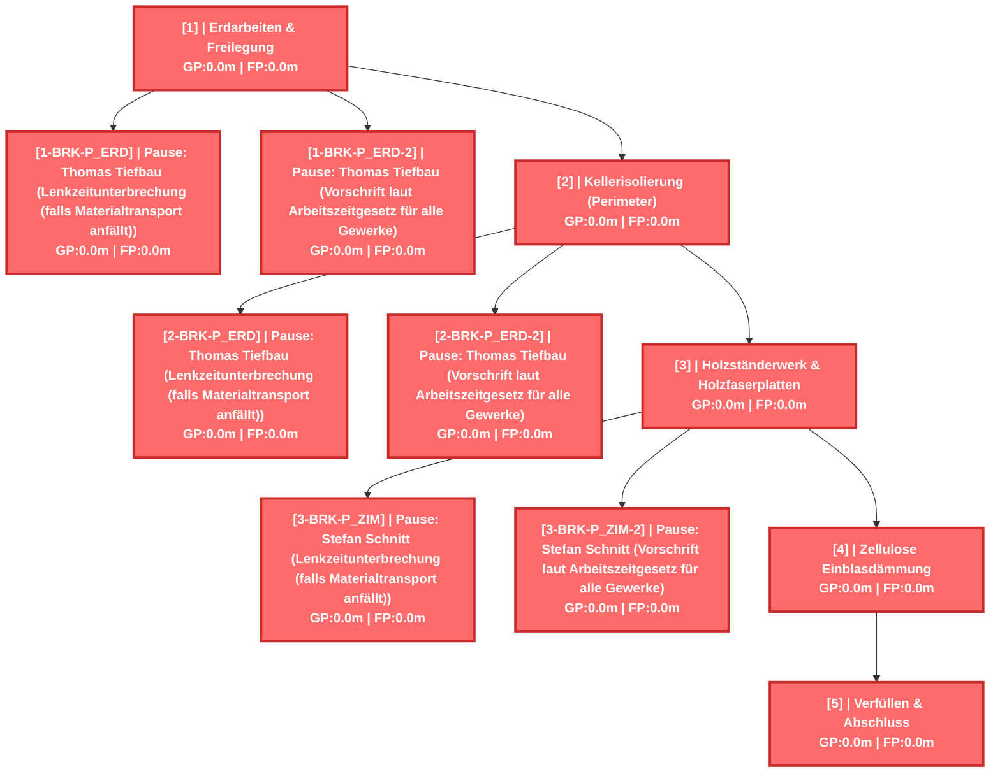
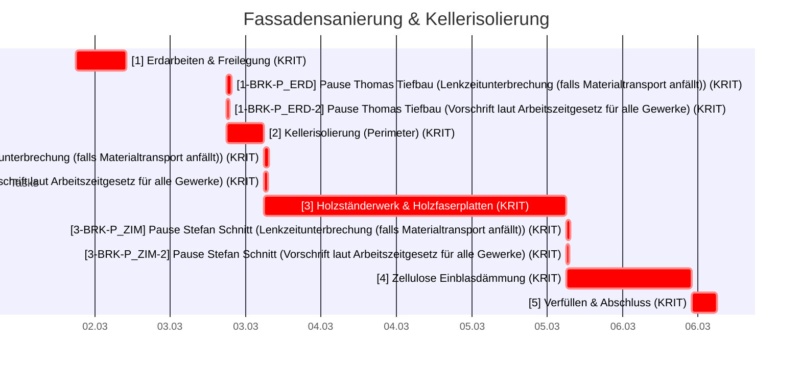
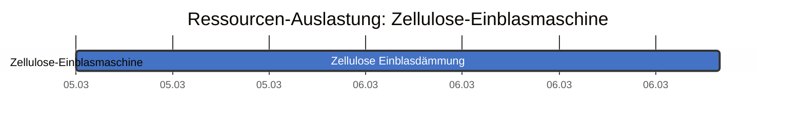
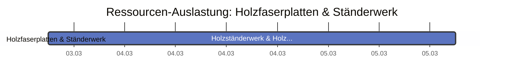
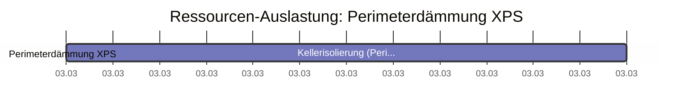
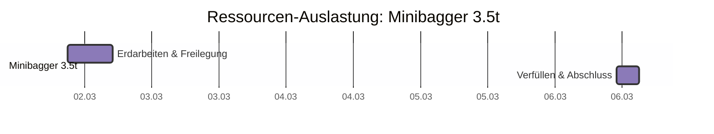
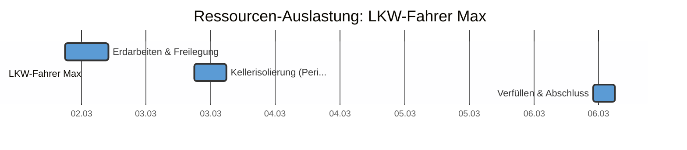
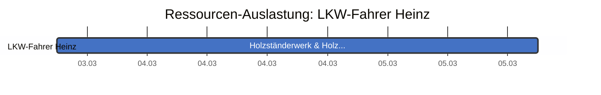

# Fassadensanierung & Kellerisolierung - CPM Report

## CPM Analyse

### Projektzusammenfassung

- **Projekt:** Fassadensanierung & Kellerisolierung
- **Projektdauer:** 2280.0m
- **Startdatum:** 2026-03-02 09:00
- **Enddatum (geschätzt):** 2026-03-06 15:00
- **Zeiteinheit:** minutes
- **Anzahl Tasks:** 11
- **Kritische Tasks:** 11

---

### Kritischer Pfad

Der kritische Pfad besteht aus folgenden Tasks:

- **[1]** Erdarbeiten & Freilegung (Dauer: 480.0m)
- **[1-BRK-P_ERD]** Pause: Thomas Tiefbau (Lenkzeitunterbrechung (falls Materialtransport anfällt)) (Dauer: 45.0m)
- **[1-BRK-P_ERD-2]** Pause: Thomas Tiefbau (Vorschrift laut Arbeitszeitgesetz für alle Gewerke) (Dauer: 30.0m)
- **[2]** Kellerisolierung (Perimeter) (Dauer: 360.0m)
- **[2-BRK-P_ERD]** Pause: Thomas Tiefbau (Lenkzeitunterbrechung (falls Materialtransport anfällt)) (Dauer: 45.0m)
- **[2-BRK-P_ERD-2]** Pause: Thomas Tiefbau (Vorschrift laut Arbeitszeitgesetz für alle Gewerke) (Dauer: 30.0m)
- **[3]** Holzständerwerk & Holzfaserplatten (Dauer: 960.0m)
- **[3-BRK-P_ZIM]** Pause: Stefan Schnitt (Lenkzeitunterbrechung (falls Materialtransport anfällt)) (Dauer: 45.0m)
- **[3-BRK-P_ZIM-2]** Pause: Stefan Schnitt (Vorschrift laut Arbeitszeitgesetz für alle Gewerke) (Dauer: 30.0m)
- **[4]** Zellulose Einblasdämmung (Dauer: 240.0m)
- **[5]** Verfüllen & Abschluss (Dauer: 240.0m)

---

### Netzplan

---

### Alle Tasks

| ID | Name | Dauer | FAZ | FEZ | SAZ | SEZ | GP | FP | Krit. |
|---|---|---|---|---|---|---|---|---|---|
| 1 | Erdarbeiten & Freilegung | 480.0m | 0.0m | 480.0m | 0.0m | 480.0m | 0.0m | 0.0m | JA |
| 1-BRK-P_ERD | Pause: Thomas Tiefbau (Lenkzeitu... | 45.0m | 480.0m | 525.0m | 480.0m | 525.0m | 0.0m | 0.0m | JA |
| 1-BRK-P_ERD-2 | Pause: Thomas Tiefbau (Vorschrif... | 30.0m | 480.0m | 510.0m | 480.0m | 510.0m | 0.0m | 0.0m | JA |
| 2 | Kellerisolierung (Perimeter) | 360.0m | 480.0m | 840.0m | 480.0m | 840.0m | 0.0m | 0.0m | JA |
| 2-BRK-P_ERD | Pause: Thomas Tiefbau (Lenkzeitu... | 45.0m | 840.0m | 885.0m | 840.0m | 885.0m | 0.0m | 0.0m | JA |
| 2-BRK-P_ERD-2 | Pause: Thomas Tiefbau (Vorschrif... | 30.0m | 840.0m | 870.0m | 840.0m | 870.0m | 0.0m | 0.0m | JA |
| 3 | Holzständerwerk & Holzfaserplatten | 960.0m | 840.0m | 1800.0m | 840.0m | 1800.0m | 0.0m | 0.0m | JA |
| 3-BRK-P_ZIM | Pause: Stefan Schnitt (Lenkzeitu... | 45.0m | 1800.0m | 1845.0m | 1800.0m | 1845.0m | 0.0m | 0.0m | JA |
| 3-BRK-P_ZIM-2 | Pause: Stefan Schnitt (Vorschrif... | 30.0m | 1800.0m | 1830.0m | 1800.0m | 1830.0m | 0.0m | 0.0m | JA |
| 4 | Zellulose Einblasdämmung | 240.0m | 1800.0m | 2040.0m | 1800.0m | 2040.0m | 0.0m | 0.0m | JA |
| 5 | Verfüllen & Abschluss | 240.0m | 2040.0m | 2280.0m | 2040.0m | 2280.0m | 0.0m | 0.0m | JA |

---

### Gantt Chart (mit Wochenenden)

---

### Resource List

#### Ressourcenauslastung (Textform)

| Farbe | Name | Ressource | Anzahl Tasks | Tasks |
|---|---|---|---|---|
| ■ |  | Zellulose-Einblasmaschine (EB1) | 1 | 4 |
| ■ |  | Holzfaserplatten & Ständerwerk (MAT_WOOD) | 1 | 3 |
| ■ |  | Perimeterdämmung XPS (MAT_XPS) | 1 | 2 |
| ■ |  | Minibagger 3.5t (MB1) | 2 | 1, 5 |
| ■ | Thomas Tiefbau | LKW-Fahrer Max (R_PERS_ERD) | 3 | 1, 2, 5 |
| ■ | Klaus Flocke | Baggerführer Bodo (R_PERS_ISO) | 1 | 4 |
| ■ | Stefan Schnitt | LKW-Fahrer Heinz (R_PERS_ZIM) | 1 | 3 |

#### Ressourcenauslastung (Gantt-Diagramm)

#### Personen

| Person | Kosten/Stunde | Abwesenheiten im Projektzeitraum | Abwesenheiten kurz nach dem Projektzeitraum |
|---|---|---|---|
| Thomas Tiefbau | 60.00 €/h | keine | keine |
| Stefan Schnitt | 65.00 €/h | keine | keine |
| Klaus Flocke | 55.00 €/h | keine | keine |

#### Ressourcen-Details

| Ressource | Person | Typ |
|---|---|---|
| LKW-Fahrer Max (R_PERS_ERD) | Thomas Tiefbau | person |
| LKW-Fahrer Heinz (R_PERS_ZIM) | Stefan Schnitt | person |
| Baggerführer Bodo (R_PERS_ISO) | Klaus Flocke | person |
| Minibagger 3.5t (MB1) |  | machine |
| Zellulose-Einblasmaschine (EB1) |  | machine |
| Perimeterdämmung XPS (MAT_XPS) |  | material |
| Holzfaserplatten & Ständerwerk (MAT_WOOD) |  | material |

---

### Kostenübersicht

| Ressource | Typ | Stunden | €/h | Bereitst. € | Lohnkosten € | Gesamt € |
|---|---|---|---|---|---|---|
| Zellulose-Einblasmaschine | machine | 4.0 | 45.00 | 50.00 | 180.00 | **230.00** |
| Minibagger 3.5t | machine | 12.0 | 85.00 | 120.00 | 1020.00 | **1140.00** |
| LKW-Fahrer Max | person | 18.0 | 60.00 | — | 1080.00 | **1080.00** |
| Baggerführer Bodo | person | 4.0 | 55.00 | — | 220.00 | **220.00** |
| LKW-Fahrer Heinz | person | 16.0 | 65.00 | — | 1040.00 | **1040.00** |

**Zusammenfassung:**

- Personalkosten: **2340.00 €**
- Maschinenkosten (Lohn): **1200.00 €**
- Bereitstellungskosten: **170.00 €**
- **Gesamtkosten: 3710.00 €**
